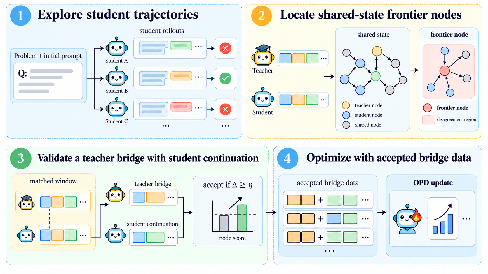
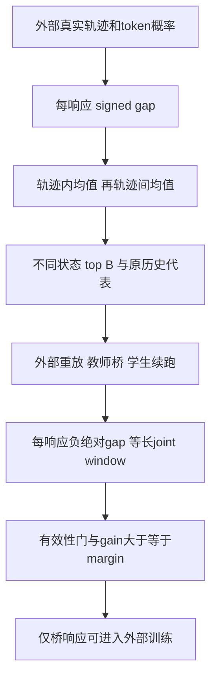

# Frontier-OPD：按轨迹平衡的学习前沿选择与教师桥验证

Frontier-OPD 在共享观测状态上聚合师生分歧，每个状态选择一个可重放历史，插入短教师桥，并用桥加学生续跑的等长窗口决定是否接纳额外蒸馏数据。本地实现独立的数值排名和显式测量输入的接纳协议，不模拟环境、教师或学生，也不宣称完整 Agent OPD。

## 论文信息

| 字段 | 内容 |
|---|---|
| 论文 | [Frontier-OPD: Discovering the Edge of Agent Capability and Teaching Agents to Go Beyond](https://arxiv.org/abs/2610.32802v1) |
| 公司 / 作者机构 | 一作 **Zheng Jiang，Tsinghua University**；原文未列 Google/Meta 合作机构 |
| 原始发布日期 | **2026-10-23 15:40:44 UTC**，arXiv v1；2026-10-26 公告 |
| 原作者代码 | 论文链接 [jiangz20/FrontierOPD](https://github.com/jiangz20/FrontierOPD)，但截至 2026-10-26 `git ls-remote` 返回 Repository not found，raw LICENSE 404；**已声明但无法核验公开源码**，不写成已确认开源 |
| 固定 SHA / 源码许可 | 无可访问代码，无法核验；论文许可 CC BY-NC-ND 4.0；本地依据公开论文独立实现 |
| 本地 Adapter / key | `frontier-opd`；独立 L1 排名/接纳协议组件 |
| 本地代码 | `src/auto_research/agent_research/frontier_opd.py` |
| 本地入口 | `response_scores`、`select_frontier`、`accept_bridge`、`diagnostic(seed, device='cpu')` |
| 完整实验 | **成本过高，不复现（审查 DONE）**，不自动重试 |

## 原始论文总结

### 背景与主要改动

同一个环境观测可能经不同历史反复到达，直接按访问次数或 token 数平均会让循环轨迹主导教师介入判断。Frontier-OPD 先在轨迹内、再在轨迹间聚合有符号师生分歧，对不同状态选原历史代表；教师桥与学生续跑须通过同长窗口比较后才接纳，状态共享不能替代真实历史或任务成功评测。

排名只寻找值得试验的节点。教师最多接管 $K$ 回合，再让学生继续 $H$ 回合。新窗口必须和原历史从同一位置开始的 $L_{realized}+H$ 回合窗口比较；只有成功重放、非终止交接、完整有效续跑且师生 agreement 不下降，桥的教师响应才加入训练。

<!-- paper-figure:start -->
### 原论文关键图



图片来自[原论文](https://arxiv.org/html/2610.32802v1#S3.F2)，版权归原作者所有。PNG 为固定 v1 原图，未裁剪、未重绘；SHA-256 和许可见 `assets/provenance.json`。图中环境执行和训练步骤尚未由本地组件实现。

<!-- paper-figure:end -->



### 核心公式

对同一响应的同一 token，$g_j=\ell_j^S-\ell_j^T$。排名用有符号 $d(c)=\operatorname{mean}_j g_j$，验证用 $a(c)=-\operatorname{mean}_j|g_j|$；不能把二者混用。

$$
s(v)=\frac1{|I(v)|}\sum_{i\in I(v)}\frac1{|Q_i(v)|}\sum_{c\in Q_i(v)}d(c),\qquad
c^*(v)=\arg\max_{c\in\cup_iQ_i(v)}d(c).
$$

三次 score=10 的循环访问来自一条轨迹，另一条轨迹访问一次 score=0，节点分数是 **5**，不是 7.5。阈值应用于聚合后的节点分数，允许负值。预算约束不同节点，不是不同轨迹；代表取最大有符号分歧，同分按轨迹和回合先后。节点同分按最早合格访问排序。

$$
\Delta=\operatorname{mean}_{c\in W^{new}}a(c)-\operatorname{mean}_{c\in W^{old}}a(c),\qquad
accept=V\land[\Delta\ge\eta].
$$

窗口先逐响应 token mean，再等权平均回合。$W^{new}$ 包括桥与续跑，长度用实际桥长而非上界 $K$；默认 $\eta=0$ 时相等也接纳。它**不证明仅续跑变好、不证明任务成功、不证明训练后能力提高**。

### 论文离线与线上效果

Table 1，Qwen3-32B 教师到 Qwen3-4B 学生：ALFWorld success rate 从 OPD 的 $42.8\pm4.5$ 到 $49.5\pm1.9$，ScienceWorld 从 $8.2\pm.9$ 到 $16.2\pm.6$，均为三种子样本标准差，百分比口径。不能仅凭三种子均值推断显著性。原文未报告生产线上 A/B；本地排名和接纳诊断不复现上述分数。

## 本地复现

本轮已在CPU及真实NVIDIA A100上执行同一冻结版本、42/43/44三个种子：[独立机制指标](metrics/component-cuda-seeds42-44.json)、[脱敏GPU凭证](../../gpu-validations/frontier-opd-a100-20261026.json)。仅验收下述L1组件，不宣称完整模型能力。

```bash
PYTHONPATH=src python -c 'from auto_research.agent_research.frontier_opd import diagnostic; print(diagnostic(42))'
OMP_NUM_THREADS=1 MKL_NUM_THREADS=1 PYTHONPATH=src python -m pytest tests/post_training/test_oct26_post_agent_components.py -q
```

调用方传入真实 collector 的状态 key、完整原历史关联、可重放标记、合法动作和剩余回合数；本地不假装能验证环境重放。本地明确检查数值和长度；replay/handoff/continuation 失败直接拒绝，不把失败改成成功。采样 token 概率保持冻结，padding NaN 不影响分数。

训练器必须另行保留 $D^{stu}\uplus D^{bridge}$ 中的重复响应：不是按节点去重；用于验证的新学生续跑**不能加入训练池**；桥没有额外 reward-weighted loss，原文 stored reward 不被 `multi_turn_opd` 使用。本组件未实现该训练器或经验池，不能只注册一个名字就称 evolve 已集成。

测试覆盖轨迹平衡负控、有符号/绝对值排名相反的样例、不同 token 长度、同分顺序、过滤后阈值、多个同轨迹节点、等长窗口及无效重放。`diagnostic_only=true`，无 task success/accuracy；CPU与真实A100三种子机制检查均已通过，仍只属于L1数值/协议验收。

### 高成本完整实验

Sec.4/Appendix A 配置含 Qwen3-32B 或 Qwen3-8B-RL 教师、1.7B/4B 学生、ALFWorld/WebShop/ScienceWorld、每任务 4 rollout、默认 $B=4,K=1,H=3$，200 training steps、最大 prompt 10240 / response 512，三种子、多对照和独立 test。Sec.4.5 训练效率实验明确使用 **4 张 NVIDIA B300**。附加验证每任务最多再花 $B(K+H)$ 生成回合，拒绝的桥也消耗推理资源。

单张 A100/A30 或 Mac 不跑完整模型/环境矩阵；**成本过高，不复现（审查 DONE）**。不下载权重、不试跑昂贵配置、不自动重试，也不把协议诊断宣称任务能力比较。
