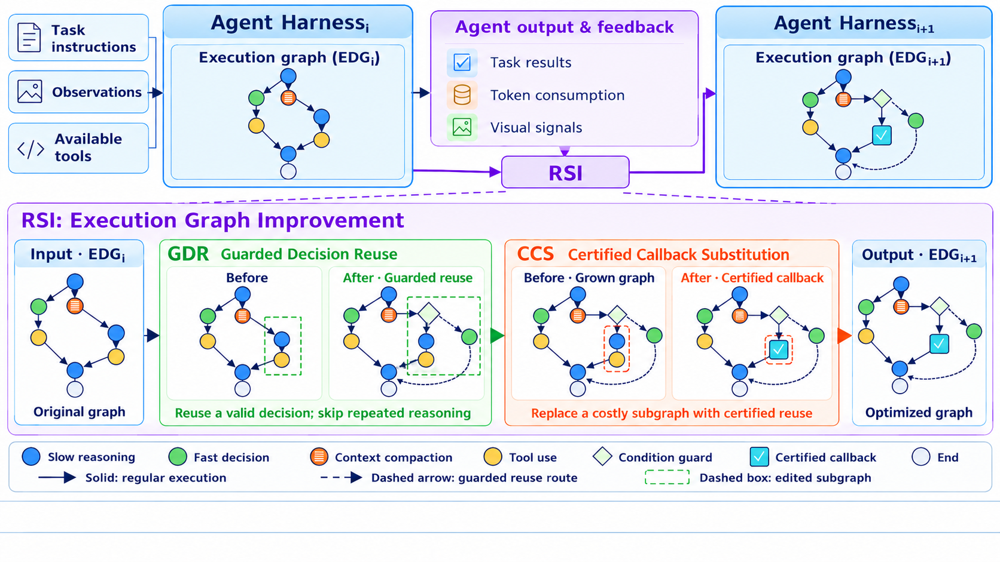

# HarnessMM: Reusing settled decisions with real tool receipts

<!-- source-sha256: 72105c59968fc80af570b90acf5d470ace63c9e13870f12d66597fb22d389c09 -->

[简体中文](README.md)

> **Literature and cost review only.** Full native-harness experiments were not reproduced (review complete).

## Paper information

| Field | Details |
| --- | --- |
| Paper | [HarnessMM: Recursive Self-Improvement for Harness Token Efficiency](https://arxiv.org/abs/2610.32813v1); [reviewed full text](https://arxiv.org/html/2610.32813v1) |
| Affiliations | First author Yuhua Jiang: Tsinghua University; Chang Xu and Li Zhao: Microsoft Research Asia. |
| First public release | 2026-10-23 15:47:47 UTC (announced 2026-10-26) |
| Author code | No verifiable method repository, revision or source license. The linked Codex, DeepSeek and Terminal-Bench baseline commits are not EDG/GDR/CCS source; the paper's arXiv license is not a code license. |
| Local key | `harnessmm`; no adapter |
| Local code | No executable local implementation. |
| Local evidence | No local experiment, metrics or GPU receipt. |

## What the paper changes

The executable decision graph (EDG) stores only actions and literal arguments already resolved by prior slow reasoning. Guarded Decision Reuse (GDR) selects an eligible node or abstains: predecessors must have completed, public guards must hold on real receipts, and arguments must be closed. Unsupported observations or new semantic decisions fall back to the slow actor. Certified Callback Substitution (CCS) executes through the same native tool API and binds the graph hash, decision and predecessor IDs/receipts, exact arguments, tool receipt and bypassed callback ID. Audit actual execution and a reduction of at least one slow call at the registered parent boundary. Closure alone cannot establish semantic correctness; the benchmark scorer remains necessary.

### Original paper figure

Original figure from the reviewed paper, reused without redrawing. See [figure provenance](assets/provenance.json).

### Core formulation

Episode cost sums input and output tokens over physical calls, including authorship, selection, added context, failures, fallback, recovery, finalization and cached input. Report development cost separately and amortize it as $C_{dev}/N+\mathbb E[C_{episode}]$ for $N$ deployments. Token cost does not establish latency or energy savings. Minimize cost subject to each predeclared endpoint $Q_b(h_\pi)\ge Q_b(h_0)-\epsilon_b$. Develop on TRAIN, choose on validation and freeze before TEST; at runtime select only from resolved actions or abstain.

### Results reported by the authors

Across 2,133 ALFWorld tasks, HarnessMM reports 66.20% success and 31.12K tokens/task versus SkillOpt 63.29% and 101.33K. A separate 257-task Codex MBPP test reports baseline 91.83% versus HarnessMM 90.66%, so capability is not strictly preserved in every comparison. Some Terminal-Bench results are archived partial snapshots. Configurations differ, and gains cannot all be assigned to GDR. No production A/B.

## Local reproduction and limits

No native callback substitute, fabricated receipt, actor/shell execution, metrics or Evolve integration. Existing tracing is not a HarnessMM reproduction.

### Full experiment: not reproduced

Sections 3–5.1 and Appendices C/D/L require real Codex, MiMo and DeepSeek harnesses, HumanEval/MBPP, ALFWorld, SearchQA, AIME, GAIA2 and Terminal-Bench, with validation, native tools and accounting for all failures. The multi-benchmark API/environment matrix exceeds the single-device budget. No trial, download or automatic retry.

### Additional references

[Paper Figure 1](https://arxiv.org/html/2610.32813v1#S0.F1)
