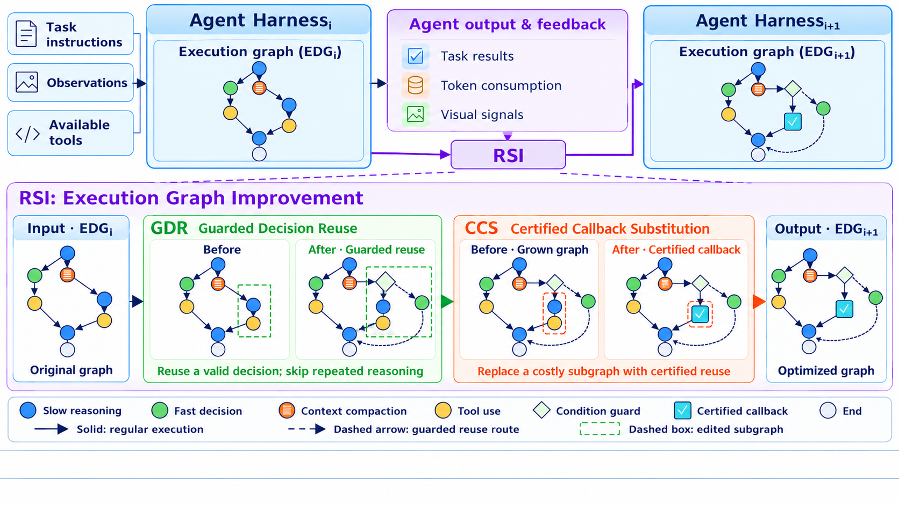

# HarnessMM：用真实工具回执复用已确定决策，替代推理回调

HarnessMM 将慢推理已确定的动作、字面参数、依赖和 guards 存成 Executable Decision Graph；真实工具回执满足条件时复用决策，并在原生 harness 注册边界证明一次 slow callback 被省去。它同时审计完整物理调用成本与能力约束，不把短输出、快速路径命中或虚构证书当作省算力证据。

> **仅文献与成本收录**。完整实验：**成本过高，不复现（审查 DONE）**；不自动重试，不阻塞水位。无 adapter、operator、运行命令、metrics 或 GPU receipt。

## 论文信息

| 字段 | 内容 |
|---|---|
| 论文 | [HarnessMM: Recursive Self-Improvement for Harness Token Efficiency](https://arxiv.org/abs/2610.32813v1) |
| 固定方法版本 | [arXiv v1 全文](https://arxiv.org/html/2610.32813v1) |
| 公司 / 作者机构 | 一作 **Yuhua Jiang，Tsinghua University**；固定 v1 PDF 首页上标 1=清华；Chang Xu、Li Zhao 为 Microsoft Research Asia，不因原生 Codex 基线归为 OpenAI/Google |
| 原始发布日期 | **2026-10-23 15:47:47 UTC**，arXiv v1；2026-10-26 公告 |
| 原作者代码 | **未找到可核验 HarnessMM 方法仓库**。原文提供 Codex、DeepSeek harness、Terminal-Bench 等基线仓库/固定 commit，不等于公开了 EDG/GDR/CCS 的本论文实现 |
| 固定 SHA / 源码许可 | 本方法 SHA/源码许可无法核验；不以基线 commit 冒充。论文为 arXiv perpetual non-exclusive license，不是开源代码许可 |
| 本地 Adapter / key | `harnessmm`；`adapter=null` |
| 本地复现代码位置 | **无**：仅文献与成本审查，不伪造原生回调替代 |
| 本地验证 | 不调用 actor，不生成 metrics/receipt；`requires_gpu_validation=false`、`gpu_validation_passed=false` |

## 原始论文总结

### 背景与主要改动

Agent 在得到工具反馈后经常再调用模型，即使上一轮推理已确定下一步命令。HarnessMM 的 EDG 只保存先前确实完成语义解析的动作及完整字面参数；GDR 检查前置任务完成、public guard 真和参数闭合，再选一个合格节点或 abstain。不支持的观察、缺少依赖、需要新语义判断时回到原慢 actor。

CCS 不只决定“可以少调模型”，还通过同一个原生工具接口执行精确动作，将 graph hash、decision ID、predecessor receipt、exact args、tool receipt 与 bypassed callback ID 绑定为证据。审计既要检查真实工具执行，也要确认注册 parent boundary 原来的一次慢调用未发生。参数语法闭合只是结构条件，**不能证明这个动作在语义上正确**，仍须原 benchmark scorer 评估。

<!-- paper-figure:start -->
### 原论文关键图

图片来自[原论文](https://arxiv.org/html/2610.32813v1#S0.F1)，版权归原作者所有。固定 v1 原始 PNG 未重绘、未裁剪；图为示意执行图，不是模型实际运行 trace。来源、许可、SHA-256 与目视核验见 `assets/provenance.json`。
<!-- paper-figure:end -->

### 核心公式

GDR 的 eligibility 为 $\mathbf1[pred\ completed]\mathbf1[g(s)=true]\mathbf1[arg\ closed]$，guards 消费**实际观察到的回执**，不是模型预测结果。CCS 要求注册边界的慢调用数满足 $N^{parent}_{slow}-N^{HarnessMM}_{slow}\ge1$，并保存上文证书；不能根据“理论上应该省一次”预填计数。

完整任务成本 $C_{episode}=\sum_{c\in physical\ calls}(T_c^{in}+T_c^{out})$，含 authorship、selector、额外上下文、失败、fallback、recovery、finalization 和 cached input。开发成本单独记为 $C_{dev}$，部署 $N$ 任务的摊销是 $C_{dev}/N+\mathbb E[C_{episode}]$。token 成本不证明延迟或能耗降低。

目标是最小化成本且满足各预先声明质量端点 $Q_b(h_\pi)\ge Q_b(h_0)-\epsilon_b$。所有配置先 TRAIN 开发、validation 选择，再冻结 TEST，不能借 test 结果继续挑。在线只在已确定的动作中选或放弃，不动态自由组合所有优化技巧。

### 论文离线与线上效果

原文有多种 core/companion/native harness 配置，不能把所有结果都归因于单一 GDR。示例中 ALFWorld 全 2,133 任务的 HarnessMM success 为 66.20%、31.12K token/task；SkillOpt 为 63.29%、101.33K。另一个 Codex MBPP 完整 257 test 任务比较，baseline success 91.83%、HarnessMM 90.66%，因此不是所有配对都严格不损能力。Terminal-Bench 部分结果明确为 archived partial snapshot，不冒充完整总体。未报告互联网生产 A/B；本地未复现任何能力或 token savings。

## 本地复现

本地不实现原生 harness 替代器，不制造 fake callback/receipt，不执行 LLM 生成动作或 shell，不用确定性 fixture 证明节省 token。仅保留规范文献及成本终态；`promotion_eligible=false`、`evolve_integrated=false`。既有 Agent tracing 框架不等于本论文已集成。

### 高成本完整实验

固定 v1 Sec.3–5.1/Appendix C/D/L 涉及真实 Codex、MiMo、DeepSeek 原生 harness 及 HumanEval/MBPP 全 taskset，多领域 ALFWorld、SearchQA、AIME、GAIA2 和 Terminal-Bench 配置，并需开发、保护性 validation、原生工具执行、actor 回调和所有失败调用计费。完整实验依赖实际 LLM/API 和上下游环境；单纯用一个计数器无法保真。

对于单张 A100/A30 或 Mac 的当前预算，完整原生集成/付费请求/多基准矩阵为 **成本过高，不复现（审查 DONE）**。不下载权重、不调用模型、不试跑昂贵配置、不自动进入待交付队列；这个终态不表示 callback 替代能力已被本地验证。
