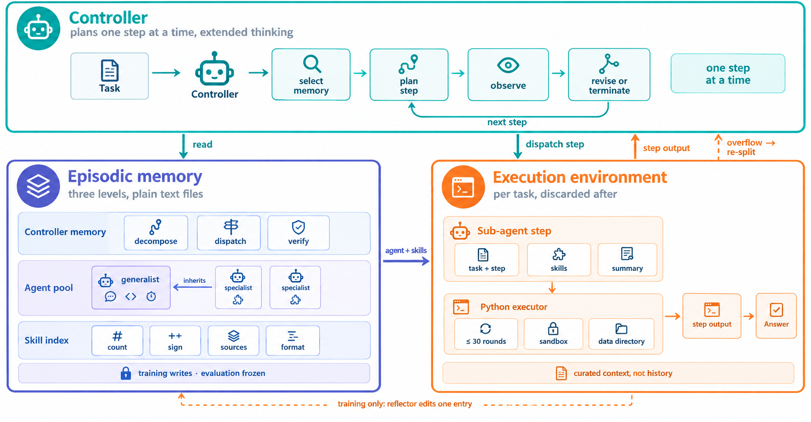

# EMMA: Structured episodic memory and single-edit guards

<!-- source-sha256: 93bec7aad432843c6c05e6463327d32b730280ae4f119987333b5ad654aec829 -->

[简体中文](README.md)

> **Local scope: CPU-only L1 structure diagnostic.** No LLM, reflection model, or environment task runs. A passing guard is not an agent success rate. The full multi-model, multi-environment experiment was reviewed and not reproduced because of cost.

## Paper information

| Field | Details |
| --- | --- |
| Paper | [EMMA: Structured Episodic Memory for Multi-Agent Workflow Synthesis](https://arxiv.org/abs/2610.35966v1) |
| Reviewed version | [arXiv v1 full text](https://arxiv.org/html/2610.35966v1) |
| First author and affiliation | Ruijia Niu, UC San Diego; work completed during an Amazon internship with Amazon coauthors |
| First public release | 2026-10-25 18:00:11 UTC, arXiv v1; added during a later overlap review, not first published on October 30 |
| Author code | No verifiable EMMA implementation repository found in the reviewed v1 sources. Referenced projects such as smolagents are not EMMA source code. |
| Local key | <code>emma</code>; structure-guard component, not a complete multi-agent adapter |
| Local implementation | <code>src/auto_research/agent_research/emma.py</code> |

## What the paper proposes

Treating every failure as a reason to edit a prompt, add a skill, or add an agent can make a workflow drift with the backbone's preferences rather than address the failure. EMMA separates persistent memory into controller routing rules, specialist agents that inherit a generalist prompt, and skills assignable to individual steps. Each reflection may edit only one item in the layer responsible for the failure.

A one-off execution slip gets a temporary plan directive. Reusable behavior belongs in an agent prompt, a missing procedure in a skill, and a decomposition or dispatch error in the controller. When a step runs out of context or turns, the system first splits the unfinished work while preserving the completed prefix. An overflow is not by itself evidence of missing capability.

### Original paper figure

Unredrawn figure from the [reviewed paper](https://arxiv.org/html/2610.35966v1#S3.F2), licensed CC BY 4.0. See the [figure provenance](assets/provenance.json). The pictured LLM and Python executor are not implemented by the local component.

### Edit model

The three memory layers, effective specialist prompt, and permitted edit $\alpha$ for diagnosed scope $z$ are

$$
\mathcal M=(\mathcal C,\mathcal A,\mathcal S),\qquad
\widetilde p_j=p_0\|p_j,\qquad \alpha\in\operatorname{Act}(z).
$$

| Failure scope | Permitted actions |
| --- | --- |
| <code>execution_slip</code> | <code>revise_plan</code> or <code>no_change</code>; no persistent edit |
| <code>agent_behavior</code> | <code>refine_prompt</code> for an agent that participated in the attempt |
| <code>procedure</code> | <code>revise_skill</code> or <code>create_skill</code> |
| <code>missing_capability</code> | <code>create_skill</code> or <code>create_agent</code> |
| <code>routing</code> | <code>memory_note</code> or <code>revise_plan</code>; <code>create_agent</code> only with overflow evidence |

Appendix B requires keeping at least 60% of complete lines in an existing prompt, caps the pools at 10 agents and 40 skills, caps individual prompts and skills at 6,000 and 3,000 characters respectively, and requires at least 150 characters for a new specialization. The same layer cannot be edited across more than two consecutive failures. Repeated overflow on the same step calls for a different decomposition, not another prompt or skill change.

The next plan must actually exercise a new or edited item. The final failed attempt must not leave behind an edit that will never be tried. An accepted edit persists even if the next attempt fails. Memory is frozen at test time, but the workflow can still select existing memory and replan.

### What the paper reports

The authors evaluate five backbones on KramaBench, AppWorld, and BBEH-mini against ACE, GEPA, EvoMAS, and ADAS. Metrics depend on the task protocol and are not a single aggregate success rate. The local component does not run those tasks or provide production A/B evidence.

## Local reproduction and validation

<code>EpisodicMemory</code> stores the three layers. <code>apply_guarded_edit</code> implements the checkable subset of Table 1 and Appendix B: ownership, participant eligibility, line retention, edit rotation, size and pool limits, training-only writes, and a remaining rerun. <code>prompt_for</code> inherits from the current generalist when read. <code>assert_exercised</code> checks that the next attempt uses the changed item. <code>splice_overflow</code> implements the splice from Algorithm 2 using existing agents and skills; it does not generate a decomposition.

<code>ExternalSafety</code> keeps semantic checks explicit and external. An independent caller attests to deduplication, real specialization, absence of answer leakage, path safety, and meaningful decomposition. A local check rejects 15-word verbatim task spans, but neither that check nor a supplied Boolean proves semantic safety. The interface receives no gold answers and runs no evaluated actor. Reflection, tool execution, judges, the complete attempt chain, end-of-task controller summaries, and a semantic safety service are not implemented.

From the repository root:

~~~bash
PYTHONPATH=src python -c 'from auto_research.agent_research.emma import diagnostic; print(diagnostic(42))'
PYTHONPATH=src python -m pytest tests/test_oct30_post_agent.py -q
~~~

Tests reject edits in the wrong layer, edits to nonparticipating agents, excessive prompt removal, verbatim task leakage, inference writes, missing reruns, a third consecutive same-layer edit, repeated overflow without changed decomposition, unsafe paths, and duplicate entries. They also reject claiming an edit was exercised when the next plan did not use it. The [three-seed CPU record](metrics/component-cpu-seeds42-44.json) measures structures and guard outcomes, not capability.

### Full experiment: reviewed, not reproduced

The full protocol combines five backbones, three environments, and multiple baselines. It allows up to six executions per training task and 30 turns per step, with an executor limit of 600 seconds and 24 GiB. This long-run matrix was not launched on the project's single A100/A30 or Mac budget.
