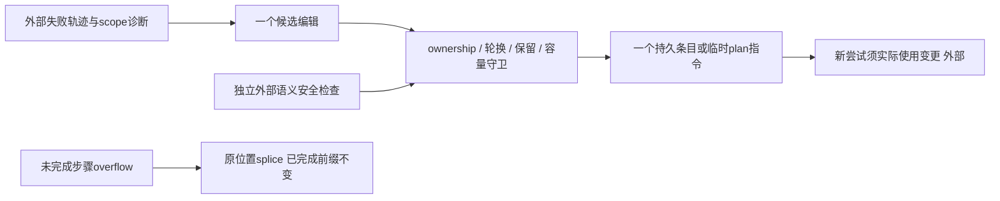
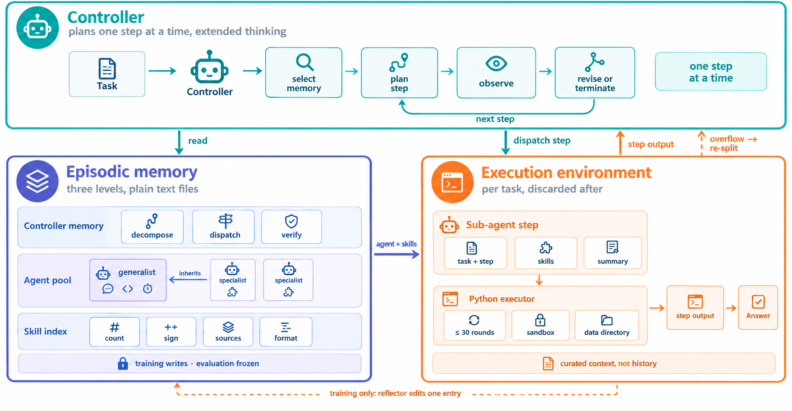

# EMMA：结构化记忆与单编辑守卫组件

## 论文信息

| 字段 | 内容 |
| --- | --- |
| 论文链接 | [EMMA](https://arxiv.org/abs/2610.35966v1)，固定[v1全文](https://arxiv.org/html/2610.35966v1) |
| 公司/机构 | 一作Ruijia Niu：UC San Diego；工作在Amazon实习期间完成，论文含Amazon合作者 |
| 首次公开日期 | 2026-10-25 18:00:11 UTC，arXiv v1；本批为同公告补漏，不是10/30首发 |
| 原文开源代码 | 本轮在固定v1全文/arXiv未找到可核验作者实现仓库；引用的smolagents等不当作EMMA源码 |
| 本地 Adapter | `emma`为纯CPU结构守卫组件键，不是完整多Agent系统 |
| 本地复现代码 | `src/auto_research/agent_research/emma.py` |

> 不执行LLM、反思或环境任务。完整多模型多环境实验**成本过高，不复现（审查 DONE）**；下文“通过”只指结构守卫，不是Agent成功率。

## 原始论文总结

### 背景与主要改动

把失败一律写进prompt、skill或新增agent，会让结构变化跟随backbone偏好而不是失败原因。EMMA把持久记忆分为controller路由规则、继承generalist的agent专门化、每步可分配的skill，并让每次反思只修改承担修复责任的一项。

单次执行失误只产生本任务临时plan directive；通用工作习惯写prompt，方法缺失写skill，分解/派发错误归controller。上下文或轮数overflow首先拆分未完成步骤，保留已完成工作，不直接视为能力失败。

### 架构与数据流

<!-- paper-figure:start -->
### 原论文关键图

图片来自[原论文](https://arxiv.org/html/2610.35966v1#S3.F2)，保持原图未重绘，版权归原作者所有（论文CC BY4.0）；来源/哈希见`assets/provenance.json`。原图中的LLM和Python executor不属于本地已接入部分。
<!-- paper-figure:end -->

### 核心公式

$$
\mathcal M=(\mathcal C,\mathcal A,\mathcal S),\qquad
\tilde p_j=p_0\|p_j,\qquad \alpha\in\mathrm{Act}(z).
$$

| 失败scope | 允许的修改 |
| --- | --- |
| execution_slip | revise_plan / no_change，不写持久经验 |
| agent_behavior | refine_prompt，仅参与该尝试的agent |
| procedure | revise_skill / create_skill |
| missing_capability | create_skill / create_agent |
| routing | memory_note / revise_plan；有overflow证据才允许create_agent |

附录规则包括：原prompt完整行至少保留60%；最多10个agent、40个skill；单prompt/skill分别不超过6000/3000字符；新专门化至少150字符；同一层不能连续修改超过两轮失败。相同步骤连续overflow须改变工作拆分，而不是继续改prompt/skill。

新建/修改条目须在下一次计划中实际使用；最终失败后不能再留下未重跑的编辑。被接受的编辑即使下一次尝试失败也会保留。测试时记忆冻结，但仍可选择记忆和重规划。

### 论文离线与线上效果

作者在KramaBench、AppWorld和BBEH-mini以及五个backbone上报告结果，比较ACE/GEPA/EvoMAS/ADAS；具体指标属于不同任务协议，不能混成统一成功率。本地未执行这些任务，也没有生产线上A/B证据。

## 本地复现

### 数据协议与实现边界

`apply_guarded_edit`真实复制并修改一个内存条目，检查scope、参与者、完整行保留、轮换、大小、池上限、训练/剩余rerun边界。`prompt_for`在读取时继承当前generalist，`splice_overflow`只用现有agent/skill替换未完成步骤。

语义重复、真正专门化、答案泄漏、数据路径与结构性拆分是否成立，由独立外部服务给显式Boolean证明；本地检查15词任务原文跨度，但**不能证明外部服务判断正确**。接口不接收gold答案，也没有被评测actor。反思模型、工具执行、任务judge、整条attempt chain、end-of-task controller总结及语义安全服务均未实现，不宣传完整EMMA或evolve能力。

### 本地结果与负控

小结构测试覆盖scope错位、未参与prompt、60%保留、15词泄漏、推理写入、无剩余rerun、第三轮同层失败、重复overflow、重复/路径安全拒绝，以及新条目未使用不能算已exercise。仅输出条目/计划数量和拒绝计数，无能力成功率。

### 代码映射

`EpisodicMemory`对应三层状态；`apply_guarded_edit`对应Table1/AppendixB的可检查守卫子集；`ExternalSafety`显式隔离未实现的语义服务；`assert_exercised`对应下一次计划使用义务；`splice_overflow`对应Algorithm2的拼接，不生成分解计划。

### 高成本完整实验

五个backbone、三套完整环境和多基线，每训练任务最多6次执行、每step30轮、executor上限600秒/24GiB。单A100/A30或Mac不启动此长链矩阵；完整实验**成本过高，不复现（审查 DONE）**，不把结构守卫通过变成性能证据。
