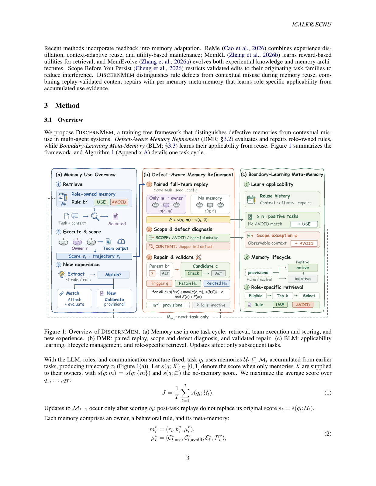

# DiscernMem: Attribute memory failures before validating a repair

<!-- source-sha256: a5c82d9184ebece8d16e3b6d66033b0b11aafc776b4c3fec3b1fab7290a0c588 -->

[简体中文](README.md)

> **L1 numerical and versioning rules; diagnostic only**, not multi-agent memory capability. Full experiments were not reproduced due to cost (review complete).

## Paper information

| Field | Details |
| --- | --- |
| Paper | [Remembering Is Not Enough: Refining Memories and Learning When to Use Them in Multi-Agent Systems](https://arxiv.org/abs/2610.36652v1); [reviewed full text](https://arxiv.org/html/2610.36652v1) |
| Affiliations | First author Yipeng Hao: East China Normal University; collaborators include Ocean University of China, Tongji University and Information Engineering University. |
| First public release | 2026-10-27 05:12:46 UTC (announced 2026-10-28) |
| Author code | [ECNU-ICALK/DiscernMem](https://github.com/ECNU-ICALK/DiscernMem), MIT, reviewed at `0d59f5fce155cbf5c695ada7f040c1d283e43ada`. Local rules are independently implemented; no user data was copied. |
| Local key | `discernmem`; no adapter |
| Local code | `src/auto_research/agent_research/discernmem.py` |
| Local evidence | [Local mechanism metrics](metrics/component-cpu-seeds42-44.json) |

## What the paper changes

A team failure does not show that every injected memory was wrong. Compare a complete-team replay with just one memory injected into its original owner against a no-memory replay on the same task, seed and configuration. This distinguishes a defective rule from a good rule used out of scope. Only harmful in-scope effects supported by a concrete trace defect justify content repair; existing avoid conditions take precedence. Evaluate the original task before updating memory, and do not retroactively replace its score with the replay outcome.

### Original paper figure



Original figure from the reviewed paper, reused without redrawing. See [figure provenance](assets/provenance.json).

### Core equations

$$
\Delta_i^v(q)=s(q;m_i^v)-s(q;\varnothing).
$$

$$
s(h;c)\ge\max\{s(h;m_i^v),s(h;\varnothing)\}-\epsilon\quad\forall h\in\mathcal V,
$$

$$
F(c)\le F(m_i^v),\qquad F(x)=|\{h\in\mathcal V:s(h;x)\le0\}|.
$$

Equation 4 measures the whole-team effect of isolated injection, not the marginal contribution within the original memory set. With tolerance $\epsilon=0.01$, an effect is positive or negative only beyond the corresponding strict threshold. An avoid hit always goes to scope review; a negative out-of-scope effect also goes to scope review. Equations 9–10 compare each trigger, previously helped task and related task against both parent and no-memory baselines. The failure-count gate rejects creating a complete failure even if a drop such as 0.005 to 0 is inside tolerance. Appendix A.2 additionally requires diagnosis evidence, repair intent and a changed body for non-improving proposals. A new version clears inherited effects; append a repair record only for trigger gain above tolerance and a nonempty related set.

### Results reported by the authors

With Qwen3-4B-Instruct-2507 frozen, the authors evaluate AutoGen, CAMEL and MacNet on TriviaQA, PopQA, KodCode and PDDL. Average gains over the strongest listed baselines are 0.70, 0.51 and 4.32 points, respectively; not every QA setting wins. CAMEL/PDDL is 37.71 versus 28.48 (+9.23 points). Metrics differ by task, and each setting uses one run. No production A/B or local capability measurement.

## Local reproduction and limits

`paired_effect` checks task/version/role/seed/configuration agreement. `attribution` and `repair_gate` take externally measured scores and supporting judgments; empty/duplicated validation or a missing trigger is rejected. `revised_version` preserves identity and owner, excludes the source task from validation and clears old effects. Three CPU seeds check paired replay metadata, avoid precedence, unsupported repair rejection, historical regression, new complete failure and version isolation. No team replay, LLM judgment, semantic retrieval, generation, candidate ranking, BLM condition generalization or lifecycle is executed. Callers own pre-action context, historical-set selection, score authenticity and score-before-update order; no Evolve promotion.

```bash
PYTHONPATH=src python -m pytest tests/agent_research/test_oct29_memory_rubrics.py -q
PYTHONPATH=src python -c 'from auto_research.agent_research.discernmem import diagnostic; print(diagnostic(42))'
```

### Full experiment: not reproduced

Appendix C reports roughly 900 GPU-hours for main experiments, ablations and sweeps. The 4B executor and 0.6B embedding model are joined by two GPUs for QA retrieval and another for code execution. This exceeds one A100/A30 or a Mac. No weight/data download, probe or automatic retry.

### Additional references

[Paper PDF, p. 3](https://arxiv.org/pdf/2610.36652v1#page=3)
