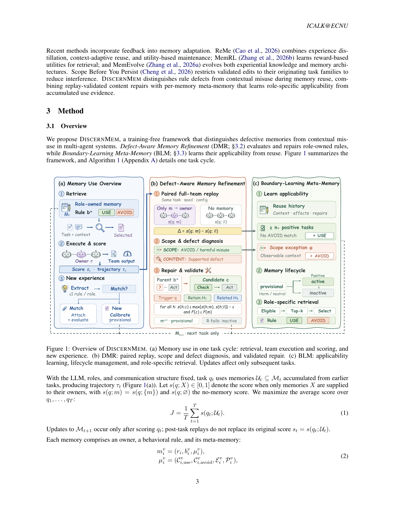
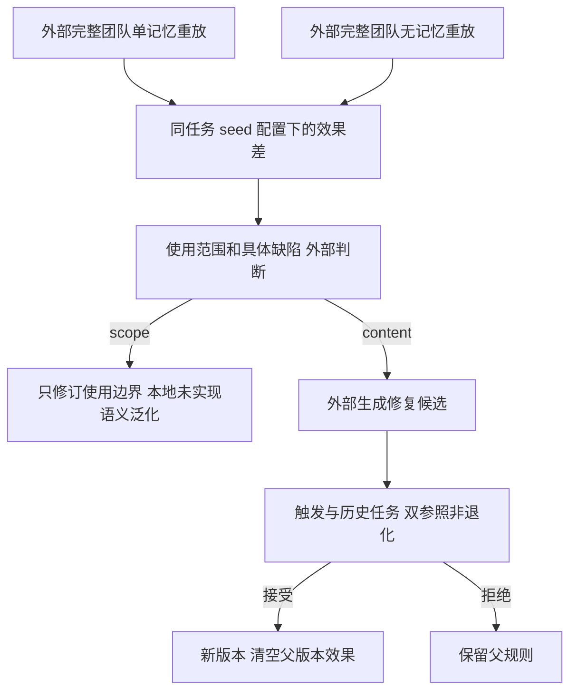

# DiscernMem：先判断记忆错在哪，再验证修复会不会伤及旧任务

> 本地状态：**L1 数值与版本规则组件，diagnostic only**，不是多 Agent 记忆能力复现。完整实验：**成本过高，不复现（审查 DONE）**，不自动重试。

## 论文信息

| 字段 | 内容 |
| --- | --- |
| 论文 | [Remembering Is Not Enough: Refining Memories and Learning When to Use Them in Multi-Agent Systems](https://arxiv.org/abs/2610.36652v1) |
| 公司 / 作者机构 | 一作 Yipeng Hao：**华东师范大学（East China Normal University）**；合作中国海洋大学、同济大学、信息工程大学。非 Google / Meta 论文 |
| 原始发布日期 | **2026-10-27 05:12:46 UTC**，arXiv v1；10月28日公告 |
| 原作者代码 | [ECNU-ICALK/DiscernMem](https://github.com/ECNU-ICALK/DiscernMem)，MIT；固定 `0d59f5fce155cbf5c695ada7f040c1d283e43ada`，独立据论文实现，不复制用户数据 |
| 本地 Adapter / key | `discernmem`；独立组件，adapter 为 null，未接入 evolve |
| 本地复现代码 | `src/auto_research/agent_research/discernmem.py` |
| 本地入口 | `paired_effect`、`attribution`、`repair_gate`、`revised_version` |
| 验证 | 纯 CPU 固定数值合同；指标见 `metrics/component-cpu-seeds42-44.json`，不需要 CUDA |

## 原始论文总结

### 背景与主要改动

团队失败不代表注入的每条记忆都有错。DiscernMem把“规则内容有缺陷”和“好规则用错场景”分开：以相同任务、seed和配置运行完整团队，仅向原拥有者注入一条记忆，再与所有角色都无记忆的执行比较。仅当负效应发生在适用范围内，而且配对轨迹支持具体缺陷时，才触发改写；已有avoid条件优先约束使用，不靠改写覆盖掉范围错误。

修复不是只把眼前任务做对。候选需要同时通过触发任务、过去有用任务和相关任务上的保留性检查；新body生成新版本，父版本的正效果不能冒充新版本可靠性。原始任务先评分、再更新，事后重放不能把原失败分数替换成成功。

<!-- paper-figure:start -->
### 原论文关键图



图片来自[原论文](https://arxiv.org/pdf/2610.36652v1#page=3)第3页，版权归原作者所有；整页截图保留Figure 1与图注、未经重绘，论文CC BY 4.0。已目视核对三个子面板，哈希与出处见 `assets/provenance.json`。图中的检索、LLM语义诊断和团队执行不在本地组件范围内。
<!-- paper-figure:end -->



### 核心公式

Eq.4比较的是**孤立注入的总团队效果**，不是原多记忆集合里的边际贡献：

$$
\Delta_i^v(q)=s(q;m_i^v)-s(q;\varnothing).
$$

默认容差 $\epsilon=0.01$，严格大于为正、严格小于负容差为负，其余中性。scope/defect仍是外部依据轨迹做的判断，不是把负分直接转换为内容错误。已有avoid命中无论效果正负都归scope；负效应且不在use范围也归scope；仅负效应、在范围且有支持缺陷才归content。

Eq.9–10对固定验证集合 $\mathcal V=\{q\}\cup\mathcal H_1\cup\mathcal H_2$ 必须同时成立：

$$
s(h;c)\ge\max\{s(h;m_i^v),s(h;\varnothing)\}-\epsilon\quad\forall h\in\mathcal V,
$$
$$
F(c)\le F(m_i^v),\qquad F(x)=|\{h\in\mathcal V:s(h;x)\le0\}|.
$$

只看平均分会允许某个旧任务退化；只看第一条容差会允许把0.005变成完全失败0，因此还需要失败计数。非改善候选额外要求引用诊断证据、写明修正意图并改变body（Appendix A.2）。接受后Eq.11清空旧效果；只有触发增益严格超过容差且related集合非空时，才追加本次修正记录。

### 论文离线与线上效果

原文用Qwen3-4B-Instruct-2507冻结主干，对AutoGen、CAMEL、MacNet三架构与TriviaQA、PopQA、KodCode、PDDL四任务评测。平均分相对最强表列基线分别提高0.70、0.51、4.32点；QA并非所有设置都最好。CAMEL/PDDL为37.71，相对28.48提高9.23点。不同任务的分数定义不同，不能把所有分数统称成功率。

每个设置仅一次运行；原文未报告生产线上A/B。本地不复算上述能力结果。

## 本地复现

### 数据协议与实现边界

输入是外部真实测量得分与显式任务/版本/角色/seed/配置，不是预造的Agent答案。`paired_effect`拒绝不一致的配对元数据；`repair_gate`拒绝空集、重复任务或缺触发任务，逐条比较父记忆和无记忆基线。`revised_version`保留identity/owner，拒绝source任务参与验证，并清空父版本效果。

本地**不执行**团队重放、LLM判断、语义检索、规则生成、候选排序、BLM条件泛化或完整生命周期，也不能证明外部scores真实或任务确为历史任务。调用方负责预行动上下文、历史选择与固定任务集合、只在原任务评分后更新。普通数值诊断不说明记忆能提高实际Agent能力；不接入evolve、不晋级能力证据。

```bash
PYTHONPATH=src python -m pytest tests/agent_research/test_oct29_memory_rubrics.py -q
PYTHONPATH=src python -c 'from auto_research.agent_research.discernmem import diagnostic; print(diagnostic(42))'
```

### 本地结果与负控

三种子只重复执行纯CPU合同，不调用模型。包含同配置配对、avoid优先、无支持缺陷不改内容、触发提升但历史退化拒绝、容差内新增完全失败拒绝，以及新版本不能继承旧可靠性。`metrics`只记机制标量，不写购物/规划准确率。

### 高成本完整实验

原文Appendix C实测：主结果、消融和超参扫描共约**900 GPU小时**；4B执行模型、0.6B embedding，QA检索另用两张GPU，代码执行另用一张。相对单张A100/A30或Mac明显超出本轮预算：**成本过高，不复现（审查 DONE）**。不下载权重或任务数据、不启动模型探针、不自动重试。
