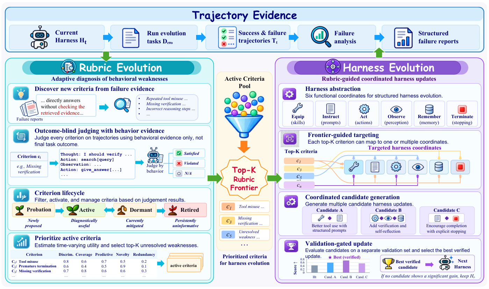

# RuHarness: Co-evolving the rubric and the agent harness

<!-- source-sha256: 01c81c72f03453d7ecff3e3ab7e10ad03b9b84925a5fd8def1a87d678df02a37 -->

[简体中文](README.md)

> **L1 statistical and validation-gate component; diagnostic only.** Full experiments were not reproduced due to cost, and the review is complete.

## Paper information

| Field | Details |
| --- | --- |
| Paper | [When the Critic Falls Behind: Co-Evolving Rubrics and Harnesses for Continual Agent Self-Improvement](https://arxiv.org/abs/2610.36826v1); [reviewed full text](https://arxiv.org/html/2610.36826v1) |
| Affiliations | First author Hao Chen: Harbin Institute of Technology; collaboration with Tsinghua University. |
| First public release | 2026-10-27 08:24:44 UTC (announced 2026-10-28) |
| Author code | No public author repository was found in the paper or author links as of 2026-10-29; no code license or revision was verified. |
| Local key | `ruharness`; no adapter |
| Local code | `src/auto_research/agent_research/ruharness.py` |
| Local evidence | [Local mechanism metrics](metrics/component-cpu-seeds42-44.json) |

## What the paper changes

A fixed rubric can keep rewarding skills the agent has already mastered while missing new failure modes. RuHarness alternates rubric evolution with harness changes. It identifies checkable criteria from traces, asks an outcome-blind judge for Satisfied, Violated or N/A, then relates these judgments to externally measured task outcomes. Small samples can inflate point estimates, so candidate criteria are ranked by a conservative posterior utility. Harness updates still require independent validation; a rubric is not the task objective.

### Original paper figure



Original figure from the reviewed paper, reused without redrawing. See [figure provenance](assets/provenance.json).

### Core equations

$$
D=\frac{v_f}{v_f+s_f}-\frac{v_p}{v_p+s_p},\quad
C=\frac{v_f}{v_f+s_f+n_f},
$$

$$
P=\frac{v_f}{v_f+v_p}-\frac{v_f+s_f}{v_p+s_p+v_f+s_f}.
$$

$$
U=D+0.5C+P+0.5N-0.5\mathrm{Red}.
$$

The first three terms measure failure discrimination, coverage and predictiveness in a six-cell table of success/failure by behavior label. $N$ measures failed traces uniquely flagged by the criterion; Red is the largest Jaccard overlap with other violation sets, not semantic similarity. Appendix A.4 adds 0.5 to each cell and draws 2,000 joint Dirichlet samples, recomputing $D,C,P$ while keeping $N$ and Red fixed. Ranking uses the 0.2 utility quantile and the active Top-10. Independent Beta draws would lose shared-table correlations. Equations 9–10 accept only the highest-validation candidate that passes the verifier and improves strictly by more than 0.05; otherwise retain the current harness.

### Results reported by the authors

The authors compare Qwen3.5-35B-A3B and GLM-4.7-Flash with DeepAgent on five EvoAgentBench domains, separating evolution, validation and test. Task, tool and evaluation interfaces are fixed; each round proposes at most three candidates changing up to three components each. The paper reports improvements over listed harness-evolution baselines and studies held-out transfer. No production A/B or local Pass@1 was measured.

## Local reproduction and limits

`contingency`, `set_statistics`, `dcp`, `conservative_frontier` and `validation_update` use externally supplied behavior labels, outcomes and active/validation state. Undefined observed denominators are rejected; the posterior prior does not alter observed estimates. Empty violation-set Jaccard is explicitly zero. Linear NumPy quantiles and stable input-order ties are local conventions. Three CPU seeds check table counts, joint posterior and repeatability, Jaccard=1 for identical nonempty violation sets, exclusion of inactive or verifier-rejected candidates, and rejection at exactly 0.05 gain. The component does not judge language, evolve rubric lifecycles, execute six-coordinate changes or establish external measurement validity, causality, validation isolation or Evolve capability.

```bash
PYTHONPATH=src python -m pytest tests/agent_research/test_oct29_memory_rubrics.py -q
PYTHONPATH=src python -c 'from auto_research.agent_research.ruharness import diagnostic; print(diagnostic(42))'
```

### Full experiment: not reproduced

The full multi-round setup uses 35B-A3B and GLM-4.7-Flash, 713 evolution, 268 validation and 337 test tasks plus repeated tool use, diagnoses and baselines. No total GPU hours were reported. A full run is outside the single A100/A30 or Mac budget; no weights, API/environment probes or retries.

### Additional references

[Paper Figure 2](https://arxiv.org/html/2610.36826v1#S3.F2)
