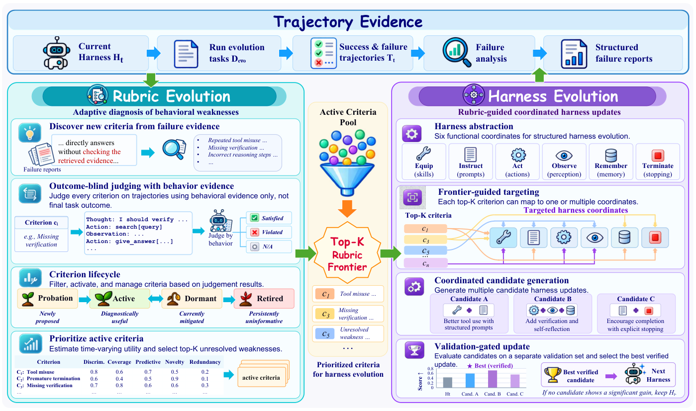
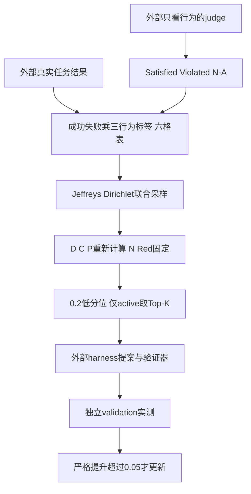

# RuHarness：让评判标准跟上 Agent 自进化

> 本地状态：**L1 统计与验证门槛组件，diagnostic only**，不是完整harness进化或Agent能力实现。完整实验：**成本过高，不复现（审查 DONE）**，不自动重试。

## 论文信息

| 字段 | 内容 |
| --- | --- |
| 论文 | [When the Critic Falls Behind: Co-Evolving Rubrics and Harnesses for Continual Agent Self-Improvement](https://arxiv.org/abs/2610.36826v1) |
| 公司 / 作者机构 | 一作 Hao Chen：**哈尔滨工业大学（Harbin Institute of Technology）**；合作清华大学。非 Google / Meta 论文 |
| 原始发布日期 | **2026-10-27 08:24:44 UTC**，arXiv v1；10月28日公告 |
| 原作者代码 | 截至2026-10-29，原论文和作者链接**未找到公开代码仓库**；不编造license或SHA |
| 本地 Adapter / key | `ruharness`；独立组件，adapter 为 null，未接入 evolve |
| 本地复现代码 | `src/auto_research/agent_research/ruharness.py` |
| 本地入口 | `contingency`、`set_statistics`、`dcp`、`conservative_frontier`、`validation_update` |
| 验证 | 纯 CPU 公式与集合统计；指标见 `metrics/component-cpu-seeds42-44.json`，不需要 CUDA |

## 原始论文总结

### 背景与主要改动

Agent解决早期缺陷后，固定rubric可能继续奖励已经会做的事，却遗漏后来出现的行为问题。RuHarness交替进化rubric与harness：从执行轨迹发现可检验的标准，先让看不到任务最终结果的judge判断Satisfied、Violated或N/A，再把这些行为判断与外部任务结果统计关联，找出仍能解释当前失败的标准。

不是命中几次失败就直接排最前。样本少时点估计容易虚高，方法对成功/失败与三种行为标签形成的六格联合分布做后验采样，以效用低分位选active标准。候选harness仍只能通过独立validation晋级，不能把rubric打分当成真正任务效果，也不修改原任务目标。

<!-- paper-figure:start -->
### 原论文关键图



图片来自[原论文](https://arxiv.org/html/2610.36826v1#S3.F2)，版权归原作者所有；直接保存Figure 2原始PNG，未经重绘。已目视核对盲评、生命周期、Top-K rubric frontier、六坐标修改和validation门槛，来源与哈希见 `assets/provenance.json`。图中完整Agent与提案执行不在本地范围。
<!-- paper-figure:end -->



### 核心公式

记成功任务的violated/satisfied/N/A计数为 $v_p,s_p,n_p$，失败任务为 $v_f,s_f,n_f$。Appendix A.2：

$$
D=\frac{v_f}{v_f+s_f}-\frac{v_p}{v_p+s_p},\quad
C=\frac{v_f}{v_f+s_f+n_f},
$$
$$
P=\frac{v_f}{v_f+v_p}-\frac{v_f+s_f}{v_p+s_p+v_f+s_f}.
$$

N是失败中只被当前标准违规命中的比例；Red是当前违规轨迹集合与其它标准违规集合的最大Jaccard。不是标签相似度，也不是LLM语义分数。默认效用：

$$
U=D+0.5C+P+0.5N-0.5\mathrm{Red}.
$$

Appendix A.4向六格各加0.5形成同一个Dirichlet后验，联合抽 **2000** 次；每次重新计算D、C、P，但**N和Red保持观测集合值不变**，最后取效用样本的0.2分位。不能把三个率分别独立抽Beta而丢掉共同列联表相关性。

只对active标准排序选Top-10；本地active状态必须由外部提供，不伪造论文生命周期。Eq.9–10对通过验证器的候选选择最大validation分数，并仅在严格增益 $>0.05$ 时接受。全部失败或没有候选时保留当前harness。

### 论文离线与线上效果

原文以Qwen3.5-35B-A3B、GLM-4.7-Flash与DeepAgent测试五域EvoAgentBench，evolution/validation/test隔离。初始任务、工具接口与评估目标固定，harness最多同时改三个组件，每轮至多三个候选。论文报告优于表列harness-evolution基线，且关心held-out迁移；这不是线上生产A/B，原文未报告线上业务实验。

本地只核数值统计与接受条件，没有执行这五域任务，因而不将任何论文Pass@1写成本地成绩。

## 本地复现

### 数据协议与实现边界

输入是外部行为标签和任务结果，代码分别校验两种数据类型。`contingency`统计六格；`set_statistics`按真实轨迹位置计算N与Red；`conservative_frontier`按联合后验抽样且排除inactive。原始计数若没有可应用的成功/失败组或无违规，点估计分母未定义会拒绝，不静默填零；后验的0.5先验不是修改观测点统计。空违规集合Jaccard本地显式约定为0。

本地采用NumPy线性样本分位和相同分数按输入顺序打破平局，这些是论文未指定的数值细节，不宣称完全复制上游代码。代码不调用judge、不判断自然语言标准、不处理出生/休眠/退役、不生成或执行六坐标修改，也不验证外部测量真实性、盲评合规或validation隔离。标签与结果的关联不证明因果关系，更不构成统一evolve接入。

```bash
PYTHONPATH=src python -m pytest tests/agent_research/test_oct29_memory_rubrics.py -q
PYTHONPATH=src python -c 'from auto_research.agent_research.ruharness import diagnostic; print(diagnostic(42))'
```

### 本地结果与负控

纯CPU三种子统计诊断：独立六格计数/公式参考、相同违规集合的Jaccard=1、联合Dirichlet完整参考、固定seed可重复、inactive不入选、未通过外部验证器的高分候选被排除，以及恰好0.05的增益不晋级。三种子不等于三次真实Agent能力比较。

### 高成本完整实验

完整配置使用35B-A3B与GLM-4.7-Flash，多域长任务、多轮候选、LLM轨迹诊断与评审；Appendix A.1有713条evolution、268条validation和337条test，外加多方法多轮真实执行。原文未给总GPU小时，不能编造用时；相对单张A100/A30或Mac，本轮**成本过高，不复现（审查 DONE）**。不下载权重、不启动API/环境探针、不自动重试。
