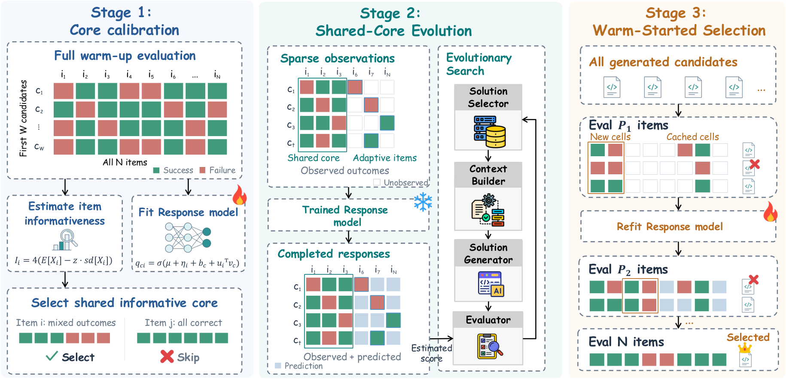

# EvalAlloc: Fixed-reference candidate scoring and paired confirmation

<!-- source-sha256: 04e5b9c3cea405eb2244d2e0f4f062a70ae83b5076595524c750a99f4b3629be -->

[简体中文](README.md)

> **Local scope: CPU-only statistical and budget-planning subcomponents.** This is not the full EvalAlloc search controller. No LLM calls or fabricated task scores are used. The complete search and benchmark experiments were reviewed and not reproduced because of cost.

## Paper information

| Field | Details |
| --- | --- |
| Paper | [Where Should the Evaluation Budget Go in LLM-Driven Agent Scaffold Evolution?](https://arxiv.org/abs/2610.37276v1) |
| Reviewed version | [arXiv v1 full text](https://arxiv.org/html/2610.37276v1) |
| First author and affiliation | Sichun Luo, University of Hong Kong; collaborators include China Mobile JIUTIAN |
| First public release | 2026-10-27 14:06:26 UTC, arXiv v1 |
| Author code | No verifiable EvalAlloc repository found in the reviewed v1 sources. Referenced frameworks such as ShinkaEvolve are not EvalAlloc code. |
| Local key | <code>evalalloc</code>; statistical and paired-round component, not integrated into Evolve |
| Local implementation | <code>src/auto_research/agent_research/evalalloc.py</code> |

## What the paper proposes

Search needs inexpensive, comparable feedback; selecting the final winner needs stronger confirmation from actual measurements. EvalAlloc fully evaluates a few warm-up candidates, selects shared informative items, and fits an item-response model. During search, it keeps the item model fixed and infers only a new candidate's parameters. Observed scores are then combined with predictions for unobserved cells. Final confirmation expands a common random item prefix in rounds and reuses cached observations.

### Original paper figure

Unredrawn figure from the [reviewed paper](https://arxiv.org/html/2610.37276v1#S5.F3); see the [figure provenance](assets/provenance.json). The pictured item-model training, full evolution loop, and multi-round successive halving are not implemented locally.

### Core equations

For item $i$ with $a_i$ full-credit observations out of $n_i$ total, $p_i\sim\operatorname{Beta}(a_i+1,n_i-a_i+1)$. The conservative information score is

$$
I_i=4\left\{\mathbb E[p_i(1-p_i)]-
z\sqrt{\operatorname{Var}[p_i(1-p_i)]}\right\}.
$$

Only **full credit** contributes to $a_i$. Partial credit remains a score for response modeling but counts as not full credit in acquisition. Negative information scores are not clipped. Outside the shared core, Gumbel top-$k$ uses logits $I_i/\tau$ for sampling without replacement.

$$
q_{ci}=\sigma(\mu+\eta_i+b_c+u_i^\top v_c),\qquad
\widehat F(c)=\frac{\sum_{i\in S_c}Y_{ci}+\sum_{i\notin S_c}q_{ci}}{N}.
$$

With item parameters and the Gaussian prior frozen, MAP fits the new candidate using its sparse observations. Predictions never overwrite known scores. In confirmation round $r$, $U_c^r=O_c\cup P_r$ combines cached observations with the common prefix; only missing cells are evaluated. The first round uses the union mean. Later rounds use

$$
\widetilde F_r(c)=\overline Y_{U_c^r}
+\lambda_r\left(\overline{\widetilde q}_{\mathrm{all}}-
\overline{\widetilde q}_{U_c^r}\right),
$$

where the pooled within-candidate regression slope is clipped to $[0,1.5]$. The paper refits MIRT in two cross-fitted folds after the first round. The local component accepts externally fitted predictions and training-candidate identities; it rejects a prediction fitted using the candidate being scored. When every item is observed, the correction vanishes exactly and the final result rests on observations.

### What the paper reports

The authors compare evaluation budgets on four benchmarks, two evolution frameworks, and three runs, reporting competitive or higher mean scores at roughly half the cell budget. Table 5 shows that cell count and token cost do not scale proportionally, so halving cells is not the same as halving LLM spend. The local component does not run the paper's searches or report TEST scores. No production A/B test is reported.

## Local reproduction and validation

The interface receives SEARCH item indices and sparse observations, not DEV/TEST answers or a hidden complete score matrix. <code>FrozenItemModel</code> copies externally fitted item parameters and the prior into read-only arrays. Only new candidate parameters change during MAP. Callers remain responsible for checking the actual fitting data and cross-fit provenance; supplied identities do not by themselves prove a leak-free training process.

<code>informativeness</code> implements Eqs. 2–3; <code>shared_core</code> and <code>acquire</code> cover Eq. 5; <code>infer_candidate</code> fits MAP with a fixed external model; <code>completed_fitness</code> covers Eq. 6; <code>regression_adjusted_scores</code> covers Eqs. 7–9. <code>plan_paired_round</code> and <code>accept_round_results</code> check the missing-cell budget and validate the returned cells before caching. L-BFGS tolerances and iteration limits are local solver settings, not unpublished author settings.

Warm-up MIRT fitting, two-fold refitting, AST deduplication, full multi-round successive halving, model calls, and evolution-framework integration are out of scope. The CPU numerical kernel requires the <code>research-components</code> extra for SciPy, not PyTorch, a checkpoint, or a GPU.

From the repository root:

~~~bash
python -m pip install -e '.[research-components]'
PYTHONPATH=src python -c 'from auto_research.agent_research.evalalloc import diagnostic; print(diagnostic(42))'
~~~

With the repository test dependencies installed, run <code>PYTHONPATH=src python -m pytest tests/test_oct30_post_agent.py -q</code>. The tests compare closed-form Beta moments, verify frozen item parameters and observation precedence, check shared-core selection and sampling without replacement, preserve the cache union, reject candidate contamination and missing-cell budget violations, and require zero correction under full observation. See the [three-seed CPU record](metrics/component-cpu-seeds42-44.json). It contains mechanism statistics, not agent success or actual savings.

### Full experiment: reviewed, not reproduced

The paper's matrix covers 80 or 81 proposals, 300 SEARCH items per benchmark, four benchmarks, two frameworks, three runs, multiple LLM baselines, DEV/TEST audits, and a proposal model up to 120B. The full experiment was not launched, and omitted fitting or controller pieces are not registered as Evolve integrations.
