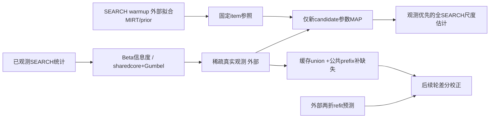
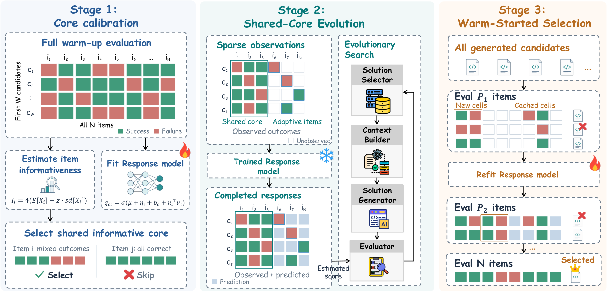

# EvalAlloc：校准、固定参照MAP与配对选择子组件

## 论文信息

| 字段 | 内容 |
| --- | --- |
| 论文链接 | [Where Should the Evaluation Budget Go in LLM-Driven Agent Scaffold Evolution?](https://arxiv.org/abs/2610.37276v1)，固定[v1全文](https://arxiv.org/html/2610.37276v1) |
| 公司/机构 | 一作Sichun Luo：University of Hong Kong；含China Mobile JIUTIAN等合作者 |
| 首次公开日期 | 2026-10-27 14:06:26 UTC，arXiv v1；同公告补漏 |
| 原文开源代码 | 固定v1/arXiv未找到作者EvalAlloc实现仓库；ShinkaEvolve等被引用框架不当作本方法源码 |
| 本地 Adapter | `evalalloc`为CPU统计/配对轮组件键，未接入统一evolve |
| 本地复现代码 | `src/auto_research/agent_research/evalalloc.py` |

> 明确是子组件，不是完整EvalAlloc搜索控制器。完整LLM搜索/多基准实验**成本过高，不复现（审查 DONE）**；不执行模型调用或伪造完整任务成绩矩阵。

## 原始论文总结

### 背景与主要改动

搜索过程需要便宜但可比较的反馈，最后选冠军则需要更精确的实测确认。EvalAlloc先完整评测少量warmup候选，选出共享信息项并拟合响应模型；搜索时固定item参照，只推断新候选参数，再把真实观测与未观测预测补全。最终以公共随机prefix逐轮确认，复用搜索缓存而不是重新全跑。

### 架构与数据流

<!-- paper-figure:start -->
### 原论文关键图

图片来自[原论文](https://arxiv.org/html/2610.37276v1#S5.F3)，保持原始完整框架图，版权归原作者所有；来源与SHA256见`assets/provenance.json`。图示MIRT训练、完整进化和多轮SH不属于本地已完成范围。
<!-- paper-figure:end -->

### 核心公式

对item的满分次数 $a_i$ 与观测次数 $n_i$，$p_i\sim\mathrm{Beta}(a_i+1,n_i-a_i+1)$，并计算

$$
I_i=4\{\mathbb E[p_i(1-p_i)]-z\sqrt{\operatorname{Var}[p_i(1-p_i)]}\}.
$$

仅**满分**计入 $a_i$；部分分仍用于响应模型，但在信息项获取统计中视为未满分。负的保守信息分不截断。固定sharedcore之外，按 $I_i/\tau$ 做Gumbel-top-k无放回选择。

$$
q_{ci}=\sigma(\mu+\eta_i+b_c+u_i^Tv_c),\quad
\widehat F(c)=\frac{\sum_{i\in S_c}Y_{ci}+\sum_{i\notin S_c}q_{ci}}{N}.
$$

搜索时冻结item参数和Gaussian prior，仅按新candidate的稀疏观测做MAP；不能用补全预测覆盖已知实测。最终轮使用 $U_c^r=O_c\cup P_r$，只执行缺失cell。首轮用union均值，后续用

$$
\tilde F_r(c)=\bar Y_{U_c^r}+\lambda_r(\bar{\tilde q}_{\mathrm{all}}-\bar{\tilde q}_{U_c^r}),
$$

其中 pooled within-candidate回归斜率裁剪到 $[0,1.5]$。论文在首轮后做两折cross-fitted MIRT refit；本地只接收外部预测和训练candidate身份，检查当前候选不在其item模型拟合集内。全部item都观察到时校正严格消失，最终结果靠观测，不靠外推。

### 论文离线与线上效果

作者在四benchmark、两进化框架、三次运行比较评测预算，报告约一半cell预算下有竞争力或更高的均值。Table5也显示cell与token成本不成比例，不能把少一半cell直接写成少一半LLM费用。本地未执行原文搜索或TEST分数；未报告生产线上A/B。

## 本地复现

### 数据协议与实现边界

API只有SEARCH item索引和稀疏真实观测，没有DEV/TEST答案或完整隐藏成绩矩阵。`FrozenItemModel`复制并只读保存外部item参数/prior，MAP只改新candidate参数；来自外部的拟合数据与cross-fit provenance仍须调用者核验，布尔/身份声明不能替代真实训练证据。

运行该CPU数值核需安装`research-components`可选依赖（SciPy）；不需要PyTorch、checkpoint或GPU。CONCUR/EMMA的纯CPU路径不依赖SciPy，只有其独立测试中的约束优化参照使用开发依赖。

实现Beta矩、sharedcore/Gumbel、外部固定参照的MAP、完成均值、差分斜率、公共prefix缺失cell预检和结果精确入缓存。**不实现warmup MIRT拟合、两折refit、AST候选去重、完整多轮successive halving、模型调用/进化框架接口**；因此不称完整EvalAlloc controller或benchmark接入。

### 本地结果与负控

独立测试对照Beta闭式矩、固定item不变、观测覆盖预测、共享core和无放回获取、缓存union保留、同候选训练污染/预算不足/未请求额外cell拒绝，以及全观测校正为零。只输出机制统计，不报告Agent成功率或实际费用节省。

### 代码映射

`informativeness`对应Eq2/3；`shared_core/acquire`对应Eq5；`infer_candidate`是固定外部模型下的MAP；`completed_fitness`对应Eq6；`regression_adjusted_scores`对应Eq7–9；`plan_paired_round/accept_round_results`检查本轮预算与真实结果。L-BFGS数值容差/迭代上限是显式本地求解配置，不冒充作者未公开代码。

### 高成本完整实验

原文包含80/81个提案、每套300项SEARCH、四benchmark×两框架×三次及多基线LLM执行，另有DEV/TEST审计和最高120B提案模型配置。完整实验**成本过高，不复现（审查 DONE）**，不启动试跑、不把被省略的外部模型拟合和controller登记为已接入evolve。
