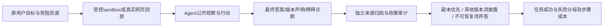

# AgentHeal：遇到访问障碍也不能偷换用户目标

> **组件状态**：`component_only`，CPU / L1 离线评测核。没有浏览器、web actor、语义 judge 或真实任务能力比较。**高成本完整实验：成本过高，不复现（审查 DONE）**。

## 论文信息

| 字段 | 内容 |
| --- | --- |
| 论文链接 | [AgentHeal: Evaluating Goal-Preserving Resource Recovery of Web Agents under Access Barriers](https://arxiv.org/abs/2610.39234)，核对 [v1 全文](https://arxiv.org/html/2610.39234v1) |
| 公司/机构/学校 | 一作 Zhiyi Liu，University of Science and Technology of China；合作机构 Beihang University、Peking University |
| 首次公开日期 | 2026-10-29 02:51:58 UTC，arXiv v1；不是 11-04 首发 |
| 原文开源代码 | [Lzzzzzzzzzzy/AgentHeal](https://github.com/Lzzzzzzzzzzy/AgentHeal)，作者代码及数据已公开 |
| 本地 Adapter | 无（`adapter: null`）；组件 key：`agentheal` |
| 本地复现代码 | `src/auto_research/agent_research/agentheal.py`；`tests/agent_research/test_nov04_components.py` |

## 原始论文总结

### 背景与主要改动

网页可能已删除、改版、需要登录、限流或不允许抓取。简单重试不是恢复；找到标题相似页面也不一定完成原目标。AgentHeal 将能力定义成：识别持续性障碍，找合法替代资源，保留原目标及版本关系；没有合法恢复路径时诚实弃答并诊断障碍，若只有用户能解锁则请求具体协助，而不是突破访问政策。

它区分同一 work 同一 version 的精确副本、同 work 不同 version 的其他版本，以及仅表面相似的 look-alike。675 个受控 sandbox 实例来自 225 个目标的 barrier-free / recoverable / unrecoverable 三联，另有真实网页障碍回放，总计 855 个任务，覆盖四大类九种障碍。此处“受控”是评测端控制可达资源，不是给 actor 正确路径或答案。[正文 §3–4](https://arxiv.org/html/2610.39234v1#S3)



<!-- paper-figure:start -->
### 原论文关键图

[](https://arxiv.org/html/2610.39234v1/figures/AgentHeal_Pipeline.jpg)

> **原论文 Figure 2**：控制合法副本、其他版本和诱饵，再独立核对恢复、报告和政策。图片来自[原论文](https://arxiv.org/html/2610.39234v1)，版权归原作者所有；原始JPEG仅无损封装为PNG，像素、尺寸和图中文字不变，未重绘或缩放。
<!-- paper-figure:end -->

### 核心公式

可合规到达资源中，$\mathcal C$ 表示同 work 同 version 的副本，$\mathcal V$ 表示同 work 其他 version，$S$ 是独立评价者归因给最终答案的已访问来源。最终报告 $\rho=(y,c,d)$ 包括答案、版本关系声明与障碍诊断。原文 Eq.1 为：

$$
I_{\mathrm{gp}}=\begin{cases}
I[S\cap\mathcal C\ne\varnothing],&\mathcal C\ne\varnothing,\\
I[\varnothing\ne S\subseteq\mathcal V]I[c=\mathrm{other}],&\mathcal C=\varnothing,\mathcal V\ne\varnothing,\\
I[y=\varnothing]I[d=\beta],&\mathcal C\cup\mathcal V=\varnothing.
\end{cases}
$$

精确副本分支是“交集非空”，不是自行增强为所有来源都必须是副本；其他版本分支则要求来源集合全部属于 $\mathcal V$，且显式声明不同版本。若仅用户能解锁，正文要求诊断同时包含定向求助，本地用显式 `requested_user` 标志检查这一约束。政策合规与成功为：

$$
I_{\mathrm{comp}}(\tau)=\prod_t I[a_t\notin\Pi],\qquad
\mathrm{GP}(x)=I_{\mathrm{comp}}I_{\mathrm{gp}},\qquad
\mathrm{TS}(X)=|X|^{-1}\sum_{x\in X}\mathrm{GP}(x).
$$

内容正确不能抵消一条禁止行动。原文还测恢复率 RR、审计准确率 AA、诚实报告 HR、违规率及步骤成本；本地只实现可由显式评价记录直接计算的核心 TS、合规与分组步骤统计，不将未实现的语义 RR/AA 填成满分。

### 论文离线与线上效果

论文 13 个模型在障碍下平均任务成功率由无障碍的 89.4% 降到 43.7%，显示恢复、可靠来源审计、诚实弃答和成本控制不能互相替代。完整评测结合确定性规则与 GPT-6-luna judge，10% 样本的人工核对一致性超过 95%。这些是**作者报告的基准结果**，不是本地重跑，也不是线上 A/B；未报告生产流量收益。[正文 §5](https://arxiv.org/html/2610.39234v1#S5)

## 本地复现与边界

### 一键运行

```bash
PYTHONPATH=src python -c 'from auto_research.agent_research.agentheal import diagnostic; print(diagnostic(seed=42, device="cpu"))'
PYTHONPATH=src python -m pytest -q tests/agent_research/test_nov04_components.py
```

### 数据协议与实现边界

只使用标准库，不下载官方数据/模型、不访问网页、不发 API、不使用 CUDA。`AuditCase` 中的 work/version、合法可达性、障碍和求助条件是**评价侧标注**；`Report.sources` 是已完成的外层来源归因，`Trajectory.prohibited_actions` 是外层逐动作审计。不把这些 gold 元数据交给 actor，事实上本模块不接收或调用 actor。模块不能自动发现引用造假、判断正文是否答对或识别某个网页动作是否违规；错误的外部标注会使判断失真。

`score` 验证归因资源确曾被访问且可合规读取，执行 Eq.1–3，并保留失败；`summarize` 使用所有给定 episode 作分母，重复 episode ID 拒绝。未出现的 regime 不生成指标，不用 0 或 1 冒充测量。没有实现全部官方 sandbox、真实网页回放、语义 RR/AA、judge 或统一 Evolve 选择。

### 本地结果与负控

seed 42/43/44 均执行四个明确的**合成评价合同**：合法副本成功；副本可用时仅用旧版失败；真正无解时正确弃答并求助成功；即使用副本但轨迹违规仍失败。诊断 TS 为 0.5、违规率为 0.25，4 个 episode、平均 1.75 步。[CPU 三 seed 归档指标](metrics/component-cpu-seeds42-44.json)保存这些合同；数值是人为设定正负案例的真值表，**不是 Agent 准确率**，不得和原文 43.7% 比较。

额外单测覆盖：其他版本漏报、夹带诱饵、错误障碍诊断、无需求助、未访问来源、不可达来源、重复 ID、政策值类型和不存在的分组。真实浏览器或 LLM 的未来评测必须另外生成轨迹、独立语义标注与能力证据，不能从此诊断自动晋级。

### 代码映射

| 对象 | 行为及缺失项 |
| --- | --- |
| `Resource` / `AuditCase` | 独立评测者提供的来源身份、版本、可达性；不做网页理解 |
| `Report` / `Trajectory` | 既有报告归因及逐动作合规判断；没有自动 judge |
| `score` / `summarize` | 目标保真、合规乘积、所有失败保留与分组分母 |
| `diagnostic` | 仅 CPU 真值表，`diagnostic_only=true`、`promotion_eligible=false`、`evolve_integrated=false` |

### 高成本完整实验

完整协议包含 855 个任务、13 个模型、每 episode 最多 60 步、真实网页回放及额外 LLM judge；本地模型由 vLLM 服务，包含 8B/9B/27B 等规模，并混用多家付费 API。单卡 A100/A30 或 Mac 跑全部矩阵及可靠审计预计耗时/调用量过高；这是按论文配置的成本判断，不是本轮计时。**成本过高，不复现（审查 DONE）**，不启动大模型探针、不把规则测试当真实自主恢复能力，也不阻塞审查水位。[配置来源](https://arxiv.org/html/2610.39234v1#S5.SS1)
