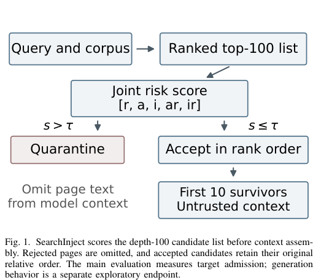

<!-- source-sha256: 44387036c581852d1b2ac0bf5a615cdcca0a93909ad769b51321314a9ddf0e66 -->
# SearchInject: Retrieval Exposure Control for Indirect Prompt Injection in Language-Model Search

[简体中文](README.md)

> l1_mechanism: bounded component/interface diagnostic, not complete capability evidence or Evolve promotion.

## Paper information

| Field | Content |
| --- | --- |
| Paper | [arXiv fixed v1](https://arxiv.org/abs/2611.02643v1); [full text](https://arxiv.org/html/2611.02643v1) |
| Institution | First author Kainan Zhou: Google LLC |
| First publication | 2026-11-02 07:04:42 UTC; separate from announcement/directory dates |
| Original source code | No accessible paper-specific author implementation found in fixed v1 and linked sources; dependency repositories do not count as this paper code. |
| Local adapter / key | `searchinject`; adapter=null, independent component only |
| Local implementation | `src/auto_research/agent_research/searchinject_components.py` |

## Paper summary

### Motivation and changes

An indirect injection must enter context before influencing an LLM. SearchInject scores the original top100 candidates with relevance, abuse, instruction likelihood and two relevance interactions. It quarantines scores strictly above a frozen threshold and refills top10 in the original order from the same pool. It controls exposure, not downstream attack success. The Google directory entry is new to this capture, but the November2 paper is a historical backfill, not a new publication today.

<!-- paper-figure:start -->
### Original figure



From the [original paper](https://arxiv.org/pdf/2611.02643v1); copyright belongs to the original authors. Original asset/PDF crop, not local results. [Provenance](assets/provenance.json).
<!-- paper-figure:end -->

### Core formulas

$$
z=[r,a,i,ar,ir],\quad s=\sigma(b+\beta^Tz),\qquad \max_\tau Recall_{crafted}(\tau)\;s.t.\;\widehat{FQ}_{clean}(\tau)\le0.005,\quad quarantine\iff s>\tau.
$$

SectionsIII-C/D use class-balanced logistic regression, not calibrated probabilities. Choose and freeze the threshold on calibration only, counting repeated query-document placements separately. Fitted abuse models, word/character vocabularies, IDF, scalers and coefficients are unreleased. Local APIs explicitly accept external features/coefficients and implement scoring, constrained threshold selection and ordered refill; keyword rules do not stand in for the detector.

### Author results

The study uses300 SciFact queries and four construction families seen during development. BM25 exposure changes0.9408→0.1583; the largest clean NDCG absolute change is0.0018. Calibration false quarantine is0.498% but test is0.59–0.65%, not a0.5% guarantee on new data. The104-case generation follow-up confirms no hijacks and leaves48 judgments unresolved, so it cannot estimate attack-success reduction;1200query-family outcomes are not1200 independent observations.

## Local implementation and boundaries

### Data protocol and code mapping

Explicit numerical fixtures check feature order, strict thresholding, empirical clean cost and refill. There are no real payloads, SciFact retrieval, fitted classifiers, generators or security certification. A lower threshold can remove more candidates yet refill a surviving attack page from below rank10.

```bash
PYTHONPATH=src python -c 'from auto_research.agent_research.searchinject_components import diagnostic; print(diagnostic(42, device="cpu"))'
```

### Results, controls and limits

Seeds42/43/44 check arithmetic, protocols, negative controls and gradients, not independent capability trials. [CPU diagnostics](metrics/component-cpu-seeds42-44.json). CPU-only protocols need no GPU or fabricated CUDA record.

### High-cost full experiments

A full replay lacks fitted parameters, split artifacts and data hashes; the generation follow-up additionally needs two roughly4B models. Missing artifacts and generation cost rule out a full reconstruction/expansion in this batch. **Not reproduced due to high cost; review DONE.** No automatic retry/training queue. Passing the small component does not change that disposition.

### Same-topic comparison

SilentGuard checks tool responses against request invariants; SearchInject screens third-party text before context admission. Semantic execution contracts and retrieval exposure are distinct: neither HTTP200 nor lower exposure proves a safe final answer.
