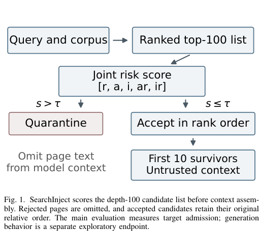

# SearchInject：检索风险与干净误隔离预算

[English](README-en.md)

> l1_mechanism：低成本组件/接口诊断，不是完整模型能力证据，不接入Evolve晋级。

## 论文信息

| 字段 | 内容 |
| --- | --- |
| 论文链接 | [SearchInject: Retrieval Exposure Control for Indirect Prompt Injection in Language-Model Search](https://arxiv.org/abs/2611.02643v1)；[固定v1全文](https://arxiv.org/html/2611.02643v1) |
| 公司 / 作者机构 | 一作 Kainan Zhou：Google LLC；按固定v1及正文核验，不由同名作者/前作推断 |
| 首次公开日期 | 2026-11-02 07:04:42 UTC（arXiv v1；与公告/目录更新时间分开） |
| 原作者开源代码 | 固定v1及关联来源未找到可获取的本论文专用作者代码；依赖仓库不计为本篇开源。 |
| 本地adapter / 稳定键 | `searchinject`；adapter=null，仅独立组件 |
| 本地复现代码目录 | `src/auto_research/agent_research/searchinject_components.py` |

## 原始论文总结

### 背景与主要改动

间接注入先要进入上下文才有机会影响LLM。SearchInject在原top100候选中，用相关性、abuse、instruction概率及两项相关性交互做logistic风险评分；超过冻结阈值才隔离，按原顺序从同一候选池补足top10。它控制暴露，而不是验证下游攻击成功。Google官方目录今天新增，但论文首发11月2日，按历史发现补录，不算今天新论文。

<!-- paper-figure:start -->
### 原论文关键图



图片来自[原论文](https://arxiv.org/pdf/2611.02643v1)，版权归原作者所有。原始图/PDF裁剪，不是本地结果；[出处与SHA256](assets/provenance.json)。
<!-- paper-figure:end -->

### 核心公式

$$
z=[r,a,i,ar,ir],\quad s=\sigma(b+\beta^Tz),\qquad \max_\tau Recall_{crafted}(\tau)\;s.t.\;\widehat{FQ}_{clean}(\tau)\le0.005,\quad quarantine\iff s>\tau.
$$

§III-C/D：joint模型为class-balanced logistic regression，不能把输出当校准概率。阈值只在calibration集选并冻结；文档重复出现在不同query时按placement计数。原稿未发布abuse/字符与词n-gram词表、IDF、scaler或拟合系数，因此本地明确接收外部特征/系数，只实现score、约束选阈与有序refill，不用关键词规则假装原检测器。

### 论文离线与线上效果

300个SciFact查询、每query四种已见构造家族；BM25暴露率0.9408→0.1583，干净NDCG最大绝对变化0.0018。calibration误隔离0.498%但test达0.59%–0.65%，不是新样本0.5%保证。104case生成跟进零确认攻击且48判断未决，不能计算攻击成功率下降；1200个query×family结果不是1200个独立样本。

## 本地复现与边界

### 数据协议与代码映射

显式数值夹具只检查feature顺序、严格>阈值、干净经验约束与refill。无真实payload、SciFact检索、拟合分类器、生成模型或安全认证；更低阈值移除更多候选，也可能补入原rank10外的攻击页。

```bash
PYTHONPATH=src python -c 'from auto_research.agent_research.searchinject_components import diagnostic; print(diagnostic(42, device="cpu"))'
```

### 结果、负控与边界

三种子42/43/44只检查数值、协议、失败负控和梯度，不是独立能力试验。[CPU诊断](metrics/component-cpu-seeds42-44.json)。CPU协议无需GPU，不制造CUDA执行记录。

### 高成本完整实验

完整检测器缺失可复放的拟合参数、分区与数据hash，生成跟进还依赖两个4B级模型。材料缺口与生成成本下不尝试重建/扩展完整实验。 **成本过高，不复现（审查 DONE）**；不自动重试、不进入训练队列。低成本组件通过不改变此结论。

### 同主题对照

SilentGuard核对工具返回值是否满足请求不变量；SearchInject在第三方文本进入上下文之前做风险准入。前者检查语义执行合同，后者检查检索暴露，HTTP200或低暴露率都不能证明最终回答安全。
