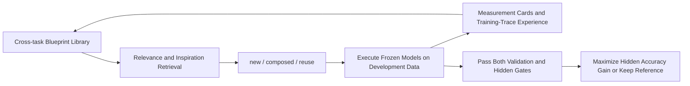
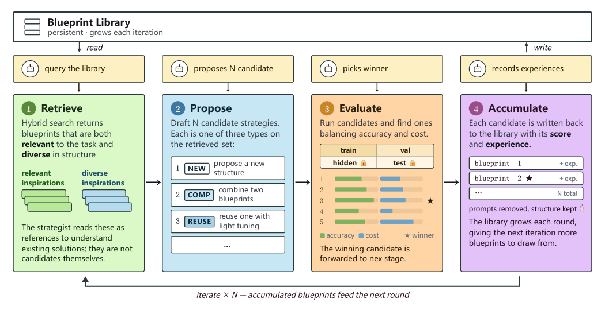

# Strategist: A Cross-Task Library of Executable Reasoning Strategies

<!-- source-sha256: 78dace5f984684a0a520bb86cb998a0799110a69997864feb631e670a0632dbe -->

[简体中文](README.md)

> **Component status:** `component_only`, CPU / L1 control and numerical diagnostics. No LLM designer, executor, or real search was run. This is not a reasoning-capability comparison or unified Evolve integration. **Full experiments: not reproduced because of high cost; review DONE.**

## Paper Information

| Field | Value |
| --- | --- |
| Paper | [Strategist: Evolving Reasoning with Agents](https://arxiv.org/abs/2611.03618); reviewed [v1 full text](https://arxiv.org/html/2611.03618v1) |
| Company / institution / university | First author Taiming Lu, Princeton University. Collaborators Qi Xu and Zhigang Hua are at Meta; Zhuang Liu is at Princeton. Group by the first author's university while retaining Meta collaboration as a priority attribute |
| Original publication | 2026-11-02 18:51:04 UTC, arXiv v1. The official recent announcement lists it on November 3; that announcement is not the v1 date |
| Author source code | [zlab-princeton/Strategist](https://github.com/zlab-princeton/Strategist), public. The upstream initial blueprint library is empty and must be populated by real search; it does not ship all the paper's discovered strategies |
| Local adapter | None (`adapter: null`); component key: `strategist` |
| Local code | `src/auto_research/agent_research/strategist.py`; `tests/agent_research/test_nov04_components.py` |

## Original Paper Summary

### Background and Main Changes

Weights are not the whole agent: direct answering, voting, decomposition, reviewing, and model routing also determine accuracy and cost. Instead of training executors, the paper lets a meta-agent propose and measure these programs on small development sets. A Python blueprint exposes `execute(llm, task) -> str` and may call previously created blueprints, forming an acyclic composition graph. Pairing a blueprint with task prompts produces a concrete strategy.

Each iteration performs Retrieve, Propose, Evaluate, and Accumulate. Relevance and adjacent-inspiration queries supply material for `new/composed/reuse` candidates. Actual executions produce accuracy, cost, measurement cards, and experience notes; evaluated structures need not win to remain useful library entries. The designer sees full training-split traces and only aggregate validation feedback. Hidden records are withheld from the designer; test data is reserved for final confirmation. The library carries experience across tasks rather than merely revising the current answer. [Sections 2–3 and Appendix A](https://arxiv.org/html/2611.03618v1#S3)



<!-- paper-figure:start -->
### Key Original Figure

[](https://arxiv.org/html/2611.03618v1/pipeline.png)

> **Original Figure 5:** retrieval, proposal, actual evaluation, and accumulation. The image comes from [paper v1](https://arxiv.org/html/2611.03618v1); copyright remains with the authors. This is the saved original, not a redraw presented as an original figure.
<!-- paper-figure:end -->

### Core Equations

Retrieval combines externally measured TF–IDF and embedding-cosine scores. Relevance and inspiration each return at most five blueprints, without overlap:

$$
s(q,b)=0.4s_{\mathrm{tfidf}}(q,b)+0.6s_{\mathrm{emb}}(q,b).
$$

Executors are Qwen3-0.6B / 1.7B / 4B, each in thinking and nothink modes. Parameter ratios determine token weights $w=(1,2.83,6.67)$; input, output, and thinking tokens all count:

$$
C(s)=\sum_jw_{\mathrm{tier}(j)}(n_j^{\mathrm{in}}+n_j^{\mathrm{out}}).
$$

The default final `hidden_best` pick compares the candidate and reference on identical questions, using $d=\overline{a_s-a_b}$ and $\rho=\sum_i c_{s,i}/\sum_i c_{b,i}$. It does not compare unpaired questions of different difficulty. On each split, the deterministic win rule is:

$$
\operatorname{win}(s,b)=[d>0.02\land\rho\le1.02]\ \lor\ [\rho<0.98\land d\ge-0.02].
$$

For accuracy, $0.02$ means **two percentage points**; for cost it is a **2% relative band**. Equality at the improvement threshold is a tie. A candidate must win on validation and hidden, then maximize hidden $d$, breaking ties by lower cost ratio. If none qualifies, retain the reference. The default uses no standard-error multiplier and is not a significance test. Upstream `paired_pick.py` requires at least 20 paired questions, which the local component retains. [Official selection implementation](https://github.com/zlab-princeton/Strategist/blob/main/strategist/paired_pick.py)

### Reported Offline and Online Outcomes

Across 30 search benchmarks, the paper reports 24 wins, two ties, two accuracy/cost tradeoffs, and two losses. Mean accuracy rises from 74.0% for the strongest training-selected baseline to 74.7%, while weighted cost falls 39%. It additionally studies retrieval on ten tasks held out of search and transfer across models. These are **author-reported results**, not local reruns; no production online A/B test is reported. [Sections 4–7](https://arxiv.org/html/2611.03618v1#S5)

## Local Component and Boundaries

### Run

```bash
PYTHONPATH=src python -c 'from auto_research.agent_research.strategist import diagnostic; print(diagnostic(seed=42, device="cpu"))'
PYTHONPATH=src python -m pytest -q tests/agent_research/test_nov04_components.py
```

Or use the Python interface:

```python
from auto_research.agent_research.strategist import diagnostic
result = diagnostic(seed=42, device="cpu")
print(result)
```

### Data Protocol and Implementation Limits

No downloads, models, APIs, CUDA, or training data are needed. Diagnostics use synthetic paired measurements, not real answers or search traces. `BlueprintLibrary` parses sources and checks **declared** parents without importing or executing code. It cannot prove that all dynamic dependencies were declared. AST deduplication removes only caller-reviewed task-prompt literals while retaining numerical thresholds, routing strings, and f-string data expressions. Prompt identification is not automated: undeclared prompt differences may conservatively produce distinct structures. Module-level helpers and import semantics are outside the execute-body fingerprint; equal fingerprints do not prove semantic equivalence.

`hybrid_retrieval` applies the formula and disjoint selection to supplied TF–IDF/cosine scores; it does not deploy an embedding service. `SplitMeasurement` accepts existing validation/hidden evaluations, not answers or test data. It requires exactly matching ordered item IDs rather than silently taking the upstream loader's intersection. Hidden records must remain unavailable to proposers. The Python API is not a process-level information-flow sandbox; integrators must isolate evaluation and proposal.

### Local Results and Negative Controls

Deterministic diagnostics for seeds 42/43/44 check rejection of prompt-only duplicates, two-split cost selection, reference fallback when no candidate qualifies, and refusal of the test split. The synthetic selected cost ratio is 0.8 with 20 questions per split. These values explain numerical control behavior, not accuracy improvement or cross-task learning. Unit tests also cover hidden-split failure, exact threshold boundaries, missing/duplicate items, NaN, zero costs, f-string expressions, and structural threshold changes. The [three-seed CPU metrics](metrics/component-cpu-seeds42-44.json) archive these local contracts, not fabricated paper benchmark scores.

### Code Map

| Object | Implemented behavior and missing pieces |
| --- | --- |
| `Blueprint` / `BlueprintLibrary` | AST fingerprints and prior-parent DAG declarations; no execution or automatic semantic review |
| `hybrid_retrieval` / `weighted_token_cost` | External-score formula, disjoint retrieval, fixed parameter weights; no real retrieval or inference |
| `paired_comparison` / `select_paired` | Paired differences/SEs, cost ratios, dual-split selection, and fallback; no candidate generation |
| `diagnostic` | CPU synthetic contracts; `diagnostic_only=true`, `promotion_eligible=false`, `evolve_integrated=false` |

### High-Cost Full Experiments

Appendix A.4 reports **eight H200 GPUs, 144 GB each**, about 60 candidates per benchmark including references/repairs, approximately 20,000 candidate-sample executions, and roughly 135,000 prompt / 45,000 response tokens for the designer. Thirty tasks additionally compare $18\times6=108$ baseline configurations per task. Repeating this matrix is inappropriate for one A100/A30 or a Mac. **Not reproduced because of high cost; review DONE.** No model probe is launched merely to prove expense, and these CPU kernels are not advertised as a full Strategist or promotion-eligible Evolve operator. [Cost source](https://arxiv.org/html/2611.03618v1#A1.SS4)
