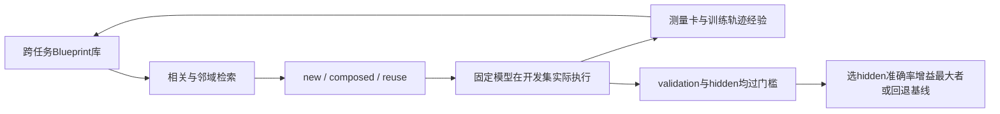
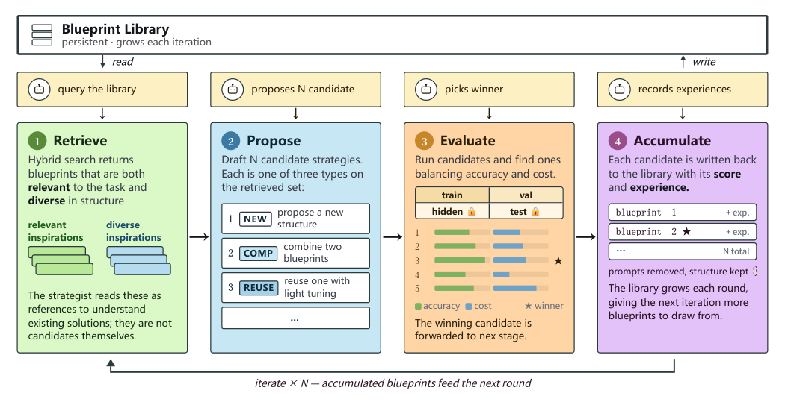

# Strategist：把推理策略变成可跨任务积累的程序库

> **组件状态**：`component_only`，CPU / L1 控制与数值诊断。没有运行 LLM 设计器、执行器或真实搜索，不是推理能力比较，也未接入统一 Evolve。**高成本完整实验：成本过高，不复现（审查 DONE）**。

## 论文信息

| 字段 | 内容 |
| --- | --- |
| 论文链接 | [Strategist: Evolving Reasoning with Agents](https://arxiv.org/abs/2611.03618)，核对 [v1 全文](https://arxiv.org/html/2611.03618v1) |
| 公司/机构/学校 | 一作 Taiming Lu，Princeton University；合作作者 Qi Xu、Zhigang Hua 来自 Meta，Zhuang Liu 来自 Princeton。按一作学校聚合，保留 Meta 合作优先属性 |
| 首次公开日期 | 2026-11-02 18:51:04 UTC，arXiv v1；官方 recent 公告列表收录于 11-03，不把公告日期写成 v1 日期 |
| 原文开源代码 | [zlab-princeton/Strategist](https://github.com/zlab-princeton/Strategist)，已公开；上游初始 blueprint 库为空，需由真实搜索生成，不是已提供论文全部搜索产物 |
| 本地 Adapter | 无（`adapter: null`）；组件 key：`strategist` |
| 本地复现代码 | `src/auto_research/agent_research/strategist.py`；`tests/agent_research/test_nov04_components.py` |

## 原始论文总结

### 背景与主要改动

模型权重不是 Agent 的全部：单步回答、投票、分解、审查、多模型路由等推理程序也决定效果和成本。论文不训练执行模型，而让一个 meta-agent 在小开发集上提出并实测这些程序，将它们表示为统一 `execute(llm, task) -> str` 的 Python blueprint。一个 blueprint 可调用此前已存在的 blueprint，构成无环组合图；与任务提示配对才形成具体策略。

每轮依次做 Retrieve、Propose、Evaluate、Accumulate：相关性检索和邻域灵感检索提出素材，候选覆盖 `new/composed/reuse`，实际执行并记录准确率、成本、测量卡和失败经验；测过但未获胜的结构也可留在库中。训练 split 的完整轨迹可供设计器反思，validation 只提供聚合结果，hidden 不给设计器，test 完全留到最终确认。原库及其经验可服务后续任务，不是只改当前答案。[正文 §2–3、附录 A](https://arxiv.org/html/2611.03618v1#S3)



<!-- paper-figure:start -->
### 原论文关键图

[](https://arxiv.org/html/2611.03618v1/pipeline.png)

> **原论文 Figure 5**：检索、提案、实测、积累的闭环。图片来自[原论文](https://arxiv.org/html/2611.03618v1)，版权归原作者所有；本地保存原图，不将流程重绘冒充原图。
<!-- paper-figure:end -->

### 核心公式

检索由外部真实 TF–IDF 和 embedding cosine 分数组合，相关与灵感两次查询各取最多 5 个且相互去重：

$$
s(q,b)=0.4s_{\mathrm{tfidf}}(q,b)+0.6s_{\mathrm{emb}}(q,b).
$$

执行器为 Qwen3-0.6B / 1.7B / 4B，每层支持 thinking 与 nothink；参数比例形成 token 权重 $w=(1,2.83,6.67)$，输入、输出及 thinking token 均计费：

$$
C(s)=\sum_jw_{\mathrm{tier}(j)}(n_j^{\mathrm{in}}+n_j^{\mathrm{out}}).
$$

最终默认 `hidden_best` 对同题候选与基线算 $d=\overline{a_s-a_b}$、$\rho=\sum_i c_{s,i}/\sum_i c_{b,i}$，不是按未配对的不同题难度比较。每个 split 的确定性胜出规则为：

$$
\operatorname{win}(s,b)=[d>0.02\land\rho\le1.02]\ \lor\ [\rho<0.98\land d\ge-0.02].
$$

$0.02$ 对准确率是 **2 个百分点**，对成本是 **2% 相对带**；等于门槛算并列。候选须在 validation 和 hidden 都胜出，再按 hidden 的 $d$ 最大、成本比最小选择；无人满足即保留基线。默认规则不乘标准误，不是显著性检验。上游 `paired_pick.py` 的默认最少配对题数为 20，本地保留该下限。[官方选择实现](https://github.com/zlab-princeton/Strategist/blob/main/strategist/paired_pick.py)

### 论文离线与线上效果

原文 30 个搜索基准中 24 胜、2 平、2 为准确率/成本互换、2 负；平均准确率由最强训练集选择基线的 74.0% 到 74.7%，加权成本下降 39%。另有 10 个未参与搜索的任务检索实验及跨模型迁移。此处均为**原文结果**，不是本仓库重跑；未报告生产线上 A/B。[正文 §4–7](https://arxiv.org/html/2611.03618v1#S5)

## 本地复现与边界

### 一键运行

```bash
PYTHONPATH=src python -c 'from auto_research.agent_research.strategist import diagnostic; print(diagnostic(seed=42, device="cpu"))'
PYTHONPATH=src python -m pytest -q tests/agent_research/test_nov04_components.py
```

也可使用 Python 接口：

```python
from auto_research.agent_research.strategist import diagnostic
result = diagnostic(seed=42, device="cpu")
print(result)
```

### 数据协议与实现边界

无下载、模型、API、CUDA或训练数据。诊断使用合成配对数值，不含真实回答或搜索轨迹。`BlueprintLibrary` 只解析源码并检查**声明的**父依赖，不导入、不执行该代码，也不能证明所有动态依赖已声明。AST 去重只剔除调用者显式复核的任务提示字面量，保留数量阈值、路由字符串与 f-string 数据表达式；提示识别不是本模块自动完成，未声明的提示差异可能保守地视为不同结构。模块级 helper 或导入语义不在 execute-body 指纹内，指纹相同不证明程序语义相同。

`hybrid_retrieval` 仅执行给定 TF–IDF/cosine 的公式及不重叠取样，未部署 embedding 服务。`SplitMeasurement` 只收 validation/hidden 的既有评价，不收答案或 test 数据；严格要求相同有序题 ID，不像上游 loader 只取交集，以免缺题被静默删除。隐藏记录不应给提案器；Python API 本身不是进程信息流沙箱，集成者仍须隔离评价和提案。

### 本地结果与负控

seed 42/43/44 的确定性诊断均检查：prompt-only 重复拒绝、两 split 成本胜出、无人合格回退基线、test split 拒绝。合成对照的选中成本比为 0.8、每 split 20 题，仅解释数值控制行为；不能称准确率提升或跨任务经验学习。单测还覆盖 hidden 失败、门槛等号、缺题、重复题、NaN、零成本、f-string 表达式与结构阈值变化。[CPU 三 seed 归档指标](metrics/component-cpu-seeds42-44.json)保存本轮组件合同，不伪造论文 benchmark 分数。

### 代码映射

| 对象 | 行为及缺失项 |
| --- | --- |
| `Blueprint` / `BlueprintLibrary` | AST 指纹、先有父节点无环声明；不执行程序、不自动审语义 |
| `hybrid_retrieval` / `weighted_token_cost` | 外部分数公式、不重叠检索、固定参数权重；无真实检索或推理 |
| `paired_comparison` / `select_paired` | 配对差值/标准误、成本比、双门槛选择及回退；不生成候选 |
| `diagnostic` | CPU 合成合同；`diagnostic_only=true`、`promotion_eligible=false`、`evolve_integrated=false` |

### 高成本完整实验

论文附录 A.4 报告 **8×H200（每卡 144 GB）**，每基准约 60 个候选（含参考与修复）、约 2 万次 candidate-sample 执行，另有设计器约 13.5 万 prompt/4.5 万 response token；30 个任务还比较每任务 $18\times6=108$ 个基线配置。单卡 A100/A30 或 Mac 不适合按原矩阵跑完。**成本过高，不复现（审查 DONE）**；不启动模型试跑来“证明很贵”，不把这些 CPU 控制核包装成完整 Strategist 或可晋级 Evolve 算子。[成本来源](https://arxiv.org/html/2611.03618v1#A1.SS4)
