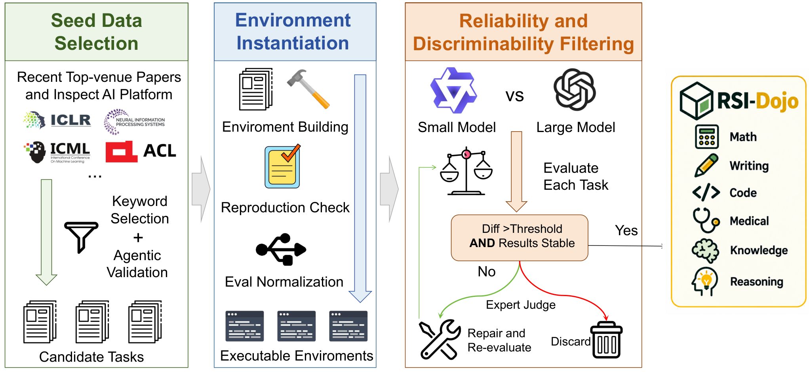

# RSI-Dojo: Environments and Trajectories for Agents That Train Models

<!-- source-sha256: ab991a497c5c3e6223382482e1c10c9783aafc2c92ab41752a5faf6140dc11cc -->

[简体中文](README.md)

> **Status:** `deferred_high_cost` / `review_only`. **Not reproduced because of high cost; review DONE.** This entry has no runtime, adapter, metrics, model downloads or GPU receipts. It does not claim that 281 environments are integrated locally.

## Paper Information

| Field | Value |
| --- | --- |
| Paper | [Training LLM Agents to Automate LLM Post-Training with RSI-Dojo](https://arxiv.org/abs/2611.03698); reviewed [v1](https://arxiv.org/html/2611.03698v1) |
| Institution | First author Shuzheng Gao, The Chinese University of Hong Kong; collaborators from ByteDance, Tsinghua and Shanghai Jiao Tong University |
| First publication | **2026-10-29 10:27:47 UTC**, arXiv v1; the November 4 announcement is a late-announcement backfill, not a November 4 first publication |
| Author code | No attributable author code or model-release link was provided/found/confirmed this round |
| Local adapter | None (`adapter: null`); catalog key: `rsi-dojo` |
| Local reproduction code | None. Only this write-up, its English counterpart and learning questions are local; referenced evaluation repositories are not presented as author code |

## Original Paper Summary

### Background and Main Changes

Improving an external harness differs from internalizing post-training skills in model weights. RSI-Craft finds tasks in papers/InspectAI, installs and validates evaluations, normalizes environments and filters unreliable or nondiscriminative tasks. RSI-Dojo yields 281 training environments, collects frontier-model trajectories with extra harness guidance, then filters process quality and outcomes before fine-tuning agents. [Section 3](https://arxiv.org/html/2611.03698v1#S3)

<!-- paper-figure:start -->
### Key Original Figure

> **Original Figure 2:** the authors' original image, visually inspected. Source: [paper v1](https://arxiv.org/html/2611.03698v1); copyright remains with the authors. Showing the pipeline does not mean these stages ran locally.
<!-- paper-figure:end -->

### Core Equations

Tasks with fewer than 50 examples are removed; those above 300 are randomly downsampled to 300. After execution checks, Qwen3-4B-Base and GPT-5-mini must differ by at least ten percentage points, without both being above 80% or below 20%:

$$
|s_{\mathrm{large}}-s_{\mathrm{small}}|\ge0.10,
\quad\neg(s_{\mathrm{large}}>0.8\land s_{\mathrm{small}}>0.8),
\quad\neg(s_{\mathrm{large}}<0.2\land s_{\mathrm{small}}<0.2).
$$

This is environment selection, not a new generic RL loss. Trajectories must also pass rubric-based process-quality and outcome-based improvement filters. A log or successful execution alone does not qualify a training example.

### Reported Offline and Online Outcomes

The paper reports PostTrainBench scores of 16.46 / 29.95 for RSI-Dojo-9B / 35B-A3B, gains of 8.74 / 16.87 over their bases; 35B-A3B reaches 53.29 on Lite. Hardware and tool-availability adaptations are disclosed, so the setup is not identical to every official leaderboard run. No production online A/B is reported. [Sections 4–5](https://arxiv.org/html/2611.03698v1#S4)

## Local Implementation

### Data Protocol and Boundaries

Only provenance, method, cost and original figures are cataloged. The published thresholds are not wrapped in an empty environment and advertised as a trained agent. No data, trajectories, weights or held-out scores are fabricated. The RSI overview may link this entry, but it is not an executable Evolve operator.

### Local Results and Negative Controls

**No full experiment was run and no local model result exists.** Teaching scores only explain thresholds. The absence of runtime/metrics is an explicit cost decision, not a hidden failure or an automatic-retry TODO.

### High-Cost Full Experiments

The configuration includes Qwen3.5-9B and Qwen3.6-35B-A3B fine-tuning and frontier trajectory collection. PostTrainBench allocates **10 GPU hours per task** and Lite still **5 hours per task**, alongside 281 training environments. These are published budgets, not local timing estimates. The full matrix is unsuitable for one A100/A30 or a Mac: **not reproduced because of high cost; review DONE.** No downloads, probes, automatic implementation or retries; unrelated delivery is not blocked.

### Code Map

There is no local algorithm. This directory is review-only documentation. Referenced PostTrainBench API judges and other systems are background sources, not this paper's source code.
