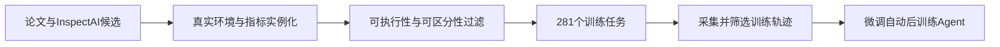
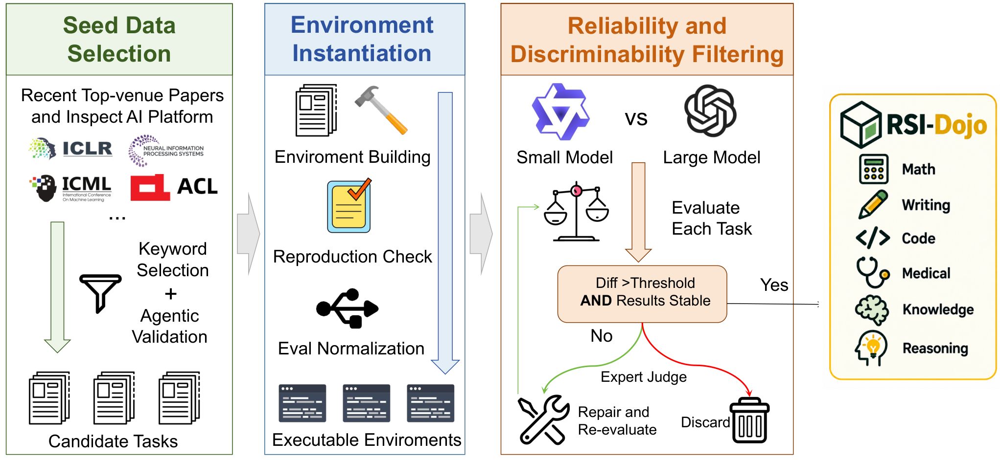

# RSI-Dojo：训练“能训练模型”的Agent需要怎样的环境与轨迹

> **收录状态**：`deferred_high_cost` / `review_only`。**成本过高，不复现（审查 DONE）**。本条没有 runtime、Adapter、metrics、模型下载或 GPU 收据，也没有宣称 281 个训练环境已在本库接入。

## 论文信息

| 字段 | 内容 |
| --- | --- |
| 论文链接 | [Training LLM Agents to Automate LLM Post-Training with RSI-Dojo](https://arxiv.org/abs/2611.03698)，核对 [v1 全文](https://arxiv.org/html/2611.03698v1) |
| 公司/机构/学校 | 一作 Shuzheng Gao，The Chinese University of Hong Kong；合作作者来自 ByteDance、清华和上海交通大学 |
| 首次公开日期 | **2026-10-29 10:27:47 UTC**，arXiv v1；11-04 公告是迟公告回填，不算 11-04 首发 |
| 原文开源代码 | 原文未给可确认作者代码或模型发布链接，本轮未找到/未确认公开作者实现 |
| 本地 Adapter | 无（`adapter: null`）；收录 key：`rsi-dojo` |
| 本地复现代码 | 无；本地只有当前方法解读、英文版和学习问答，不将评测引用仓库当作者实现 |

## 原始论文总结

### 背景与主要改动

优化外部 Harness 与让模型内化“如何做后训练”不是同一问题。RSI-Craft 从论文/InspectAI 找任务，实际安装并检验评测，标准化环境，再过滤执行不稳定或无法区分模型的任务。RSI-Dojo 得到 281 个训练环境，通过额外 Harness 指导采集前沿模型轨迹，并经过程质量和最终效果过滤后微调 Agent。[正文 §3](https://arxiv.org/html/2611.03698v1#S3)

<!-- paper-figure:start -->
### 原论文关键图

> **原论文 Figure 2**：作者原始图片，已实际视觉核对；图片来自[原论文](https://arxiv.org/html/2611.03698v1)，版权归原作者所有。图示流程不代表本地已执行这些阶段。
<!-- paper-figure:end -->

### 核心公式

任务少于 50 例剔除，超过 300 例随机下采样至 300。环境执行检查后，比较 Qwen3-4B-Base 和 GPT-5-mini，保留至少 10 个百分点分差，并排除两者同高于 80% 或同低于 20% 的任务：

$$
|s_{\mathrm{large}}-s_{\mathrm{small}}|\ge0.10,
\quad\neg(s_{\mathrm{large}}>0.8\land s_{\mathrm{small}}>0.8),
\quad\neg(s_{\mathrm{large}}<0.2\land s_{\mathrm{small}}<0.2).
$$

这是环境筛选协议，不是本文提出的通用 RL loss。轨迹还需通过 rubric-based 质量过滤和 outcome-based 效果过滤；只有“有日志”或“成功跑完”不足以成为训练样本。

### 论文离线与线上效果

作者报告 RSI-Dojo-9B / 35B-A3B 的 PostTrainBench 分数为 16.46 / 29.95，相对基座提高 8.74 / 16.87 点；35B-A3B 在 Lite 为 53.29。实验有硬件和工具可用性适配，不能称与所有官方 leaderboard 无差异。未报告生产线上 A/B。[§4–5](https://arxiv.org/html/2611.03698v1#S4)

## 本地复现

### 数据协议与实现边界

仅记录来源、方法、成本与原图。不将公开论文阈值写成一个空环境来宣称 Agent 学会训练，也不伪造任务数据、轨迹、模型权重或留出分数。RSI 汇总应链接本条，但不能作为可执行 Evolve operator。

### 本地结果与负控

**未运行完整实验，未产生本地模型结果。** 学习例中的分数只解释阈值，不是测量。没有 runtime/metrics 是有意的成本决策，不是被隐藏的失败或等待自动重试的 TODO。

### 高成本完整实验

原文涉及 Qwen3.5-9B、Qwen3.6-35B-A3B 微调与前沿轨迹收集；PostTrainBench 每任务单 GPU **10 小时**，Lite 仍 **5 小时**，另有 281 训练环境。基于这些公开预算而非本地时间估计，单张 A100/A30 或 Mac 不应尝试整套矩阵：**成本过高，不复现（审查 DONE）**，不下载、不试跑、不自动实施或重试，不阻塞其他交付。

### 代码映射

无本地算法实现；此目录是 review-only 文档。作者引用的 PostTrainBench API judge 或其他系统只作为背景来源，不冒称本文源码。
