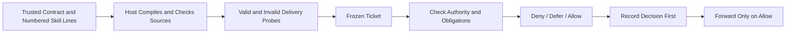
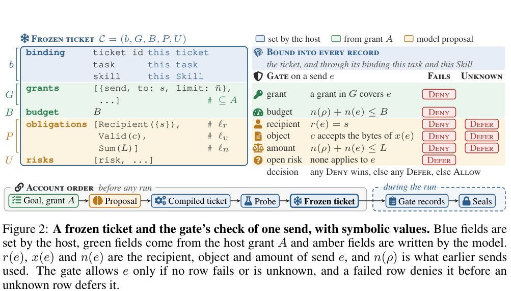

# RuntimeTickets: Source-Grounded Delivery Contracts Before Effects

<!-- source-sha256: 5b00948adf9bb0542e98df053cfe7028c1ab6925099a181503296520a390d8d4 -->

[简体中文](README.md)

> **Status:** CPU / L1 `component_only`, source-bound tickets and an atomic gate kernel. This is not a real network proxy, complete security product or unified Evolve operator. **Full experiments: not reproduced because of high cost; review DONE.**

## Paper Information

| Field | Value |
| --- | --- |
| Paper | [RuntimeTickets: Source-Grounded Security Obligations for Agent Skills](https://arxiv.org/abs/2611.03772); reviewed [v1](https://arxiv.org/html/2611.03772v1) |
| Institution | First author Kuiyi Gao, University of North Carolina at Chapel Hill; collaborators at MBZUAI / McGill University |
| First publication | 2026-11-02 17:31:13 UTC, arXiv v1; announced November 4 |
| Author code | No public attributable author repository found/confirmed. Referenced scanners, Skill datasets and agent frameworks are not the authors' RuntimeTickets implementation |
| Local adapter | None (`adapter: null`); component key: `runtime-tickets` |
| Local code | `src/auto_research/agent_research/runtime_tickets.py`; `tests/agent_research/test_nov04b_components.py` |

## Original Paper Summary

### Background and Main Changes

Permission to send does not authorize arbitrary recipients or payloads. The model proposes source-line-grounded obligations only before execution. After host approval, the ticket is frozen; a deterministic gate checks effects instead of asking an LLM again. Tickets can tighten, never expand, host authority. [Section 3, Algorithm 1](https://arxiv.org/html/2611.03772v1#S3)



<!-- paper-figure:start -->
### Key Original Figure

[](https://arxiv.org/pdf/2611.03772v1#page=4)

> **Original Figure 2:** cropped from PDF page 4 and visually inspected, retaining the original structure and caption. Image from the [original paper](https://arxiv.org/pdf/2611.03772v1). Copyright remains with the authors under CC BY 4.0.
<!-- paper-figure:end -->

### Core Equations

Delivery contract $\delta=(s,c,L)$ fixes recipient, object validator and cumulative amount:

$$
r(e)=s,\qquad c(x(e))=\top,\qquad n(\rho)+n(e)\le L.
$$

Check host authority first. Any failed obligation or exceeded budget yields Deny; otherwise unknown facts or unresolved risks yield Defer; only all-passing requests Allow. Record the decision before the effect. Only Allow consumes quota and forwards. The full paper's post-run decoder distinguishes Violated, Supported and Unknown; missing observations do not establish Supported.

### Reported Offline and Online Outcomes

The authors report 0% overlook and overkill using 60 malicious/benign Skill pairs, multiple framework-driver panels and a calibrated egress-reachable subset. Owned receivers and mock services are used: this is not zero risk on production Internet traffic or production A/B. Scope, calibration and denominators are in [Section 5 and Appendices A/D](https://arxiv.org/html/2611.03772v1#S5).

## Local Implementation

### Data Protocol and Boundaries

The host supplies a trusted contract, validator registry and audit key. Skill text is never executed: SHA256 binds it and each of three obligation references must match exact source lines. `compile_ticket` checks attenuation of host grants. `Gate` freezes the validator and checks authority, cumulative **byte** quota and three-valued decisions under a lock, writes an HMAC record, then invokes the host callback once.

Replayed request IDs do not resend; changing payload under the same ID is rejected. If a callback throws, delivery is unknown, quota remains spent and no automatic resend occurs. This is local at-most-once callback invocation, not a network exactly-once guarantee.

No LLM proposal, real host-probe execution, container/egress proxy, complete multi-issuer seal/closure or workspace witness is implemented. HMAC verifies content/order in the supplied local chain, not completeness of a truncated prefix, and never establishes the paper's Supported verdict. A trusted same-process caller can bypass the library; actual agent-attack prevention is not claimed.

### Local Results and Negative Controls

Diagnostics execute valid delivery, wrong-recipient and same-recipient invalid-object rejection, plus replay suppression. Tests add grant escalation, forged source lines, unknown validator outcomes, quota safety under 12 concurrent requests, log tampering and callback failure. The unified runner records measurements separately; no capability metrics or GPU receipts are invented.

```bash
PYTHONPATH=src python -c 'from auto_research.agent_research.runtime_tickets import diagnostic; print(diagnostic(42))'
python -m pytest tests/agent_research/test_nov04b_components.py
```

### High-Cost Full Experiments

Real multi-framework/driver execution, LLM proposals, malicious/benign calibration runs and independent network observation need a complete system and substantial model calls. The full matrix is **not reproduced because of high cost; review DONE** under one A100/A30 or a Mac. No model downloads or attack runs; kernel negative controls are not security-capability acceptance.

### Code Map

| Interface | Role |
| --- | --- |
| `SourceRef` / `compile_ticket` | Exact source lines and grant attenuation |
| `Ticket` / `Request` / `Gate.dispatch` | Frozen contracts, atomic pre-effect decisions and replay handling |
| `verify_records` | Local HMAC-chain checks, not a complete account decoder |
