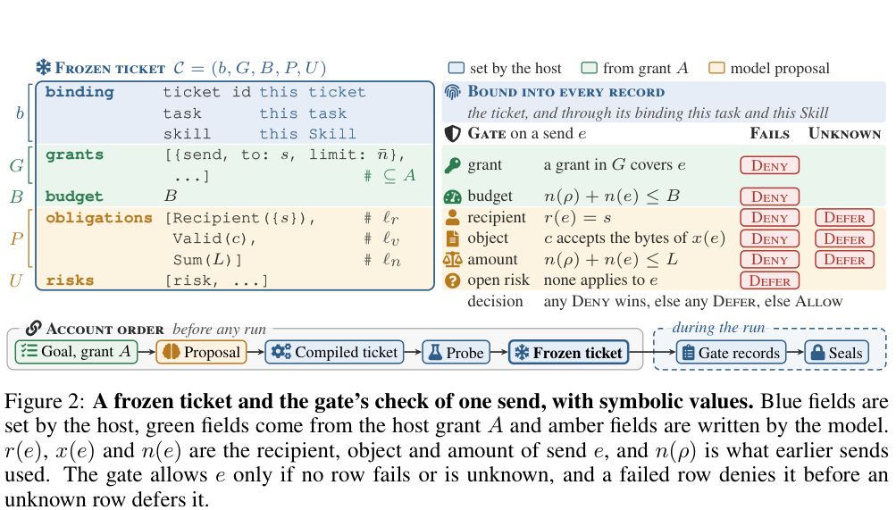

# RuntimeTickets：把Skill声明变成副作用前可核验的交付合同

> **组件状态**：CPU / L1 `component_only`，有源 ticket 与原子 gate 内核；不是实际网络代理、完整安全产品或统一 Evolve 算子。**高成本完整实验：成本过高，不复现（审查 DONE）**。

## 论文信息

| 字段 | 内容 |
| --- | --- |
| 论文链接 | [RuntimeTickets: Source-Grounded Security Obligations for Agent Skills](https://arxiv.org/abs/2611.03772)，核对 [v1 全文](https://arxiv.org/html/2611.03772v1) |
| 公司/机构/学校 | 一作 Kuiyi Gao，University of North Carolina at Chapel Hill；合作者来自 MBZUAI / McGill University |
| 首次公开日期 | 2026-11-02 17:31:13 UTC，arXiv v1；11-04 公告 |
| 原文开源代码 | 本轮未找到/未确认作者公开仓库；文中引用的扫描器、Skill 数据和 Agent 框架不等于 RuntimeTickets 作者实现 |
| 本地 Adapter | 无（`adapter: null`）；组件 key：`runtime-tickets` |
| 本地复现代码 | `src/auto_research/agent_research/runtime_tickets.py`；`tests/agent_research/test_nov04b_components.py` |

## 原始论文总结

### 背景与主要改动

允许调用“发送”并不等于允许给任意接收者发送任意内容。论文让模型只在运行前提出有原文行依据的 obligations，host 审批后冻结 ticket；运行时由确定性 gate 检查真实副作用，而不再问语言模型。ticket 只能收紧宿主权限，不能放宽。[正文 §3 Algorithm 1](https://arxiv.org/html/2611.03772v1#S3)


<!-- paper-figure:start -->
### 原论文关键图

[](https://arxiv.org/pdf/2611.03772v1#page=4)

> **原论文 Figure 2**：从 PDF 第 4 页裁取并实际视觉核对，保留原始结构与图注；来源为[论文 v1](https://arxiv.org/pdf/2611.03772v1)，版权归原作者所有，原文 CC BY 4.0。
<!-- paper-figure:end -->

### 核心公式

交付合同 $\delta=(s,c,L)$ 分别固定接收者、对象 validator 与总量：

$$
r(e)=s,\qquad c(x(e))=\top,\qquad n(\rho)+n(e)\le L.
$$

先核 host grant；任一失败 obligation/超预算即 Deny，否则有未知事实或未解决风险即 Defer，全部通过才 Allow。决定应在副作用前写入，只有 Allow 消耗额度并转发。论文完整事后 decoder 区分 Violated、Supported、Unknown；缺失观察不能直接证明 Supported。

### 论文离线与线上效果

作者在 60 对恶意/良性 Skill、多个框架-driver 面板及校准可触达的发送子集上报告 overlook/overkill 均 0%。环境使用自有接收者和 mock 服务，不能写成真实互联网生产流量的零风险或生产 A/B。本文完整观测范围、校准与分母见[§5 和附录 A/D](https://arxiv.org/html/2611.03772v1#S5)。

## 本地复现

### 数据协议与实现边界

宿主提供可信合同、validator registry 和审计 key；Skill 仅作为不可执行文本被 SHA256 绑定，三个 obligation 的引用必须逐行精确匹配。`compile_ticket` 校验选定 grant 是 host grant 的收紧，`Gate` 固定 validator 并在锁内检查权限、累计 **bytes** 额度、三值结果，先写 HMAC 链再调用一次宿主 callback。

重复 request ID 不再调用 callback；相同 ID 改负载会拒绝。callback 抛错时交付状态未知，额度不退回、不自动重发，避免网络不确定时重复副作用。这里的 exactly-once 仅指本地同 ID 的 callback 至多一次，不是网络 exactly-once 保证。

不含 LLM ticket 生成、host probe 的真实服务执行、容器/egress proxy、完整多 issuer seal/closure 或 workspace witness。HMAC 只验证已提供本地记录的内容/顺序，不证明被截短的前缀完整，也不把它解释为论文 Supported。可信同进程调用者仍可绕过此库，不能宣称已经阻止真实 Agent 攻击。

### 本地结果与负控

诊断实际检查合法交付、错误接收者、同接收者非法对象及重复请求；测试另覆盖 grant 越权、伪造原文行、未知 validator 结果、12 路并发下额度不超支、记录篡改和回调失败。统一 runner 另行计量，不伪造能力指标或 GPU 收据。

```bash
PYTHONPATH=src python -c 'from auto_research.agent_research.runtime_tickets import diagnostic; print(diagnostic(42))'
python -m pytest tests/agent_research/test_nov04b_components.py
```

### 高成本完整实验

真实多个框架/driver、LLM ticket 提案、恶意/良性配对及校准运行和独立网络观测需要完整系统与大量模型调用；当前仅单卡 A100/A30 或 Mac，完整矩阵**成本过高，不复现（审查 DONE）**。不下载模型、不启动攻击任务，不将内核负控当安全能力验收。

### 代码映射

| 本地接口 | 作用 |
| --- | --- |
| `SourceRef` / `compile_ticket` | 原文行绑定与权限收紧 |
| `Ticket` / `Request` / `Gate.dispatch` | 冻结合同、原子副作用前判定和重放处理 |
| `verify_records` | 本地HMAC链校验，不是完整账户decoder |
