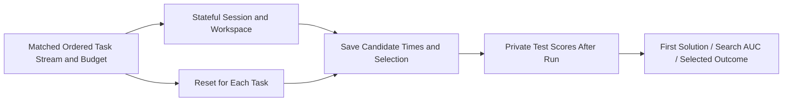
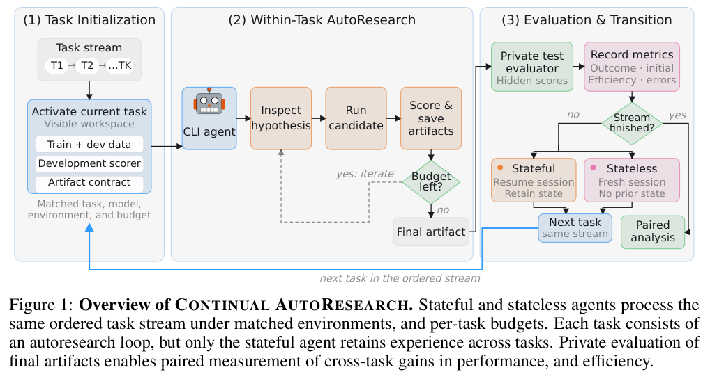

# Continual AutoResearch: Finding Solutions Earlier Is Not Selecting Better Final Solutions

<!-- source-sha256: c8cf62bc2d2bfd1c422c69c4d938637a720aead2aa0002c612a97b09edf8f04f -->

[简体中文](README.md)

> **Status:** CPU / L1 `component_only`, a post-run offline scorer and matching protocol. No autonomous research agent or unified Evolve integration was run. **Full experiments: not reproduced because of high cost; review DONE.**

## Paper Information

| Field | Value |
| --- | --- |
| Paper | [From AutoResearch to Continual AutoResearch: Do Agents Learn Across Tasks?](https://arxiv.org/abs/2611.05108); reviewed [v1](https://arxiv.org/html/2611.05108v1) |
| Institution | First author Jeremy Qin, RBC Borealis / ELLIS Institute Tübingen / Max Planck Institute for Intelligent Systems; work done during an RBC internship |
| First publication | 2026-11-03 16:02:34 UTC, arXiv v1; announced November 4 |
| Author code | No attributable author repository was found/confirmed. Citing karpathy/autoresearch does not release this paper's implementation |
| Local adapter | None (`adapter: null`); component key: `continual-autoresearch` |
| Local code | `src/auto_research/agent_research/continual_autoresearch.py`; `tests/agent_research/test_nov04b_components.py` |

## Original Paper Summary

### Background and Main Changes

Persistent sessions can reuse code and experience to find valid solutions earlier without improving the final held-out outcome. The paper compares stateful and reset agents under matched task streams, models, data and per-task budgets. It preserves the first valid submission, all candidates and the actual final selection; private tests evaluate them only after execution. Task 1 has no previous experience to transfer and is excluded from transfer gains. [Section 3](https://arxiv.org/html/2611.05108v1#S3)



<!-- paper-figure:start -->
### Key Original Figure

[](https://arxiv.org/pdf/2611.05108v1#page=2)

> **Original Figure 1:** cropped from PDF page 2 and visually inspected, preserving the original diagram and caption. Copyright remains with the authors under CC BY 4.0. Source: [paper v1](https://arxiv.org/pdf/2611.05108v1).
<!-- paper-figure:end -->

### Core Equations

Accuracy/F1 remain unchanged. RMSE is first normalized by the training-set channel standard deviation, then mapped to $1/(1+\mathrm{RMSE})$. $R^2$ maps to $1/(2-\min(R^2,1))$. With budget $B$, completion times $t_j$ and **post-run** hidden rewards $r_j$:

$$
U=\frac1B\int_0^B\max_{j:t_j\le t}r_j\,dt.
$$

The curve is zero before the first valid submission. Early termination carries the best value to the budget endpoint. Final outcome uses the agent's actual selection, not the evaluator's oracle-best candidate. Paired gains are stateful-minus-reset normalized reward points, averaged within each stream before averaging streams.

### Reported Offline and Online Outcomes

Search-efficiency gains are positive for all five evaluated models, but final gains differ: Table 2 reports +6.1 search points and -0.8 final points for GPT-5.6-Sol, versus +7.6 final points for Sonnet 4.6. Persistence affects initialization/efficiency; it does not universally improve final capability. No production online A/B is reported. [Section 5](https://arxiv.org/html/2611.05108v1#S5)

## Local Implementation

### Data Protocol and Boundaries

Only `ClosedRun(closed=True)` evaluator records are accepted. Candidates retain unique IDs, chronological completion times, validity flags and external private-test scores. Invalid candidates cannot carry hidden scores, and final selection must name a valid submission. Out-of-budget candidates and live runs are rejected. The scorer exposes no actor interface and runs no training; it cannot stop a caller leaking offline scores separately.

The RMSE interface handles one already-aggregated channel and requires a positive training SD. Multi-channel records must first follow the paper's normalization protocol; test statistics are not substitutes for training SD. No data is resplit and no synthetic model submissions are claimed.

### Local Results and Negative Controls

A contract example with budget 10, score 0.8 at time 2 and 0.5 at time 6, selecting the latter, gives initialization 0.8, search AUC 0.64, final outcome 0.5 and selection regret about 0.3. This only checks measurement semantics. Tests cover invalid submissions, a zero initial curve, time ordering, first-task exclusion, matching and equal stream weighting. No real research capability is measured.

```bash
PYTHONPATH=src python -c 'from auto_research.agent_research.continual_autoresearch import diagnostic; print(diagnostic(42))'
python -m pytest tests/agent_research/test_nov04b_components.py
```

### High-Cost Full Experiments

The paper covers nine task families, five frontier CLI agents and 32 transfer tasks per agent, with additional 15/30/60-minute budget studies and repeated paired runs. The complete real-research matrix exceeds the available single-device/local budget. **Not reproduced because of high cost; review DONE.** No automatic experiments or downloads. A CPU scorer is not a reproduction of agent learning capability.

### Code Map

| Interface | Role |
| --- | --- |
| `normalized_reward` | The paper's three reward transformations |
| `ClosedRun` / `score_run` | Post-run first, best-curve, selected outcome and regret |
| `paired_stream` / `family_balanced` | Matched transfer excluding Task 1; equal stream weighting |
