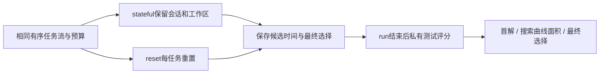
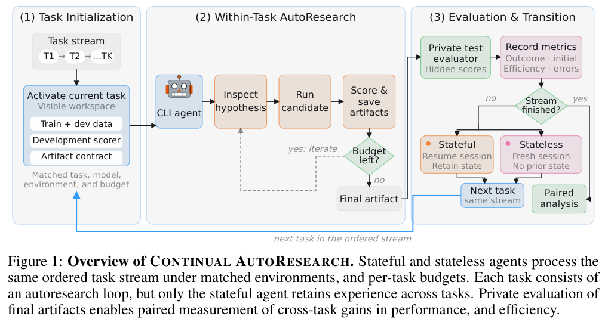

# Continual AutoResearch：把更早找到解与最终选得好分开测量

> **组件状态**：CPU / L1 `component_only`，运行后离线 scorer 与匹配协议；没有运行自主研究 Agent，也未接入统一 Evolve。**高成本完整实验：成本过高，不复现（审查 DONE）**。

## 论文信息

| 字段 | 内容 |
| --- | --- |
| 论文链接 | [From AutoResearch to Continual AutoResearch: Do Agents Learn Across Tasks?](https://arxiv.org/abs/2611.05108)，核对 [v1 全文](https://arxiv.org/html/2611.05108v1) |
| 公司/机构/学校 | 一作 Jeremy Qin，RBC Borealis / ELLIS Institute Tübingen / Max Planck Institute for Intelligent Systems，工作在 RBC 实习期间完成 |
| 首次公开日期 | 2026-11-03 16:02:34 UTC，arXiv v1；11-04 公告 |
| 原文开源代码 | 论文未给可确认作者源码仓库，本轮未找到/未确认公开代码；引用 karpathy/autoresearch 不等于本文实现已开源 |
| 本地 Adapter | 无（`adapter: null`）；组件 key：`continual-autoresearch` |
| 本地复现代码 | `src/auto_research/agent_research/continual_autoresearch.py`；`tests/agent_research/test_nov04b_components.py` |

## 原始论文总结

### 背景与主要改动

持续会话可能复用代码和经验，更快找到有效方案，但未必提高最终留出效果。论文在相同任务流、模型、数据和逐任务时间预算下比较 stateful 与 reset Agent；保留首个有效提交、所有提交及最终选择，完成后才由私有测试评价。第一任务没有历史可转移，不能计入跨任务增益。[正文 §3](https://arxiv.org/html/2611.05108v1#S3)



<!-- paper-figure:start -->
### 原论文关键图

[](https://arxiv.org/pdf/2611.05108v1#page=2)

> **原论文 Figure 1**：从原 PDF 第 2 页裁取并实际视觉核对，保留原图与图注；版权归原作者所有，原文 CC BY 4.0。来源为[论文 v1](https://arxiv.org/pdf/2611.05108v1)。
<!-- paper-figure:end -->

### 核心公式

Accuracy/F1 保持原值；RMSE 先以训练集 channel 标准差归一化，再映射为 $1/(1+\mathrm{RMSE})$；$R^2$ 映射为 $1/(2-\min(R^2,1))$。对预算 $B$、完成时刻 $t_j$ 和**运行后**隐测奖励 $r_j$：

$$
U=\frac1B\int_0^B\max_{j:t_j\le t}r_j\,dt.
$$

首个有效提交前曲线为零，提前停止则将已有最大值延续到预算末尾。最终分数来自 Agent 实际选择的候选，不是 evaluator 事后挑出的最好候选。配对增益为 stateful-minus-reset 的归一化百分点，先在任务流内平均，再平均任务流。

### 论文离线与线上效果

作者五个模型的搜索效率增益均为正，但最终增益不一致：Table 2 中 GPT-5.6-Sol 搜索增益 +6.1 点、最终 -0.8 点；Sonnet 4.6 最终 +7.6 点。它们支持“持久经验影响初始化/效率”，不能概括为持续研究一定提高最终能力。未报告生产线上 A/B。[正文 §5](https://arxiv.org/html/2611.05108v1#S5)

## 本地复现

### 数据协议与实现边界

只接收 `ClosedRun(closed=True)`，每个候选保留唯一 ID、单调完成时刻、valid 标记和外部私有测试分数。无效候选不能附隐藏分数，最终选择须为确实有效的提交；预算外候选和未结束记录被拒绝。scorer 不向 actor 提供接口，不运行训练，也无法防止调用者把离线分数另行泄露。

本地 RMSE 接口处理单个已汇总 channel，要求训练集 SD 为正；多 channel 数据应先遵循作者归一化协议再构造对应记录，不把测试统计当训练 SD。没有数据重切分、伪造模型提交或用最优候选替换最终选择。

### 本地结果与负控

合成合同例中，预算 10、时刻 2 得分 0.8、时刻 6 得分 0.5 且最终选后者，首解为 0.8、搜索面积为 0.64、最终为 0.5、选择遗憾约 0.3。它仅检验分数口径。测试覆盖无效提交、零起点、时间顺序、首任务排除、匹配合同和等权任务流聚合；没有真实研究能力测量。

```bash
PYTHONPATH=src python -c 'from auto_research.agent_research.continual_autoresearch import diagnostic; print(diagnostic(42))'
python -m pytest tests/agent_research/test_nov04b_components.py
```

### 高成本完整实验

原文覆盖九类任务、五个前沿 CLI Agent、每模型 32 个转移任务，另有 15/30/60 分钟预算及多次配对对照。重复执行完整真实研究矩阵超出当前单卡/本地预算，**成本过高，不复现（审查 DONE）**；不启动自动实验或资源下载，CPU scorer 不等于复现 Agent 学习能力。

### 代码映射

| 本地接口 | 作用 |
| --- | --- |
| `normalized_reward` | 原文三类归一化 |
| `ClosedRun` / `score_run` | 运行后首解、最优曲线、实际最终选择与遗憾 |
| `paired_stream` / `family_balanced` | 排除首任务的匹配增益和任务流等权 |
