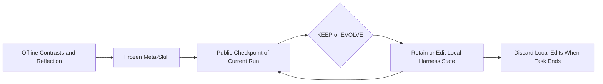
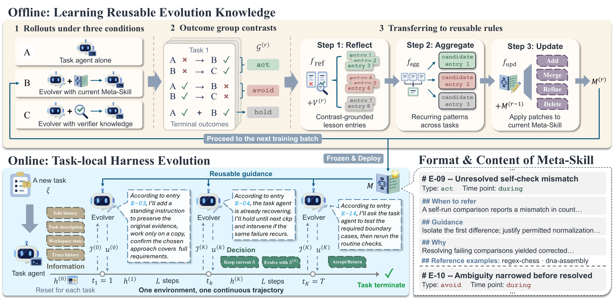

# Meta²: Frozen Evolution Knowledge and Run-Local Edits

<!-- source-sha256: 8aa494ae6aabf5476345a15f97b6c1dda0be3e4dca24503070f8fe60e1b45095 -->

[简体中文](README.md)

> **Status:** CPU / L1 `component_only`. This implements deployment state and feedback interfaces, not Meta-Skill training, an agent, or a capability operator in unified Evolve. **Full experiments: not reproduced because of high cost; review DONE.**

## Paper Information

| Field | Value |
| --- | --- |
| Paper | [Meta²: Precomputing Reusable Knowledge for Online Harness Evolution in Long-Horizon Agents](https://arxiv.org/abs/2611.05139); reviewed [v1](https://arxiv.org/html/2611.05139v1) |
| Institution | First author Lingzhi Yuan, University of Maryland; collaborators include UW, UIUC and Scale AI. **Meta² is a method name, not a paper from Meta the company** |
| First publication | 2026-11-03 16:19:21 UTC, arXiv v1; the November 4 announcement is not its first-publication date |
| Author code | The paper provides a [project page](https://meta-square.github.io/), but an attributable author source repository could not be confirmed this round; public code not found/confirmed |
| Local adapter | None (`adapter: null`); component key: `meta-square` |
| Local code | `src/auto_research/agent_research/meta_square.py`; `tests/agent_research/test_nov04b_components.py` |

## Original Paper Summary

### Background and Main Changes

A shared harness need not fit every new task, while unguided online changes can disrupt ongoing progress. Offline, Meta² contrasts a task agent without an evolver, with an ordinary evolver, and with an evolver given verifier information **only during training**. Reflection, aggregation and updates produce a reusable Meta-Skill. Deployment freezes it and chooses KEEP or EVOLVE at checkpoints; edits affect only the remainder of the current run without resetting the environment. [Section 3 and Appendix B](https://arxiv.org/html/2611.05139v1#S3)



<!-- paper-figure:start -->
### Key Original Figure

[](https://arxiv.org/html/2611.05139v1/main-figure_v2.png)

> **Original Figure 2:** the authors' original image, visually inspected. Source: [paper v1](https://arxiv.org/html/2611.05139v1). Copyright remains with the authors under CC BY-NC-ND 4.0. The redraw above is not presented as this original.
<!-- paper-figure:end -->

### Core Equations

$$
u^{(k)}\in\{\operatorname{KEEP},\operatorname{EVOLVE}(\delta^{(k)})\},\qquad
h^{(k)}=\operatorname{Apply}(h^{(k-1)},\delta^{(k)}).
$$

KEEP is a null edit. Online evidence consists only of the task, the public trajectory so far, permitted workspace observations and previous-edit status, not the held-out final verifier. Terminal EVOLVE returns work to the **same run**; terminal KEEP accepts completion. Training A/B/C contrasts provide whole-trajectory directional evidence, not the causal effect of one edit.

### Reported Offline and Online Outcomes

The paper reports 81.00% on Terminal-Bench 2.1 and 44.44% on DeepSWE 1.1 with GPT-5.6-Terra. These are author benchmark results, not local measurements. No production online A/B is reported. [Abstract and experiments](https://arxiv.org/abs/2611.05139)

## Local Implementation

### Data Protocol and Boundaries

`MetaSkill` stores externally reviewed text and training-task IDs. `DeploymentRun` rejects training/deployment task overlap and accepts an exact whitelist of public checkpoint fields. `Checkpoint` has no verifier, gold or hidden-score field. Immutable `Edit` objects declare bounded notice/instruction/hook/tool channels; the module executes no supplied text or code.

This is a host interface, not an information-flow sandbox. The caller must not paste secrets into supposedly public text, and Python objects cannot isolate malicious code in the same process. The component neither learns the supplied skill nor determines which intervention improves capability. An unchanged environment ID describes continuation; it does not simulate a real terminal environment.

### Local Results and Negative Controls

`diagnostic(seed, device='cpu')` executes terminal-EVOLVE continuation, terminal-KEEP closure, cross-task edit clearing and unknown-feedback-field rejection. Tests cover accumulated history, frozen knowledge, task overlap and atomic rejection of oversized edits. These are state contracts, not agent success rates. The unified runner records this batch's measurements separately; no results are handwritten here.

```bash
PYTHONPATH=src python -c 'from auto_research.agent_research.meta_square import diagnostic; print(diagnostic(42))'
python -m pytest tests/agent_research/test_nov04b_components.py
```

### High-Cost Full Experiments

The full configuration requires frontier agent/evolver A/B/C rollouts, offline reflection and aggregation, repeated checkpoints, two long-horizon suites and multiple baselines. Based on that published configuration, it exceeds the low-cost window of one A100/A30 or a Mac. **Not reproduced because of high cost; review DONE.** No downloads, trial runs or automatic retries. No learned Meta-Skill, capability result or Evolve promotion is claimed.

### Code Map

| Interface | Role |
| --- | --- |
| `MetaSkill` / `Edit` | Frozen knowledge and bounded edit declarations |
| `DeploymentRun.checkpoint` | Public-history accumulation, KEEP/EVOLVE and terminal state |
| `diagnostic` | CPU mechanism negative controls, not capability evaluation |
