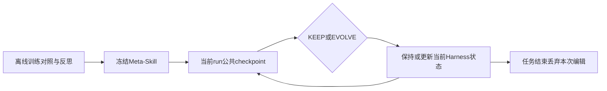
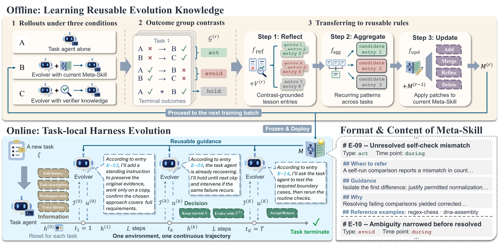

# Meta²：冻结演化知识，限制运行中编辑的生命周期

> **组件状态**：CPU / L1 `component_only`。这里只实现部署状态与反馈接口，不训练 Meta-Skill、不调用 Agent，也不是统一 Evolve 的能力算子。**高成本完整实验：成本过高，不复现（审查 DONE）**。

## 论文信息

| 字段 | 内容 |
| --- | --- |
| 论文链接 | [Meta²: Precomputing Reusable Knowledge for Online Harness Evolution in Long-Horizon Agents](https://arxiv.org/abs/2611.05139)，核对 [v1 全文](https://arxiv.org/html/2611.05139v1) |
| 公司/机构/学校 | 一作 Lingzhi Yuan，University of Maryland；合作署名包括 UW、UIUC、Scale AI。**Meta² 是方法名，不是 Meta 公司论文** |
| 首次公开日期 | 2026-11-03 16:19:21 UTC，arXiv v1；11-04 公告不是首次日期 |
| 原文开源代码 | 正文给出[项目页](https://meta-square.github.io/)，本轮未能取得可确认作者源码仓库；代码未找到/未确认公开 |
| 本地 Adapter | 无（`adapter: null`）；组件 key：`meta-square` |
| 本地复现代码 | `src/auto_research/agent_research/meta_square.py`；`tests/agent_research/test_nov04b_components.py` |

## 原始论文总结

### 背景与主要改动

一个共享 Harness 不一定适合所有新任务，而毫无经验的在线修改又可能扰乱仍在推进的执行。Meta² 离线对照无演化器、普通演化器和获得**训练期** verifier 信息的演化器，用反思、聚合和更新构建可复用 Meta-Skill。部署时冻结这份知识，在 checkpoint 选择 KEEP 或 EVOLVE，编辑只影响当前任务余下轨迹，不重置环境。[正文 §3、附录 B](https://arxiv.org/html/2611.05139v1#S3)



<!-- paper-figure:start -->
### 原论文关键图

[](https://arxiv.org/html/2611.05139v1/main-figure_v2.png)

> **原论文 Figure 2**：原作者发布的原图，已视觉核对；来源为[论文 v1](https://arxiv.org/html/2611.05139v1)，版权归原作者所有，遵守原文 CC BY-NC-ND 4.0，不把流程重绘冒充原图。
<!-- paper-figure:end -->

### 核心公式

$$
u^{(k)}\in\{\operatorname{KEEP},\operatorname{EVOLVE}(\delta^{(k)})\},\qquad
h^{(k)}=\operatorname{Apply}(h^{(k-1)},\delta^{(k)}).
$$

KEEP 是空编辑。在线输入仅含任务、截至当前的公共轨迹、允许的工作区观察和前次编辑状态；留出任务最终 verifier 不能作为演化器输入。终点 EVOLVE 仍回到**同一 run** 继续工作，终点 KEEP 才接受结束。训练 A/B/C 对照是整条轨迹的方向证据，不证明单次编辑的因果作用。

### 论文离线与线上效果

原文报告 GPT-5.6-Terra 在 Terminal-Bench 2.1 / DeepSWE 1.1 为 81.00% / 44.44%。这些是作者基准结果，不是本地测量；未报告生产线上 A/B。[摘要与实验](https://arxiv.org/abs/2611.05139)

## 本地复现

### 数据协议与实现边界

`MetaSkill` 保存外部已审文本和训练任务 ID；`DeploymentRun` 拒绝训练/部署任务重叠，按严格字段白名单接收公共 checkpoint。`Checkpoint` 不包含 verifier、gold 或 hidden score 字段；编辑是不可变 `Edit`，只允许 notice/instruction/hook/tool 四种声明通道及有界文本。模块不执行这些文本或代码。

这是宿主接口，不是信息流沙箱：调用者仍须保证传入的“公共文本”没有粘贴秘密，Python 对象也不能隔离恶意同进程代码。组件不判断何时演化更好，不将外部给定知识说成已训练成果。环境 ID 在同一 run 内保持不变，仅描述续跑合同，不假装已经运行真实终端环境。

### 本地结果与负控

`diagnostic(seed, device='cpu')` 实际执行终点 EVOLVE 继续、终点 KEEP 关闭、跨任务清空编辑和未知反馈字段拒绝。测试还覆盖累计轨迹、冻结知识、重叠任务和超长编辑的原子拒绝。这些是状态契约，不是 Agent 成功率；本轮独立计量由统一 runner 记录，不在此手写结果。

```bash
PYTHONPATH=src python -c 'from auto_research.agent_research.meta_square import diagnostic; print(diagnostic(42))'
python -m pytest tests/agent_research/test_nov04b_components.py
```

### 高成本完整实验

原配置包含前沿 Agent/Evolver 的离线 A/B/C 轨迹、反思聚合、多轮 checkpoint，以及两套长程任务和多方法对照。基于公开配置判断，该完整矩阵超出单卡 A100/A30 或 Mac 的低成本窗口；**成本过高，不复现（审查 DONE）**，不下载模型、不试跑、不自动重试。这里没有学习 Meta-Skill、模型能力结果或 Evolve 晋级资格。

### 代码映射

| 本地接口 | 作用 |
| --- | --- |
| `MetaSkill` / `Edit` | 冻结知识与有界编辑声明 |
| `DeploymentRun.checkpoint` | 公共观察累积、KEEP/EVOLVE及终点状态 |
| `diagnostic` | CPU机制负控，非能力评测 |
