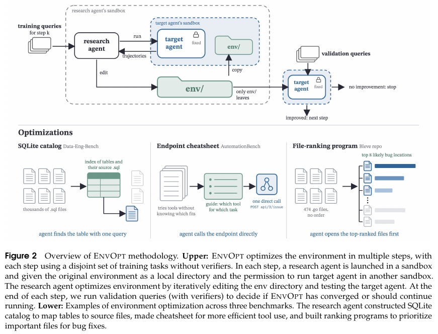

<!-- source-sha256: d8b536710de4a590c4026908eebe5e3abefc24ea1b7d190f1d094378aa84bdee -->

# EnvOpt: evolve the environment while holding the model and harness fixed

[简体中文](README.md)

> **Scope:** CPU-only L1 replay of the acceptance and rollback rules in Algorithm 1. No agent, API or live workspace is run; no cost improvement is measured and Evolve does not use the component. The full experiment is not reproduced due to cost (review DONE).

## Paper information

| Field | Value |
| --- | --- |
| Paper | [EnvOpt: Automated Optimization for Agent Environments](https://arxiv.org/abs/2611.07372v1), [fixed v1 text](https://arxiv.org/pdf/2611.07372v1) |
| Affiliation | First author Mingxuan Li; UC Berkeley, University of Chicago and Bespoke Labs |
| First public date | 2026-11-05 03:16:52 UTC, arXiv v1; announced November 6 |
| Author code | [Author repository](https://github.com/itea1001/EnvOpt) publishes AutomationBench environment artifacts; these are not the complete training implementations for all five settings |
| Local adapter | None (`adapter: null`); component key `envopt` |
| Local code | `src/auto_research/agent_research/envopt.py`; `tests/agent_research/test_nov06_envopt.py` |

## Paper summary

### Motivation and method

A stable workspace can support many queries. EnvOpt holds the target model and harness fixed and has a research agent improve access to the same information, for example by indexing scattered table definitions in SQLite or making a guide to existing endpoints. It changes the environment directory, not the model weights or a separate workflow for every task. The research agent observes trajectories on disjoint training shards without verifiers. Separate validation then measures the environment candidate; test tasks are not used for selection.

### Original figure



Figure 2 and its caption are cropped from page 3 of the [original paper](https://arxiv.org/pdf/2611.07372v1#page=3) and checked visually. Copyright remains with the authors; the paper is CC BY 4.0.

### Core formulas

For fixed information $I$ and target agent $T$, optimize the representation $E(I)$ to lower expected task cost. Algorithm 1's inner loop accepts a candidate only if it **strictly reduces cost** relative to the currently accepted version and the research agent judges quality preserved through proxies or answer consistency. This judgment is not an external gold answer.

The outer loop measures aggregate cost $c_k$ and accuracy $a_k$ on a fixed validation set. It stops and retains version $k-1$ if $c_k > c_{k-1}$ or $a_k < a_{k-1}-\delta$. Equal cost and accuracy exactly on the tolerance boundary do not cause rollback. See Section 2, Algorithm 1.

### Reported results

On AutomationBench the authors report a 72.7% cost reduction for Haiku 4.5 and an increase in pass rate from 2.33% to 16.67% (+14.34 percentage points, Table 2). An environment can transfer to other models and complement Meta-Harness. Proxy judgments can also fail: answer length alone can admit changes that degrade quality. These are published benchmark results, not local measurements or production A/B outcomes.

## Local reproduction

### Data protocol and implementation boundary

`select_training_environment` sees recorded candidate costs and proxy decisions, not validation scores, gold answers or test access. `replay_environment_evolution` checks that training IDs are disjoint across shards and from validation, the declared harness matches, and validation aggregates are bound to the training-selected environment. It stops at the first regression and retains the previous environment.

Inputs are completed, externally budgeted records. Identifier checks are not process isolation. This module does not execute agents, inspect environment directories, authenticate supplied measurements or enforce the original execution budget. A trusted host must still isolate validation, test and agent-visible data.

### Local checks and negative controls

In the synthetic replay, an equal-cost proposal and a cheaper proposal with a failed proxy are rejected. The second step passes training's proxy but exceeds the permitted validation accuracy drop, so the first version is retained. Tests also cover harness changes, split overlap, misbound validation, cost regression and equality at the tolerance boundary. These are rule checks, not measurements of agent effectiveness.

```bash
PYTHONPATH=src python -c 'from auto_research.agent_research.envopt import diagnostic; print(diagnostic(42))'
python -m pytest tests/agent_research/test_nov06_envopt.py
```

### High-cost full experiment

Table 3 reports 3.7–25.4 hours and USD 33.08–339.44 per optimization setting across five settings, including real API and target-agent runs. A full rerun additionally needs real workspace or repository environments and multi-model validation and held-out evaluation. One A100/A30 or a Mac does not replace the services. **Not reproduced due to cost (review DONE)**; no downloads, API calls or automatic retries.
