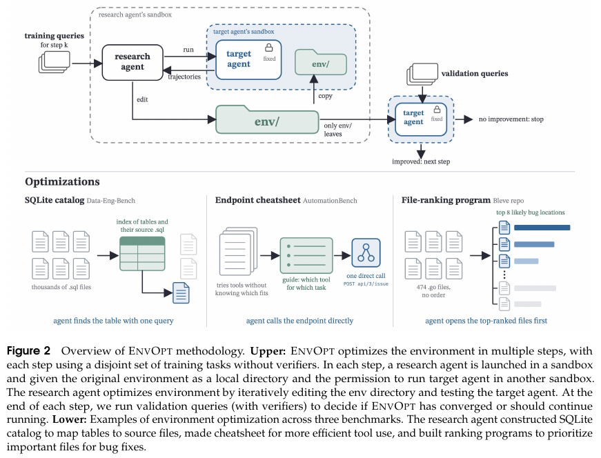

# EnvOpt：固定模型和 Harness，演进环境表示

> **实现边界**：CPU / L1，离线回放论文 Algorithm 1 的接受与回滚规则。没有运行 Agent、API 或真实工作区，没有验证成本收益，也没有接入 Evolve。完整实验成本过高，不复现（审查 DONE）。

## 论文信息

| 字段 | 内容 |
| --- | --- |
| 论文链接 | [EnvOpt: Automated Optimization for Agent Environments](https://arxiv.org/abs/2611.07372v1)，[固定 v1 正文](https://arxiv.org/pdf/2611.07372v1) |
| 公司/机构/学校 | 一作 Mingxuan Li；UC Berkeley、University of Chicago、Bespoke Labs |
| 首次公开日期 | 2026-11-05 03:16:52 UTC，arXiv v1；11-06 公告 |
| 原文开源代码 | [作者仓库](https://github.com/itea1001/EnvOpt) 公开 AutomationBench 环境产物；不将这批产物等同于完整五组训练实现 |
| 本地 Adapter | 无（`adapter: null`）；组件 key：`envopt` |
| 本地复现代码 | `src/auto_research/agent_research/envopt.py`；`tests/agent_research/test_nov06_envopt.py` |

## 原始论文总结

### 背景与主要改动

长期稳定的工作环境可以承载多类查询。EnvOpt 固定目标模型与 Harness，让研究 Agent 改变同一信息的可访问表示，例如用 SQLite 目录索引散落的表定义，或为既有接口写索引手册。优化对象是环境目录，不是底座权重，也不是每个任务重写一份工作流程。研究 Agent 在不相交的训练分片上读取目标 Agent 轨迹，训练不提供 verifier；验证阶段才独立度量候选环境，测试任务不参与选择。

<!-- paper-figure:start -->
### 原论文关键图



图片来自[原论文](https://arxiv.org/pdf/2611.07372v1#page=3) Figure 2，裁取 PDF 第 3 页原图与图注并核对可读性；版权归原作者所有，原文 CC BY 4.0。
<!-- paper-figure:end -->

### 核心公式

对固定信息 $I$ 和目标 Agent $T$，优化环境表示 $E(I)$，使任务分布上 $T$ 的期望运行成本下降。Algorithm 1 内层只在候选相对当前接受版本**成本严格下降**且研究 Agent 通过代理或答案一致性判断效果保持时接受；该判断不是外部金标。

外层用固定验证集得到第 $k$ 轮聚合成本 $c_k$ 与准确率 $a_k$。若 $c_k > c_{k-1}$ 或 $a_k < a_{k-1}-\delta$，即停止并保留第 $k-1$ 轮。成本相等、准确率恰好到容差边界都不触发回退。参考论文 §2 Algorithm 1。

### 论文离线与线上效果

作者在 AutomationBench 报告 Haiku 4.5 成本降低 72.7%，通过率从 2.33% 增至 16.67%（+14.34 个百分点，Table 2）。同一环境可迁移给不同模型，并与 Meta-Harness 叠加。也出现代理指标误判：只检查答案长度可能接受质量退化的改动。结果来自作者的基准实验，不是本地测量，也不是线上生产 A/B。

## 本地复现

### 数据协议与实现边界

`select_training_environment` 仅接收已记录的候选成本与代理判断，没有验证分数、真实答案或测试接口。外层 `replay_environment_evolution` 检查训练 ID 分片互斥且与验证 ID 不重叠、候选 Harness 标识一致、验证聚合绑定训练选定环境，并在首次回归时回放停止及回滚。

这里输入的是**已完成、受预算约束的记录**。固定 ID 不是进程沙箱：接口不执行真实调用、不检查环境目录内容、不验证提交者的成本或保真判断，也不复刻论文的预算执行器。生产运行仍需由可信宿主隔离验证、测试和 Agent 可见数据。

### 本地结果与负控

合成轨迹中，等成本候选与更便宜但代理失败的候选不被接受；第二轮的训练代理虽然放行，验证准确率降超容差，故停在第一轮。测试另覆盖 Harness 替换、分片重叠、验证结果错绑、成本回归及容差恰等。它只证明规则在这些输入上的行为，不是 Agent 效果。

```bash
PYTHONPATH=src python -c 'from auto_research.agent_research.envopt import diagnostic; print(diagnostic(42))'
python -m pytest tests/agent_research/test_nov06_envopt.py
```

### 高成本完整实验

论文 Table 3 的五个优化场景分别用 3.7–25.4 小时、33.08–339.44 美元的真实 API 与目标 Agent 执行（单场景总量）。完整重复还需真实工作区/仓库以及多模型验证和留出测试，单张 A100/A30 或本地 Mac 不替代所需服务。**成本过高，不复现（审查 DONE）**；不下载资源、不调用 API、不自动重试。
