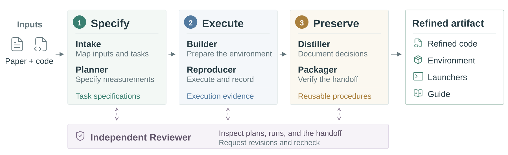
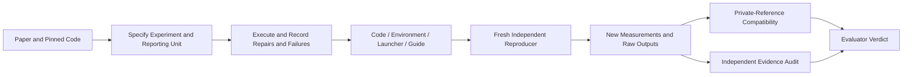

# ReproBridge: Preserving Reproduction Knowledge as Auditable Artifacts

<!-- source-sha256: 504ab8b476ae88cb371d3d81ee738137ade332ebbf08639aea08fb9fd204a3f4 -->

[简体中文](README.md)

> `component_only`, CPU / L1 evaluator-side mechanism. No LLM Reproducer or semantic Auditor. Full experiments are **not reproduced because of high cost; review DONE**. This is a newly discovered omission, not a November 11 first release.

## Paper Information

| Field | Value |
| --- | --- |
| Paper | [ReproBridge: Building Reproducibility into ML Research Artifacts](https://arxiv.org/abs/2611.08452); reviewed [v1](https://arxiv.org/html/2611.08452v1) |
| Company / institution / university | First author Yubo Wang, University of Waterloo / Google; other authors at Google |
| First public release | 2026-11-05 18:45:36 UTC, arXiv v1; November 6 in Shanghai |
| Author source code | The [author project](https://wyyyb.github.io/reprobridge_website/) states that code and data remain under internal review; no released author repository found |
| Local adapter | None (`adapter: null`); component key `reprobridge` |
| Local code | `src/auto_research/agent_research/reprobridge.py`; `tests/agent_research/test_nov11_priority.py` |

## Original Paper Summary

<!-- paper-figure:start -->
### Key Figure from the Paper



Source: [v1 Figure 2](https://arxiv.org/html/2611.08452v1#S3.F2), rasterized from the authors' original SVG, not redrawn. The full construction and review agents belong to the paper's system; the local component implements evaluator-side statistics and evidence contracts only.

Image from the [original paper](https://arxiv.org/html/2611.08452v1/construction_overview.svg); copyright belongs to its authors. Full-system or experimental results shown are not local component results.

<!-- paper-figure:end -->

### Background and Main Changes

ReproBridge preserves recovered execution knowledge in four components: code, environment, launchers, and a guide. Construction, independent reproduction, and retrospective auditing use separate contexts. Matching a target score does not establish procedural fidelity; repetition does not remove systematic execution bias. [Sections 2–3](https://arxiv.org/html/2611.08452v1#S2)



### Core Equation

For five independently verified reference observations:

$$
I^{(q)}=[\bar x-r,\bar x+r],\quad
r=\max\{t_{(1+q)/2,4}s\sqrt{1+1/5},\;0.01|\bar x|\}.
$$

This is a prediction interval for a new observation, not a confidence interval for the mean. Default coverage is 0.95; 0.80 supplies a stricter check. Better-but-outside results remain incompatible. An integrity violation requires localized evidence, material effect, and unsuccessful refutation, not suspicion alone. [Equation 1 and Section 4.1](https://arxiv.org/html/2611.08452v1#S4.SS1)

### Reported Offline and Online Outcomes

Across 1,029 tasks, 387 experiments, 36 papers, and four models, the authors report mean success increasing from 76.4% to 92.6% and downstream API spending decreasing by 19.7%. These are offline author results, not local measurements or production A/B evidence. Reference observations remain hidden from evaluated sessions.

## Local Component and Boundaries

### Run

```bash
python -m pip install -e '.[research-components]'
PYTHONPATH=src python -c 'from auto_research.agent_research.reprobridge import diagnostic; print(diagnostic(seed=42))'
PYTHONPATH=src python -m pytest -q tests/agent_research/test_nov11_priority.py
```

### Data Protocol and Code Mapping

`ActorTask` contains public experimental instructions, not reference values, thresholds, or successful answers. Only the independent evaluator holds `Reference`. `Artifact` checks SHA256 digests for four distinct files. `read_measurement` checks pinned code identity, script/environment/output bytes, output modification time within the declared execution window, and a finite scalar at an explicit JSON location.

These mechanical checks cannot authenticate actual shell execution, script semantics, or an executor-controlled clock. The external independent audit must supply `Finding` records with the five eligible categories, localized evidence, materiality, and refutation status. The module does not substitute regexes, file existence, or numerical agreement for semantic auditing. Published target scores are not copied into the actor interface.

### Local Results and Negative Controls

The [three-seed artifact](metrics/component-cpu-seeds42-44.json) executes the same synthetic truth table, not three independent task samples. References `(0.98,0.99,1,1.01,1.02)` yield approximately `[0.95191,1.04809]`: 1 is compatible, while 10 is outside even if interpreted as better. A substantiated copied measurement is invalidated; an uncertain finding is not automatically an integrity violation. Tests also cover stale outputs, changed bytes, escaping symlinks, wrong commits/JSON locations, and actor information isolation. No reproduction-capability success rate or Evolve promotion is claimed.

### High-Cost Full Experiments

Section 4.1 allows 24 hours per paper/model/condition and uses 8×H100-80GB for GPU experiments. Section E.1 reports USD 5,026 in construction API spending alone, excluding GPU execution, independent auditing, and human reference development. The complete matrix is unsuitable for one A100/A30 or a local Mac: **not reproduced because of high cost; review DONE**. No API calls, large downloads, or complete training were launched.
