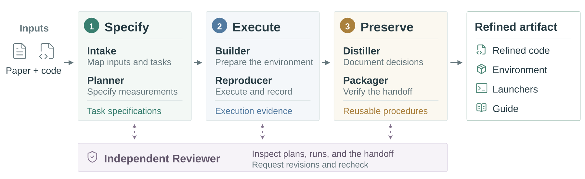
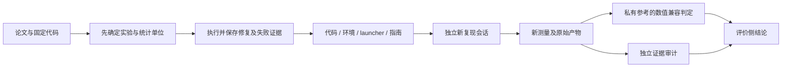

# ReproBridge：把复现经验保存成可核验产物

> `component_only`，CPU / L1 评价侧机制；没有 LLM Reproducer 或语义 Auditor。完整实验**成本过高，不复现（审查 DONE）**。这是 11 月发现的补漏，不是 11 月 11 日首发。

## 论文信息

| 字段 | 内容 |
| --- | --- |
| 论文链接 | [ReproBridge: Building Reproducibility into ML Research Artifacts](https://arxiv.org/abs/2611.08452)，核对 [v1 正文](https://arxiv.org/html/2611.08452v1) |
| 公司/机构/学校 | 一作 Yubo Wang，University of Waterloo / Google；其余作者为 Google |
| 首次公开日期 | 2026-11-05 18:45:36 UTC，arXiv v1；上海时间 11 月 6 日 |
| 原文开源代码 | [作者项目页](https://wyyyb.github.io/reprobridge_website/)明确 Code / Dataset 仍在内部审查，尚未公开；未找到已发布作者仓库 |
| 本地 Adapter | 无（`adapter: null`）；组件 key：`reprobridge` |
| 本地复现代码 | `src/auto_research/agent_research/reprobridge.py`；`tests/agent_research/test_nov11_priority.py` |

## 原始论文总结

<!-- paper-figure:start -->
### 原论文关键图



来源：[v1 Figure 2](https://arxiv.org/html/2611.08452v1#S3.F2)，由作者原始 SVG 栅格化，未重绘。图中完整构建/审查 Agent 属于论文系统；本地仅实现评价侧统计与证据合同。

图片来自[原论文](https://arxiv.org/html/2611.08452v1/construction_overview.svg)，版权归原作者所有；图中完整系统或实验结果不等于本地组件结果。

<!-- paper-figure:end -->

### 背景与主要改动

论文和代码之间常缺环境、启动方式、统计单位及修复理由。ReproBridge 将已恢复的执行知识保存为四件套：代码、环境、launcher、复现指南；构建、独立复现和事后审计使用不同上下文。分数接近目标并不证明做了同一实验，重复运行也不能消除系统性的程序偏差。[§2–3](https://arxiv.org/html/2611.08452v1#S2)



### 核心公式

五个经独立核验的参考观测为 $x_1,\dots,x_5$，新测量的双侧兼容区间为

$$
I^{(q)}=[\bar x-r,\bar x+r],\quad
r=\max\{t_{(1+q)/2,4}s\sqrt{1+1/5},\;0.01|\bar x|\}.
$$

这是**新观测的预测区间**，不是参考均值置信区间。默认 $q=0.95$，严格检查用 $0.80$；即使新结果更优，越界仍不算复现兼容。成功还要求未被独立审计认定存在有局部证据、实质影响且反驳失败的违规。数值不符、猜疑和未定审计不能直接当造假。[Eq.1、§4.1](https://arxiv.org/html/2611.08452v1#S4.SS1)

### 论文离线与线上效果

作者在 36 篇论文、387 个实验、1,029 个任务和四个模型上报告平均复现成功率 76.4%→92.6%，下游 API 费用平均降低 19.7%。这些是作者的离线结果；未报告生产用户 A/B，也不是本地实测。五个参考值始终与被评价会话隔离。

## 本地复现与边界

### 一键运行

```bash
python -m pip install -e '.[research-components]'
PYTHONPATH=src python -c 'from auto_research.agent_research.reprobridge import diagnostic; print(diagnostic(seed=42))'
PYTHONPATH=src python -m pytest -q tests/agent_research/test_nov11_priority.py
```

### 数据协议与代码映射

`ActorTask` 只有公开实验说明，不含参考值、兼容阈值或成功答案；`Reference` 仅由独立评价者持有。`Artifact` 检查四种不同文件的 SHA256。`read_measurement` 检查固定代码身份、脚本/环境/结果文件字节、输出修改时间与执行区间，并从显式 JSON 位置读取有限标量。

这些是**机械证据检查**，不能证明执行器真的运行了脚本、脚本语义正确或执行器自己的时钟可信。`Finding` 的五类违规、局部证据、实质影响和反驳状态必须由外层独立审计提供；本模块没有用正则、文件存在或相近分数伪造语义审计。论文可见的目标分数也没有被复制进 actor 接口。

### 本地结果与负控

[三 seed 归档](metrics/component-cpu-seeds42-44.json)实际执行相同的合成数值真值表，不代表三个独立任务样本。参考值 `(0.98,0.99,1,1.01,1.02)` 得到约 `[0.95191,1.04809]`：1 兼容，10 即使被解释为“更优”也越界；已证实复制测量被否决，未定审计不自动判违规。额外测试检查旧结果、字节篡改、目录外 symlink、错误 commit / JSON 路径，以及 actor 信息隔离。没有复现能力成功率，没有 Evolve 晋级。

### 高成本完整实验

原文 §4.1 对每篇论文/模型/条件给 24 小时，GPU 实验用 8×H100-80GB；§E.1 仅构建 36 个产物就报告 5,026 美元 API 费用，另不含 GPU、独立审计和人工参考开发。单卡 A100/A30 或 Mac 不适合完整矩阵。**成本过高，不复现（审查 DONE）**；未启动 API、大资源下载或完整训练。
