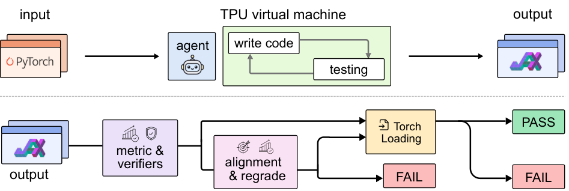

<!-- source-sha256: 51d91541689c57e382cc9191be913e8284207a8e950eab0ba6f4f1eb6d8c9574 -->

# XStack: verifying cross-framework migration by clean reruns and weight loading

[简体中文](README.md)

> **Reference only:** not reproduced due to cost (review DONE). No migration, task-data download, local metrics or GPU receipt.

## Paper information

| Field | Value |
| --- | --- |
| Paper | [XStack: A Benchmark for ML Repo Migration](https://arxiv.org/abs/2611.08472v1), [fixed v1 text](https://arxiv.org/html/2611.08472v1) |
| Affiliation | First author Linrong Cai; Princeton University. Using Google TPUs does not imply Google authorship |
| First public date | 2026-11-05 18:55:54 UTC, arXiv v1; announced November 6 |
| Author code | [Public author repository](https://github.com/zlab-princeton/XStack) with tasks, harness, judges and dataset links |
| Local adapter | None (`adapter: null`); catalog key `xstack` |
| Local code | None; review and bilingual learning material only |

## Paper summary

### Motivation and method

Correct local tensor translations do not establish that the complete experiment migrates. XStack pins the source commits of 20 PyTorch repositories and asks agents to deliver JAX migrations on TPUs, including separate setup, training/evaluation and PyTorch export entry points. A fresh machine reruns the full-scale experiment. The fourteen domains include language models, recommendation, vision and reinforcement learning. Appendix H also shows that a successful headline path need not preserve every feature of a library.

### Original figure

Original Figure 2 PNG from the [paper](https://arxiv.org/html/2611.08472v1#S2.F2), visually checked without redrawing. Copyright remains with the authors; the paper is CC BY 4.0.

### Evaluation protocol

A pass requires a full-scale run that reaches an independent target, acceptance by both correctness and anti-cheating judges, and weights that load into the original PyTorch model. A matching number does not establish that it came from this run, and loadable weights do not establish that the target was reached. Phase one is blind. On failure, phase two discloses the headline recipe but not the numeric target and permits edits only to `run_train.py`. Rewriting the frozen migration from inside that script also violates the freeze. Section 2.2, Table 2 and Appendix C separate the executing agent from grading and historical records.

### Reported results

Across the main TPU matrix of 20 repositories and seven agents, the authors report post-phase-two pass rates of 75% for Claude Opus 5, 45% for GPT-5.6-sol and at most 40% for the others. Appendix G's preliminary single-A100 experiment uses twelve smaller repositories and different parity checks; it is not the main TPU outcome. No production A/B is reported.

## Local reproduction

### High-cost full experiment

Appendix H reports 22,802 TPU chip-hours on v4/v5p/v6e for the main experiment, of which 16,158 were grading reruns. Agent and judge calls are additional: Appendix F reports USD 1,844 for the twenty Opus 5 cells alone. A single A100/A30 or a Mac does not provide the TPU environment or full matrix budget. **Not reproduced due to cost (review DONE)**. The preliminary GPU study was not run locally; no surrogate scores or automatic queue were created.

### Reproduction and verification boundary

A CPU threshold checker cannot demonstrate cross-stack training. A future reproduction should pin source commits, verify the phase-two freeze, retain fresh TPU rerun and artifact provenance, and check original-framework weight loading without leaking grading targets. Public grading files must not be passed to the agent under evaluation. This review supplies no executable implementation.
