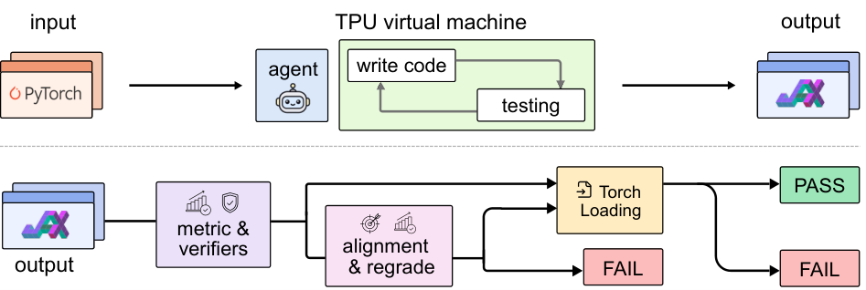

# XStack：用真实重训、隔离判分与权重回载检验跨框架迁移

> **仅资料收录**：成本过高，不复现（审查 DONE）。不执行迁移、不下载任务数据、不生成本地指标或 GPU 收据。

## 论文信息

| 字段 | 内容 |
| --- | --- |
| 论文链接 | [XStack: A Benchmark for ML Repo Migration](https://arxiv.org/abs/2611.08472v1)，[固定 v1 正文](https://arxiv.org/html/2611.08472v1) |
| 公司/机构/学校 | 一作 Linrong Cai；Princeton University；使用 Google TPU 不等于 Google 署名 |
| 首次公开日期 | 2026-11-05 18:55:54 UTC，arXiv v1；11-06 公告 |
| 原文开源代码 | [作者公开仓库](https://github.com/zlab-princeton/XStack)，含任务、harness、裁判及数据链接 |
| 本地 Adapter | 无（`adapter: null`）；收录 key：`xstack` |
| 本地复现代码 | 无；仅审查与双语学习资料 |

## 原始论文总结

### 背景与主要改动

局部张量变换正确不等于能迁移完整实验。XStack 固定 20 个真实 PyTorch 仓库的源提交，要求 Agent 在 TPU 上移植到 JAX，交付环境安装、训练/评测和 PyTorch 权重导出三个入口。评估方在新机器全规模重跑；14 个领域包括语言模型、推荐、视觉和强化学习。原文 Appendix H 的代码规模比较也说明，达标路径不一定覆盖源库每一项功能。

<!-- paper-figure:start -->
### 原论文关键图

图片来自[原论文](https://arxiv.org/html/2611.08472v1#S2.F2) Figure 2 的原始 PNG；版权归原作者所有，原文 CC BY 4.0。
<!-- paper-figure:end -->

### 评估协议

通过同时需要全规模运行达到独立评分目标、正确性与反作弊裁判接受、导出权重可加载进原 PyTorch 模型。结果匹配并不证明它来自这次训练，权重可加载也不能证明结果达标。阶段一盲迁移；若不通过，阶段二告知主实验配方，只许改 `run_train.py`，不公布数值门槛，其他文件冻结。入口脚本若重写冻结代码也违规。论文 §2.2、Table 2 与 Appendix C 将执行 Agent、测试判分与历史运行记录分离。

### 论文离线与线上效果

在 20 仓库 × 7 Agent 的主 TPU 矩阵里，作者报告两阶段后 Claude Opus 5 通过 75%、GPT-5.6-sol 通过 45%，其余至多 40%。Appendix G 的单 A100 初步实验使用 12 个较小仓库和不同的对齐检查，不是主 TPU 结果；未报告线上生产 A/B。

## 本地复现

### 高成本完整实验

Appendix H 报告主实验 22,802 TPU 芯片小时（v4/v5p/v6e），其中评分重跑 16,158 芯片小时；另有 Agent 与裁判调用。Appendix F 仅 Opus 5 的 20 个单元按作者口径已为 1,844 美元。单 A100/A30 或 Mac 不能提供主实验的 TPU 环境与全矩阵预算。**成本过高，不复现（审查 DONE）**。本地没有运行 GPU 初步实验、生成替代分数或启动自动队列。

### 复现与验证边界

一个纯 CPU 的门槛函数不能证明跨栈训练可执行。未来独立实现须固定源提交，核验阶段二文件冻结，保存干净 TPU 复跑及产物来源，并在未泄漏评分目标的条件下检查原框架回载；公开资料中的评分文件不能作为被评估 Agent 的输入。本收录不提供可执行实现。
