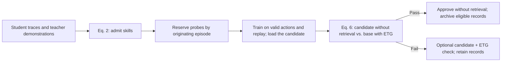
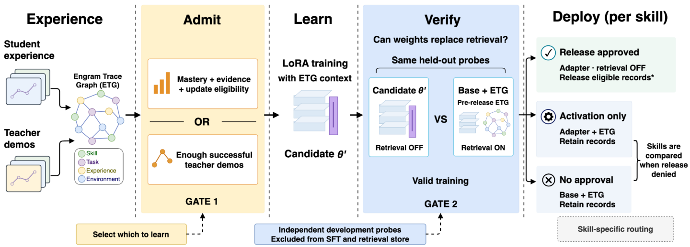

# ENGRAM: verify a skill before replacing episodic retrieval with learned weights

<!-- source-sha256: dbb38df7a3e835423a49658a9102ec1105a56827e3f27f9ce69146a80a2a5178 -->

[简体中文](README.md)

## Paper information

| Field | Value |
| --- | --- |
| Paper | [arXiv 2611.09472](https://arxiv.org/abs/2611.09472); [pinned v1 full text](https://arxiv.org/html/2611.09472v1) |
| Original title | ENGRAM: From Agent Experience to Weights through Verified Consolidation |
| Company / institution | First author Ruiyi Yang: University of New South Wales; affiliations also include HKUST (Guangzhou) |
| First public date | arXiv v1: 2026-11-06 13:51:02 UTC. Discovered via the official Atom increment on November 9; not a November 9 v1 submission |
| Author code | The authors provide an [anonymous code link](https://anonymous.4open.science/r/engram-anonymous); accessible source files, revision, and license were not verified. The local code does not depend on it |
| Local adapter / key | `engram-consolidation`; `adapter: null`, not integrated with Evolve |
| Local code | `src/auto_research/agent_research/engram_consolidation.py` |
| Implementation status | `component_only`: CPU admission, paired verification, and archive controls, L1 mechanism diagnostic |
| Full experiment | Not reproduced because of excessive cost (review DONE) |

## Original method

### Motivation and change

Retrieved traces can support an agent, but training an update does not establish that those traces are dispensable. ENGRAM separates training admission from verification of retrieval-free behavior. The experience graph (ETG) stores student attempts and teacher demonstrations. Teacher evidence is separate from student mastery. Only a verified candidate can release eligible records for a skill.



<!-- paper-figure:start -->
### Original paper figure



Figure 2 is from the [original paper by Yang et al.](https://arxiv.org/html/2611.09472v1#S4.F2), reproduced unchanged under [CC BY 4.0](https://creativecommons.org/licenses/by/4.0/). See `assets/provenance.json`. Appendix E clarifies the figure's probe annotation: the implemented reference uses the pre-release ETG, so withholding a probe from training does not necessarily withhold its source record from retrieval.
<!-- paper-figure:end -->

### Equations

Eq. (2) admits a skill through student mastery $m$, record count $n$, and update eligibility $r$, or through enough successful teacher records $d$. The latter counts records, not unique teacher episodes, and does not raise student mastery. Repeated updates on the mastery branch require a configured mastery increase.

$$
u=\mathbb{I}[(m\ge\tau_m\land n\ge n_{\min}\land r)\lor d\ge d_{\min}].
$$

In Eq. (6), $b$ requires a valid contribution from the skill to the current batch; historical replay alone does not qualify. The same development inputs and binary grader produce $A_W$ for the candidate with no episodic retrieval and $A_M$ for the base with pre-release ETG. Task observations, history, and supplied evidence stay in both arms.

$$
z=u b\,\mathbb{I}[N>0]\,\mathbb{I}[A_W-A_M\ge\delta]\,\mathbb{I}[A_W>\alpha].
$$

The relative margin is inclusive and may be negative. The absolute floor is strict. A separate hybrid check may activate the candidate with ETG if it beats the base reference and exceeds the floor; hybrid activation cannot authorize release.

### Reported outcomes and limitations

Table 2 reports 90.3% ALFWorld and 83.4% WebShop success for Qwen3-8B; MAGE scores 84.0% on the latter. In the Figure 4 development analysis, three of five skills pass release; one fails the relative check and another improves without clearing the absolute floor. On the fixed-checkpoint held-out comparison in Table 4, 269 of 600 records stay retrievable. The paired F1 difference against retaining all records is −0.2 points (95% CI [−0.6, 0.2]), not proof of no loss. Immediate release scores 66.8 F1 versus 71.1 for retain-all. Archiving shrinks the retrievable footprint, not total retained storage.

## Local implementation and boundaries

### Data protocol and code mapping

`consolidate` takes external training/loading status, current valid training record IDs, a pre-release store, and development probes. It enforces originating-episode isolation between training/replay, development, and held-out testing. A development source may still be represented in the pre-release store, but cannot feed training or replay. Callers must deduplicate QA prompts before this episode-ID check and sanitize the public fields provided to retrieval. Actors receive only public input and context; only the separate grader receives the target. Existing state is immutable. Shared records are archived only when all associated skills pass, with recent eligible records retained per skill and category. Requiring current participation for optional hybrid activation is a conservative local choice.

```bash
PYTHONPATH=src python -m pytest tests/agent_research/test_engram_consolidation.py -q
PYTHONPATH=src python -c 'from auto_research.agent_research.engram_consolidation import diagnostic; print(diagnostic(42))'
```

### Diagnostic and boundaries

Three-seed artifact: [`metrics/component-cpu-seeds42-44.json`](metrics/component-cpu-seeds42-44.json). Seeded arithmetic probes exercise real actor calls and a separate binary grader, including equality at each threshold, no probes, no valid training contribution, load failure, and shared-record controls. This tests gate behavior only, not agent capability, the original benchmarks, or Evolve promotion. The local component does not perform ETG ranking, experience acquisition, LoRA fitting, rollouts, or skill routing.

### Full-experiment cost

Appendix F describes two 8B backbones across six benchmarks and multiple controls. ALFWorld uses 5,004 optimizer updates per backbone, WebShop uses 2,149, and maximum training length reaches 16,384 tokens. With environment interaction and repeated verification, the full paper configuration is **not reproduced because of excessive cost (review DONE)** on a single A100/A30 or a local Mac. No data or weights were downloaded and no retry or implementation was queued.
