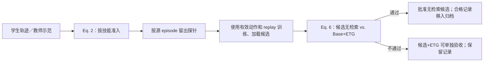
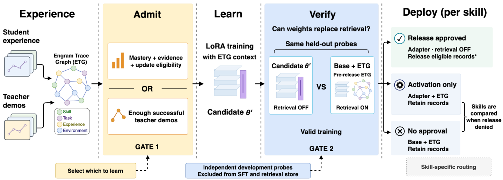

# ENGRAM：先验证技能已被权重学会，再释放检索记忆

[English](README-en.md)

## 论文信息

| 字段 | 内容 |
| --- | --- |
| 论文链接 | [arXiv 2611.09472](https://arxiv.org/abs/2611.09472)；[固定 v1 全文](https://arxiv.org/html/2611.09472v1) |
| 原文标题 | ENGRAM: From Agent Experience to Weights through Verified Consolidation |
| 公司 / 机构 | 第一作者 Ruiyi Yang：新南威尔士大学（University of New South Wales）；合作署名含香港科技大学（广州） |
| 首次公开日期 | 2026-11-06 13:51:02 UTC（arXiv v1）；11 月 9 日通过官方 Atom 增量发现 |
| 原作者代码 | 作者提供[匿名代码链接](https://anonymous.4open.science/r/engram-anonymous)；未核实可访问的源文件、版本和许可证。本地不依赖该链接 |
| 本地 adapter / key | `engram-consolidation`；`adapter: null`，不接入 Evolve |
| 本地复现代码 | `src/auto_research/agent_research/engram_consolidation.py` |
| 实现状态 | `component_only`：CPU 准入、配对验证与归档控制，L1 机制诊断 |
| 完整实验 | 成本过高，不复现（审查 DONE） |

## 原始论文总结

### 背景与主要改动

检索过往轨迹能支持 Agent 执行，但检索库不会因为模型微调而自然缩小。ENGRAM 把两个问题拆开：有没有值得学的经验，以及这次更新的权重能否替代外部检索。学生尝试和教师示范进入经验图（ETG），学生熟练度独立更新；验证通过后才按技能批准候选并处理已参与训练的记录。



<!-- paper-figure:start -->
### 原论文关键图



Figure 2 的图片来自[原论文](https://arxiv.org/html/2611.09472v1#S4.F2)（Yang 等），版权归原作者所有。原图按 [CC BY 4.0](https://creativecommons.org/licenses/by/4.0/) 署名转载，不裁剪、不改动；见 `assets/provenance.json`。图底部标注了独立探针；附录 E 进一步说明实际参考臂使用**释放前** ETG，训练排除探针并不等价于从参考检索库排除其源记录。
<!-- paper-figure:end -->

### 核心公式

Eq. (2) 将学生熟练度 $m$、存储的成败记录数 $n$ 和重新训练资格 $r$ 合为第一条路径；第二条路径只需足够的成功教师示范记录 $d$。$r$ 表示以前未固化，或自上次固化以来熟练度增加到配置量。示范数不是独立教师 episode 数，也不提高学生熟练度。

$$
u=\mathbb{I}[(m\ge\tau_m\land n\ge n_{\min}\land r)\lor d\ge d_{\min}].
$$

Eq. (6) 中，$b$ 仅表示本技能在本轮真正贡献了有效训练例，不包含纯历史 replay；两臂使用同一开发探针和二值评分器。$A_W$ 来自候选权重，无 episodic ETG；$A_M$ 来自基础模型加释放前 ETG。关闭检索不删除任务自身观察、历史和题目证据。

$$
z=u b\,\mathbb{I}[N>0]\,\mathbb{I}[A_W-A_M\ge\delta]\,\mathbb{I}[A_W>\alpha].
$$

差值门槛允许等号及配置为负的非退化余量，绝对下限不允许等号。未通过释放的候选可另以「候选+ETG」超过参考且高于下限申请启用；这不会授权归档记录。

### 原文效果与负结果

论文 Table 2 中 Qwen3-8B 的 ALFWorld 成功率为 90.3%，WebShop 为 83.4%，后者低于同表 MAGE 的 84.0%。Figure 4 的开发实验只批准五项技能中的三项：一项低于参考，另一项改善但没过绝对下限。Table 4 的固定检查点留出对照中，释放后 600 条中剩 269 条可检索；F1 相对全部保留为 −0.2 点（配对 95% CI [−0.6, 0.2]），不能据此宣称零损失。直接释放降至 66.8 F1，而全部保留为 71.1；归档仍保存原记录，缩小的是检索足迹，不是总存储。

## 本地复现

### 数据协议与代码映射

`consolidate` 接收外部训练与加载结果、当前有效训练记录 ID、预释放经验记录和开发探针。它按源 episode 阻断训练／开发／回放与最终测试的交叉：开发探针来源可出现在预释放经验元数据中，但不能出现在本轮训练或历史 replay。调用方需先完成 QA 问题级去重；这里只校验 episode 标识。actor 只收到公开输入和指定臂上下文，目标仅传给独立评分器；检索回调只收到预释放经验的公开字段，调用方须保证这些字段不夹带未授权标签。原始状态不改写；共享记录需关联技能都批准释放才可归档，按技能和类别保留最近的合格 residual。可选启用也要求当前有效参与，是本地保守限定。

```bash
PYTHONPATH=src python -m pytest tests/agent_research/test_engram_consolidation.py -q
PYTHONPATH=src python -c 'from auto_research.agent_research.engram_consolidation import diagnostic; print(diagnostic(42))'
```

### 诊断与边界

三种子产物：[`metrics/component-cpu-seeds42-44.json`](metrics/component-cpu-seeds42-44.json)。随机合成算术探针用于实际调用策略和独立二值评分器；保留边界等号、无探针、无有效训练、加载失败、共享记录等负对照。结果只说明控制规则按预期执行，不是 Agent 能力、上游基准或 Evolve 可晋级证据。本地不做 ETG 检索排序、学生／教师采集、LoRA、真实 rollout 或技能路由。

### 完整实验成本

附录 F 的两种 8B 骨干需覆盖六套基准和多组对照。ALFWorld 每种骨干 5,004 次优化器更新，WebShop 2,149 次，最大训练长度 16,384 token。考虑交互采集和多轮验证，单张 A100/A30 或本地 Mac 不按论文规模跑：**成本过高，不复现（审查 DONE）**。未下载权重或数据，不自动重试或加入实现队列。
