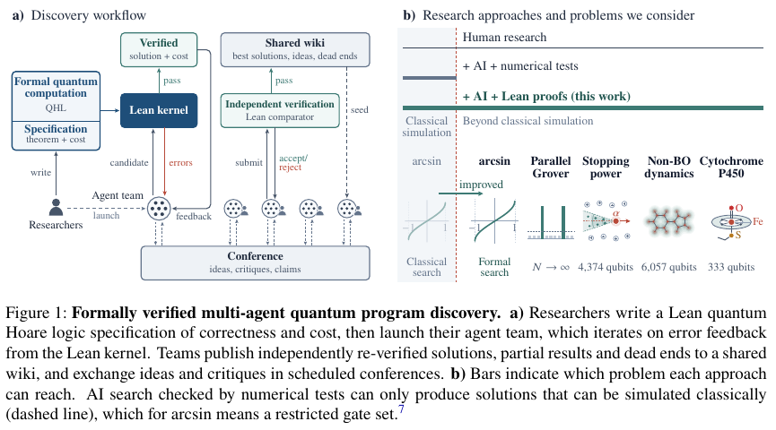

# Verified Quantum Wiki: verify independently before sharing results

<!-- source-sha256: 788c73d94a73c790596907351bdf51659bb1ed4a24764bf4a2315cef699d6086 -->

[简体中文](README.md)

> **component_only / L1 mechanism diagnostic.** The local component applies wiki admission rules after receiving a trusted external verification result. It does not run Lean, quantum programs, or LLMs. The full experiment is **too costly and not reproduced (review DONE)**; the authors have not yet released this paper's quantum Lean library, specifications, and verified solutions.

## Paper information

| Field | Details |
| --- | --- |
| Paper | [Discovering formally verified quantum programs with AI](https://arxiv.org/abs/2611.09822v1); [fixed v1 full text](https://arxiv.org/html/2611.09822v1) |
| Company / author institutions | **Google DeepMind and Google Quantum AI**; some authors worked as research consultants on assignment at Google |
| First public date | 2026-11-06 18:08:06 UTC (arXiv v1), November 7 at 02:08:06 in Shanghai. Found in the November 9 incremental scan |
| Author code | **Not released / no executable package for this paper found.** Code availability says the quantum Lean library, problem specifications, and verified solutions will be open sourced shortly. [Lean Comparator](https://github.com/leanprover/comparator) is an existing dependency, not the paper's complete implementation |
| Local adapter / key | `verified-quantum-wiki`; `adapter: null`, not eligible for Evolve promotion |
| Local code | `src/auto_research/agent_research/verified_quantum_wiki.py` |

## Original paper summary

### Motivation and main changes

Quantum programs can exceed classical simulation capacity, so numerical examples cannot establish general correctness. Researchers first freeze correctness and resource specifications in a quantum Hoare logic (QHL) library. Heterogeneous LLM teams then search for programs and Lean proofs. The paper does not prescribe each team's models, framework, or division of labor; it fixes the specification, external verification, and collaboration protocol (Sections 1.1–1.2 and Appendices A–C).

A local Lean success is insufficient for admission. Appendix B requires clean-sandbox replay using Lean Comparator to check all target theorems and transitive definitions. Proof terms may depend only on standard axioms `propext`, `Quot.sound`, and `Classical.choice`, with no `sorry` or custom axioms; the resource theorem must reduce to the claimed cost. Formal correctness remains conditional on the specification. A physical-model or accounting loophole requires researchers to revise that specification, not reuse an old proof as evidence for a changed problem.

The wiki stores each problem's best verified solution, reusable compiling Lean modules, and reviewed notes on verified, promising, and dead-end ideas. Cross-team conferences every four hours exchange conjectures and critiques; conference estimates and idea notes are not proven results. Appendix C's admission thresholds limit churn from small improvements and allow substantial code simplification to reduce context and compilation burdens.

<!-- paper-figure:start -->
### Key figure from the paper

[](https://arxiv.org/html/2611.09822v1#S0.F1)

From Figure 1 on page 2 of the [author v1 PDF](https://arxiv.org/pdf/2611.09822v1), cropped to retain the complete figure and caption, without redrawing or changing labels or data. CC BY 4.0; copyright remains with the original authors. See `assets/provenance.json` for transformation and visual review. The Lean, kernel, and agent boxes describe **the paper's system**, not implemented local components.
<!-- paper-figure:end -->

### Core equations

Appendix C's default rule uses current cost and code size $C_0,L_0$, candidate values $C_1,L_1$, and external re-verification result $V$:

$$
\mathrm{admit}=V\land\left[C_1\le0.95C_0\ \lor\ (L_1\le0.80L_0\land C_1<C_0)\right].
$$

The local implementation uses exact integer/rational cross multiplication, avoiding floating-point rounding at the 5% and 20% boundaries. It applies only to an established best solution with $C_0>0$ under an unchanged specification and cost convention; initialization is outside scope. The paper does not define code size in bytes, lines, or tokens. Callers must use the same measurement convention for both solutions; no byte convention is attributed to the paper.

### Offline and online results

Section 2 and Figure 2 report up to a 1.41-fold reduction in expected oracle rounds for parallel Grover search; more than 290-fold lower logical spacetime $Q\mathcal T$ for fixed-point arcsin, a lower bound because the baseline used lower precision; and reductions of 10.9, 8.08, and 2.49 for stopping power, non-Born–Oppenheimer dynamics, and P450. These are proven resource costs under specifications, not measured quantum-hardware runtime or local CPU acceleration.

The 61% within-team / 15% wiki / 24% conference figures in Section 2.6 and Figure 5 retrospectively attribute logarithmic cost reductions during the sharing phase across three scientific applications. The authors acknowledge ambiguous mixed credit. This is not a randomized multi-agent ablation or causal uplift estimate. **No online A/B experiment is reported.** Appendix D and the discussion state that the scientific applications still exceed early fault-tolerant hardware capabilities.

## Local reproduction

### Data protocol and code mapping

`Solution` carries frozen-specification and artifact hashes, a cost convention, exact cost, and code size. `ExternalComparatorResult` is a trusted-host boundary recording clean replay, theorem and transitive-definition matching, proof-term checking, absence of sorry, resource-theorem reduction, and used axioms. `admit` binds this evidence to the candidate before applying the two threshold branches. It returns a decision without modifying a wiki.

The hash and receipt schema are local mismatch-prevention safeguards, **not an author-published receipt format or cryptographic authentication**. The caller must authenticate provenance outside this interface; agent-supplied `True` flags are not verification. A real repository must apply the decision atomically against the same current revision and re-evaluate if that revision changes. The local component implements neither external verification services, signatures, axiom parsing, cost proofs, code-size measurement, nor concurrent git merges.

```bash
PYTHONPATH=src python -c 'from auto_research.agent_research.verified_quantum_wiki import diagnostic; print(diagnostic(42, "cpu"))'
PYTHONPATH=src python -m pytest -q tests/test_nov09_verified_quantum_wiki.py
```

### Results, negative controls, and boundaries

[Three-seed metrics](metrics/component-cpu-seeds42-44.json).

Inputs are explicitly synthetic receipt fixtures: no datasets, model calls, or gold answers. Seeds 42–44 randomly scale costs and sizes and each test the same nine admission contracts: both positive boundaries plus insufficient gains, equal cost, absent verification, changed definitions, custom axioms, stale artifacts, and unproven costs. Additional unit tests cover each failed external check, changed specifications/cost conventions, inexact or invalid costs, invalid sizes, and zero baselines. Passing these checks establishes the admission rule only. **The number of actual Lean proofs verified is zero**, not a discovery success rate, task accuracy, or collaboration gain.

### Full experiment cost

The original experiment uses multiple independent teams, repeated LLM proposal/proof work, a shared library, and five quantum problems involving thousands of logical qubits and extensive proofs. Model configuration and aggregate token/API budgets are not fully disclosed, so no defensible hour or dollar estimate is available. The quantum library, specifications, and verified solutions are not public; an existing general Comparator does not fill those gaps. With a local Mac or one A100/A30, full reproduction lacks public inputs and cannot be established as affordable. **Too costly; not reproduced (review DONE).** No weights, search runs, or automatic retries were initiated. Only the zero-model-call CPU boundary component is approved, with `promotion_eligible=false` and `evolve_integrated=false`.
