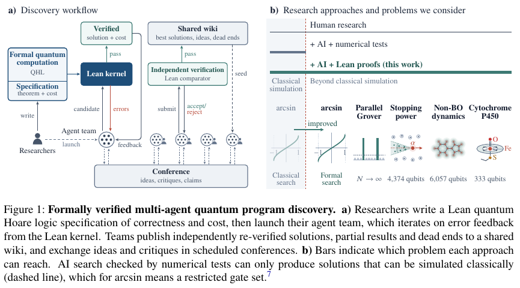

# Verified Quantum Wiki：先独立验证，再积累可复用成果

[English](README-en.md)

> **component_only / L1 机制诊断**：本地只执行收到可信外部验证结果后的 wiki 合并规则，不运行 Lean、量子程序或 LLM。完整实验**成本过高，不复现（审查 DONE）**；作者尚未公开本篇量子 Lean 库、题目规范和已验证解。

## 论文信息

| 字段 | 内容 |
| --- | --- |
| 论文链接 | [Discovering formally verified quantum programs with AI](https://arxiv.org/abs/2611.09822v1)；[固定 v1 正文](https://arxiv.org/html/2611.09822v1) |
| 公司 / 机构 | **Google DeepMind、Google Quantum AI**；作者包含在 Google 执行本项目的研究顾问 |
| 首次公开日期 | 2026-11-06 18:08:06 UTC（arXiv v1；北京时间 11 月 7 日 02:08:06）；11 月 9 日增量发现 |
| 原作者代码 | **未发布 / 未找到本篇可执行代码包**。Code availability 明确写量子 Lean 库、问题规范和验证解将随后开源。[Lean Comparator](https://github.com/leanprover/comparator) 是已有外部依赖，不等于本篇作者代码 |
| 本地 adapter / key | `verified-quantum-wiki`；`adapter: null`，不进入 Evolve 晋级 |
| 本地复现代码 | `src/auto_research/agent_research/verified_quantum_wiki.py` |

## 原始论文总结

### 背景与主要改动

量子程序的复杂度可能远超经典模拟能力，靠若干数值样例无法证明一般正确性。研究者先在量子 Hoare 逻辑（QHL）库中冻结正确性与资源规范，异构 LLM 团队搜索程序和 Lean 证明。论文不固定团队内部模型、框架或分工；共享的是规范、外部验证与协作协议（§1.1–1.2、附录 A–C）。

团队本地通过 Lean 不等于可接纳成果。附录 B 要求在干净沙箱中重放，使用 Lean Comparator 核对所有目标定理及其传递依赖定义，证明项只能依赖标准公理 `propext`、`Quot.sound`、`Classical.choice`，不能有 `sorry` 或自定义公理；资源定理还必须化简到申报成本。形式证明仍以规格为条件：若物理模型或计费规则有漏洞，应由研究者修正规范，不能将旧规格证明当作新问题的答案。

wiki 持有每题最佳验证解、可复用且能编译的 Lean 模块，以及经审阅的成功/待探索/死路笔记。每四小时的跨团队会议交换猜想与批评；会议估算和笔记不是已证明结果。附录 C 的更新门槛减少微小改进导致的频繁迁移，也允许为上下文与编译负担做代码简化。

<!-- paper-figure:start -->
### 原论文关键图

[](https://arxiv.org/html/2611.09822v1#S0.F1)

图片来自[原论文](https://arxiv.org/pdf/2611.09822v1) 第 2 页 Figure 1，版权归原作者所有；仅裁出整幅图及完整图注，没有重绘、改变标签或数据。论文许可 CC BY 4.0，转换和视觉核对记录见 `assets/provenance.json`。图中的 Lean/kernel/agent 方框是**论文流程**，不是本地已实现组件。
<!-- paper-figure:end -->

### 核心公式

附录 C 的默认规则，设当前成本、代码大小为 $C_0,L_0$，候选为 $C_1,L_1$，外部重验证通过为 $V$：

$$
\mathrm{admit}=V\land\left[ C_1\le0.95C_0\ \lor\ (L_1\le0.80L_0\land C_1<C_0)\right].
$$

本地使用整数/有理数交叉乘法，避免 5% 和 20% 边界的浮点舍入。规则仅用于已有最佳解、$C_0>0$ 且同一规范和成本口径的比较；不定义首个解的初始化。论文没有指定代码大小按字节、行还是 token 测量，本地要求调用方对两项使用相同计量约定，不擅自宣称字节口径来自论文。

### 论文离线与线上效果

§2、图 2 的作者结果：并行 Grover 预期 oracle rounds 最多降低 1.41 倍；固定点 arcsin 的逻辑时空 $Q\mathcal T$ 成本降低超过 290 倍（原基线精度更低，此比值是下界）；聚变 stopping power、非 Born–Oppenheimer 动力学和 P450 分别降低 10.9、8.08、2.49 倍。这些是规范下的证明资源成本，不是实际量子硬件运行时间或本地 CPU 加速。

§2.6、图 5 的 61% 团队内 / 15% wiki / 24% 会议是三个科学应用共享阶段的对数成本下降的事后来源归因；论文承认混合贡献难拆分，不能当随机多 Agent 消融或因果增益。**线上 A/B 未报告**。附录 D 及讨论指出，科学应用仍超出早期容错量子硬件能力。

## 本地复现

### 数据协议与代码映射

`Solution` 显式携带冻结规范摘要、候选 artifact 摘要、成本口径、精确成本及代码大小。`ExternalComparatorResult` 是可信宿主提供的外部核验边界，记录干净重放、定理/传递定义一致、证明项检查、无 sorry、资源定理化简和所用公理。`admit` 验证凭据与候选绑定，再执行两个阈值分支，返回决定但不写 wiki。

摘要与凭据结构是本地防止错配的协议设计，**不是作者公布的 receipt 格式，也不是密码学验签**。调用方必须在信任边界外确认凭据来源；把 agent 自报的 `True` 填进对象不构成验证。真实仓库应用决定时还需对当前版本做原子比较并更新；当前版改变后要重新比较。本地不实现外部验证服务、签名、公理解析、成本证明、代码大小计算或并发 git 合并。

```bash
PYTHONPATH=src python -c 'from auto_research.agent_research.verified_quantum_wiki import diagnostic; print(diagnostic(42, "cpu"))'
PYTHONPATH=src python -m pytest -q tests/test_nov09_verified_quantum_wiki.py
```

### 结果、负控与边界

[三种子指标产物](metrics/component-cpu-seeds42-44.json)。

只使用明确标记为 synthetic 的凭据夹具，无数据下载、模型调用或金标准答案。种子 42–44 随机缩放成本和长度，逐种子检验相同九项 admission 契约：两个正边界及未达阈值、相同成本、缺失验证、定义变化、自定义公理、陈旧 artifact、成本未证明等负控。单元测试另覆盖每个外部检查失败、错误规范/计费口径、非精确或非法成本、代码大小和零基线。检查通过只表示本地合并规则正确，**实际 Lean 证明验证数为 0**，不是发现成功率、任务准确率或协作收益。

### 高成本完整实验

原实验包括多个独立团队、反复 LLM 提案/证明、共享库与五个量子问题，涉及成千上万逻辑量子比特及大规模证明。模型配置与总 token/API 成本未完整披露，不能据此给出可信小时/美元估算。作者量子库、规范和验证解尚未公开，已有通用 Comparator 不足以补齐。对本地 Mac 或单 A100/A30，这条全流程既缺公开输入又无法证实预算内可完成，**成本过高，不复现（审查 DONE）**；未下载权重、未发起搜索或自动重试。只批准上述零模型调用 CPU 边界组件，`promotion_eligible=false`、`evolve_integrated=false`。
