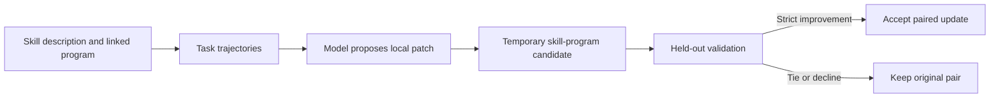
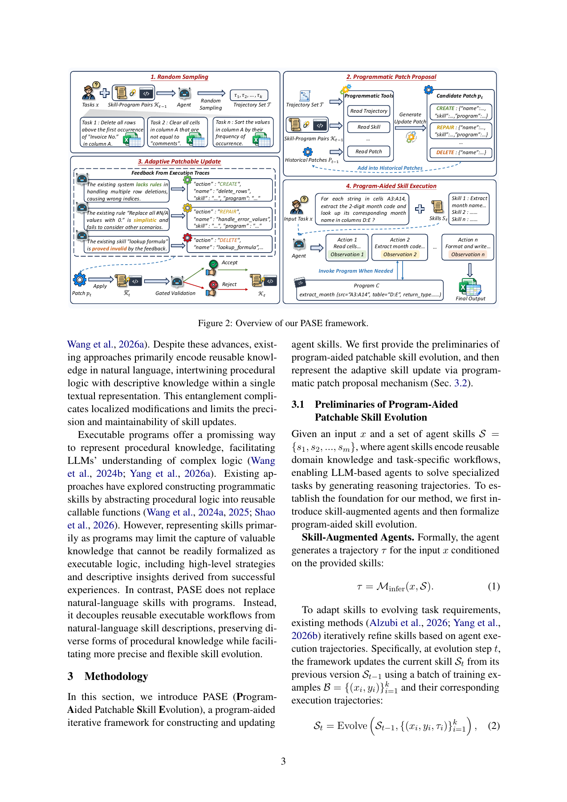

# PASE: Evolve Skill Descriptions and Program Patches Separately

<!-- source-sha256: e741421c8f476b55e2800a43f637417869df821847d270cc4f2ba1c5fa5fed04 -->

[简体中文](README.md) · English

> This CPU component implements patch transactions and validation admission, not a model proposer, generated-code executor or spreadsheet-solving agent.

## Paper information

| Field | Details |
| --- | --- |
| Paper | [Program-Aided Patchable Skill Evolution](https://arxiv.org/abs/2611.14019); reviewed [v1](https://arxiv.org/html/2611.14019v1) |
| Affiliation | First author Jiahao Wang: Northeastern University, Shenyang, China; collaborators at Alibaba; not the US namesake |
| First public release | 2026-11-10, 12:53:12 UTC |
| Authors' code | A future GitHub release is promised, but no URL or released author implementation was found |
| Local adapter | None (`adapter: null`); component key `pase` |
| Local code | `src/auto_research/agent_research/pase.py` |

## Original paper summary

### Background and main changes

Text-only skills entangle strategy and procedural details. PASE preserves descriptive knowledge while linking skills to independently editable programs. A proposed patch is kept only after held-out validation improvement. Program syntax alone establishes neither task correctness nor safety.



<!-- paper-figure:start -->
### Key figure from the paper

[](https://arxiv.org/pdf/2611.14019v1#page=3)

> Figure 2, PDF page 3, from the [original paper](https://arxiv.org/pdf/2611.14019v1#page=3), © the original authors. Model patch generation and task execution are not reproduced locally.
Image from the [original paper](https://arxiv.org/pdf/2611.14019v1#page=3); copyright belongs to its authors. Full-system or experimental results shown are not local component results.

<!-- paper-figure:end -->

### Core equations

Keep skill-program pairs $K=\{(s_i,c_i)\}$. Apply a patch to obtain $\widetilde K_t=\operatorname{Apply}(p_t,K_{t-1})$, then retain it only if $R_{val}(\widetilde K_t)>R_{val}(K_{t-1})$. Otherwise roll back. Test scores must not select patches, and AST parsing is not $R_{val}$.

### Paper results

The study covers SpreadsheetBench, Domain-Spreadsheet, WikiTQ and HiTab and examines cross-model transfer. Results depend on creator, user and benchmark. No production A/B test is reported; local code does not reproduce those gains.

## Local implementation

### Data contract and code mapping

`ProgramSkill` stores a description and linked source; AST parsing checks syntax but never executes it. `ProgramPatch` targets an ID and original SHA256, rejecting stale or misdirected edits. `apply_validated_patch()` consumes externally measured validation scores and returns a new immutable pair only for strict improvement. It has no stand-in actor or access to test answers.

```bash
PYTHONPATH=src python -c 'from auto_research.agent_research.pase import diagnostic; print(diagnostic(42))'
```

### Results, controls and limits

CPU diagnostics labeled 42/43/44 accept one improving patch and roll back a tie and decline while preserving the original digest. Tests reject test-based selection, stale patches and invalid syntax. Even source containing `raise` is parsed, not executed. These checks establish transactions, not code safety, patch quality or spreadsheet accuracy. CUDA is rejected.

### High-cost full experiment

The original study uses roughly 128K contexts, up to 50 ReAct iterations during evolution, ten rounds with batch eight, three independent runs, large 27B/31B or API backbones and four benchmarks. The full rollout grid is **too costly and is not reproduced (review DONE)**. No weights, APIs or untrusted generated programs were run. Full skill-library CREATE/DELETE edits and model refinement are outside coverage.
