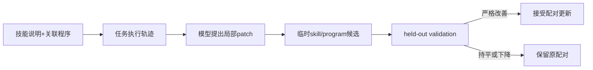
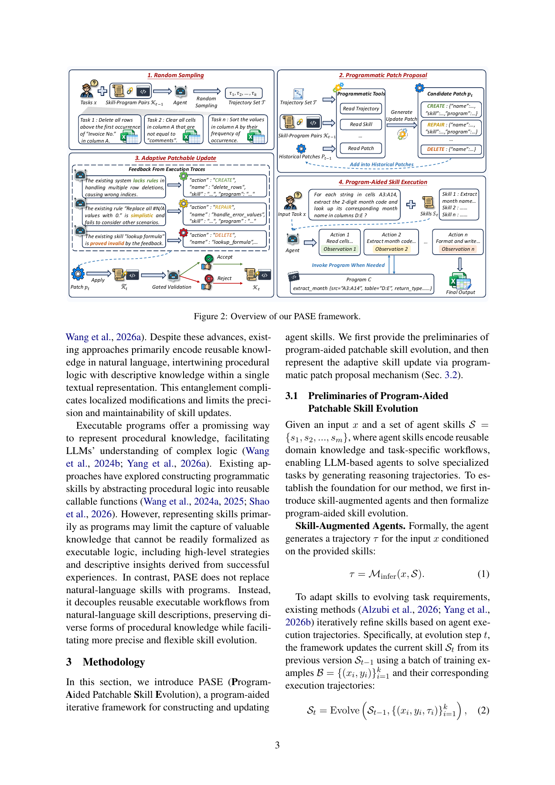

# PASE：把技能说明和程序补丁分开演化

> 本地交付纯 CPU 补丁事务与 validation 接受合同，不包含模型 proposer、未知程序执行或表格求解 Agent。

## 论文信息

| 字段 | 内容 |
| --- | --- |
| 论文链接 | [Program-Aided Patchable Skill Evolution](https://arxiv.org/abs/2611.14019)，审查 [v1 原文](https://arxiv.org/html/2611.14019v1) |
| 公司/机构 | 一作 Jiahao Wang：中国东北大学（沈阳），合作作者含阿里巴巴；不是美国同名学校 |
| 首次公开日期 | 2026-11-10，12:53:12 UTC |
| 原文开源代码 | 作者承诺后续 GitHub 发布，但原文无 URL；本轮未找到已发布源码 |
| 本地 Adapter | 无（`adapter: null`）；组件 key：`pase` |
| 本地复现代码 | `src/auto_research/agent_research/pase.py` |

## 原始论文总结

### 背景与主要改动

纯自然语言技能把策略和具体程序操作混在一起，局部修复常要求重写整份说明。PASE 让技能保留描述性知识，同时关联可独立编辑的程序；从成败轨迹提出 patch 后，以独立 validation 判断是否保留。程序化不是删除高层策略，也不意味着语法通过就能完成任务。



<!-- paper-figure:start -->
### 原论文关键图

[](https://arxiv.org/pdf/2611.14019v1#page=3)

> Figure 2，PDF 第 3 页。图片来自[原论文](https://arxiv.org/pdf/2611.14019v1#page=3)，版权归原作者所有；模型 patch 生成和任务执行未在本地复现。
<!-- paper-figure:end -->

### 核心公式

技能集合 $K=\{(s_i,c_i)\}$ 保持说明与程序的关联。候选 $\widetilde K_t=\operatorname{Apply}(p_t,K_{t-1})$，仅当 $R_{val}(\widetilde K_t)>R_{val}(K_{t-1})$ 才令 $K_t=\widetilde K_t$；否则回滚。不能用 test 成绩选择 patch，也不能把 AST 语法检查当作 $R_{val}$。

### 论文离线与线上效果

论文覆盖 SpreadsheetBench、Domain-Spreadsheet、WikiTQ 和 HiTab，并考察跨模型技能迁移。结果依赖 creator/user 与 benchmark；未报告生产线上 A/B，本地未复测其能力提升。

## 本地复现

### 数据协议与代码映射

`ProgramSkill` 保存独立说明和程序，AST 仅检查语法，**不执行**源码。`ProgramPatch` 指定目标 ID、原程序 SHA256 和替换内容，拒绝过期或错目标。`apply_validated_patch()` 输入外部已经测得的 validation 分数，严格改善才返回新不可变对象，否则返回原对象。组件不创建 callback 假 actor，不读取测试答案，也不把人工分数宣称为真实任务执行。

```bash
PYTHONPATH=src python -c 'from auto_research.agent_research.pase import diagnostic; print(diagnostic(42))'
```

### 结果、负控与边界

CPU seeds 42/43/44 均接受一条严格改善 patch，对持平和下降执行两次回滚，保留原 digest。测试还拒绝 test 选择、过期 patch、无效 Python；含 `raise` 的程序只解析不运行。以上验证事务，不验证程序安全、patch 质量或表格正确率。组件拒绝 CUDA。

### 高成本完整实验

原配置使用约 128K 上下文、演化最多 50 步 ReAct、10 轮×batch 8×三独立重复，多种 27B/31B/API backbone 及四个 benchmark。完整长 rollout grid **成本过高，不复现（审查 DONE）**；没有下载模型、调用 API 或执行不受信任的生成程序。本地尚不含 CREATE/DELETE 的全技能库编辑及模型细化。
