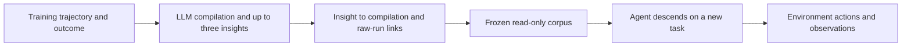
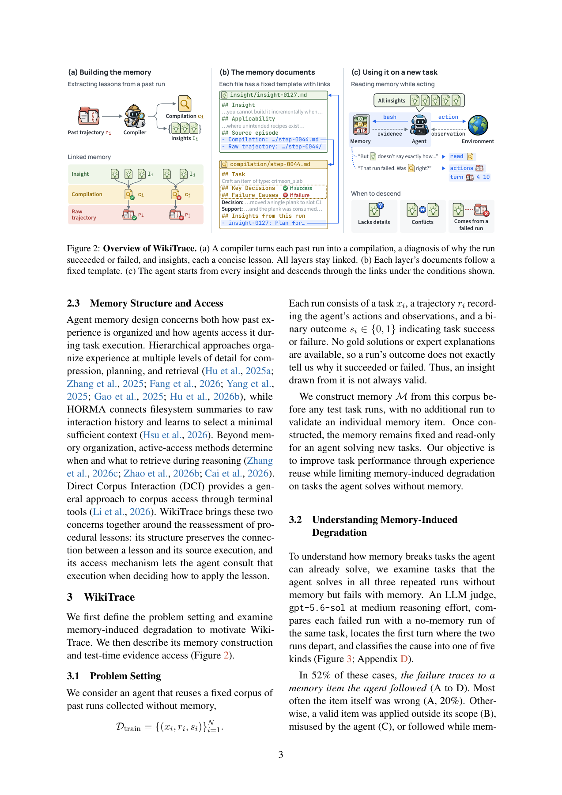

# WikiTrace: Trace Insights Back to Their Evidence

<!-- source-sha256: 9f12b146ea808a6eb94f43b897e22ceef9a4734baa0572a17388ebd3fe713b2c -->

[简体中文](README.md) · English

> This is a CPU source-linked corpus component, not an LLM compiler or task-solving agent. L1 diagnostics are not memory-capability scores and cannot qualify for Evolve promotion.

## Paper information

| Field | Details |
| --- | --- |
| Paper | [Don't Just Trust Your Memory](https://arxiv.org/abs/2611.14320); reviewed [v1](https://arxiv.org/html/2611.14320v1) |
| Affiliation | First author Yukyeong Lee: KAIST; collaborator DeepAuto.ai |
| First public release | 2026-11-10, 16:46:59 UTC; the November 11 announcement is not first publication |
| Authors' code | [WikiTrace](https://github.com/yukyeongleee/wikitrace), Apache-2.0; upstream implementation not copied |
| Local adapter | None (`adapter: null`); component key `wikitrace` |
| Local code | `src/auto_research/agent_research/wikitrace.py` |

## Original paper summary

### Background and main changes

An insight distilled from an episode can be wrong or misapplied. WikiTrace links each insight to the run's interpretation and unchanged trajectory. The agent starts with all insights and can descend when details are missing, insights conflict, or a source failed. An interpretation does not become verified knowledge merely because it has a source link.



<!-- paper-figure:start -->
### Key figure from the paper

[](https://arxiv.org/pdf/2611.14320v1#page=3)

> Figure 2, PDF page 3. Screenshot from the [original paper](https://arxiv.org/pdf/2611.14320v1#page=3), © the original authors. Model compilation and task solving are outside this component.
Image from the [original paper](https://arxiv.org/pdf/2611.14320v1#page=3); copyright belongs to its authors. Full-system or experimental results shown are not local component results.

<!-- paper-figure:end -->

### Core equations

For fixed training runs $D=\{(x_i,r_i,s_i)\}$, compilation produces $(c_i,I_i)$ and links $E=\{(u,i):u\in I_i\}$. Memory is frozen as $M=(R,C,I,E)$. The local implementation additionally hashes each raw run to check exact source recovery.

### Paper results

The authors compare gains and memory-induced regressions across eight suites from five benchmarks, using three trials. They report no production A/B test. No task scores or improvement magnitudes were reproduced locally.

## Local implementation

### Data contract and code mapping

`SourceRun` accepts training-split observable actions, observations and an outcome. Callers supply `Compilation` and `Insight`. `EvidenceLinkedCorpus` validates unique IDs, source coverage and the three-insight limit, while retaining contradictory insights and failed runs. `actor_memory()` exposes insights; `descend()` returns the exact linked interpretation and raw run. There are no gold-answer, gold-plan or test-rubric fields, and recorded commands are never executed.

```bash
PYTHONPATH=src python -c 'from auto_research.agent_research.wikitrace import diagnostic; print(diagnostic(42))'
```

### Results, controls and limits

Deterministic CPU diagnostics labeled 42/43/44 preserve one failed source, two insights, exact links and hashes, and reject corpus mutation. Tests reject test-split runs, dangling links, duplicate IDs and excess insights. These are not three model experiments; no answer accuracy is computed. CUDA is explicitly rejected.

### High-cost full experiment

The original protocol uses a high-reasoning DeepSeek-V4-Flash terminal agent, multiple methods, eight suites and three trials, with some episodes allowing 200 environment steps. The full rollout grid is **too costly and is not reproduced (review DONE)**. No weights, APIs or complete agents were run. Automatic compilation, semantic starting-point selection and correct evidence use remain outside local coverage.
