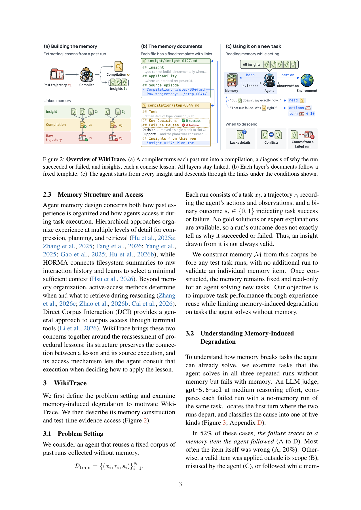

# WikiTrace：让经验洞见可回查原始证据

> 本地交付纯 CPU 链接语料组件，不包含 LLM 编译器或求解 Agent；L1 机制诊断不是记忆能力成绩，不进入 Evolve 晋级。

## 论文信息

| 字段 | 内容 |
| --- | --- |
| 论文链接 | [Don't Just Trust Your Memory](https://arxiv.org/abs/2611.14320)，审查 [v1 原文](https://arxiv.org/html/2611.14320v1) |
| 公司/机构 | 一作 Yukyeong Lee：KAIST；合作机构 DeepAuto.ai |
| 首次公开日期 | 2026-11-10，16:46:59 UTC；11 月 11 日公告不是首发日期 |
| 原文开源代码 | [作者 WikiTrace 仓库](https://github.com/yukyeongleee/wikitrace)，Apache-2.0；未复制上游实现 |
| 本地 Adapter | 无（`adapter: null`）；组件 key：`wikitrace` |
| 本地复现代码 | `src/auto_research/agent_research/wikitrace.py` |

## 原始论文总结

### 背景与主要改动

从一次成功或失败轨迹提炼出的洞见不一定正确，也可能被误用到不适用的任务。WikiTrace 不只保存一句经验，而是把洞见链接到该次执行的解释及未改写的原轨迹。模型先看全部洞见，在细节不足、洞见冲突或来源失败时，自主沿链接下钻。解释仍是模型推断，不因带有链接就自动成为已验证知识。


<!-- paper-figure:start -->
### 原论文关键图

[](https://arxiv.org/pdf/2611.14320v1#page=3)

> Figure 2，PDF 第 3 页的原文截图。图片来自[原论文](https://arxiv.org/pdf/2611.14320v1#page=3)，版权归原作者所有；图中的模型编译和任务求解不属于本地组件。
<!-- paper-figure:end -->

### 核心公式

固定训练语料为 $D=\{(x_i,r_i,s_i)\}$；编译器生成 $(c_i,I_i)$，链接集合 $E=\{(u,i):u\in I_i\}$。冻结后的记忆是 $M=(R,C,I,E)$，而不是训练期间不断替换洞见。每条原轨迹额外以本地 SHA256 校验，确保下钻返回的仍是同一份记录。

### 论文离线与线上效果

论文在五个 benchmark 的八个 suite 上比较任务收益和 memory-induced regression，并以三次 trial 报告结果；不能只看总分而忽略原本能做对的任务被记忆破坏。未报告生产线上 A/B。本地没有复测这些任务或论文改进幅度。

## 本地复现

### 数据协议与代码映射

`SourceRun` 只接受训练划分的可观察动作、观察和成败；`Compilation`、`Insight` 由调用者显式提供。`EvidenceLinkedCorpus` 检查唯一 ID、源覆盖、每次最多三条洞见，保留矛盾洞见和失败轨迹，不伪装成自动编译或事实验证。`actor_memory()` 返回洞见；`descend()` 精确返回关联解释和原轨迹。接口无 gold answer、gold plan 或测试 rubric 字段，也不执行轨迹中的命令。

```bash
PYTHONPATH=src python -c 'from auto_research.agent_research.wikitrace import diagnostic; print(diagnostic(42))'
```

### 结果、负控与边界

CPU seeds 42/43/44 上的确定性诊断均保留一份失败源、两条洞见、正确链接和相同原始 hash，并拒绝语料字典写入。额外测试拒绝 test 轨迹、悬空引用、重复 ID 和超过三条洞见。相同 seed 标签不代表三次模型实验；没有计算回答准确率。组件明确拒绝 `device='cuda'`。

### 高成本完整实验

原协议使用高 reasoning 的 DeepSeek-V4-Flash 终端 Agent，跨多方法、八个 suite、三 trial 构建并执行记忆，部分任务至多 200 环境步。完整长 rollout grid **成本过高，不复现（审查 DONE）**；没有下载权重、调用 API 或重跑完整 Agent。L1 只覆盖语料与导航合同，不覆盖自动归纳、语义相似度起点选择或是否正确使用证据。
