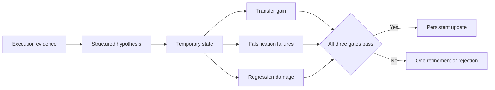
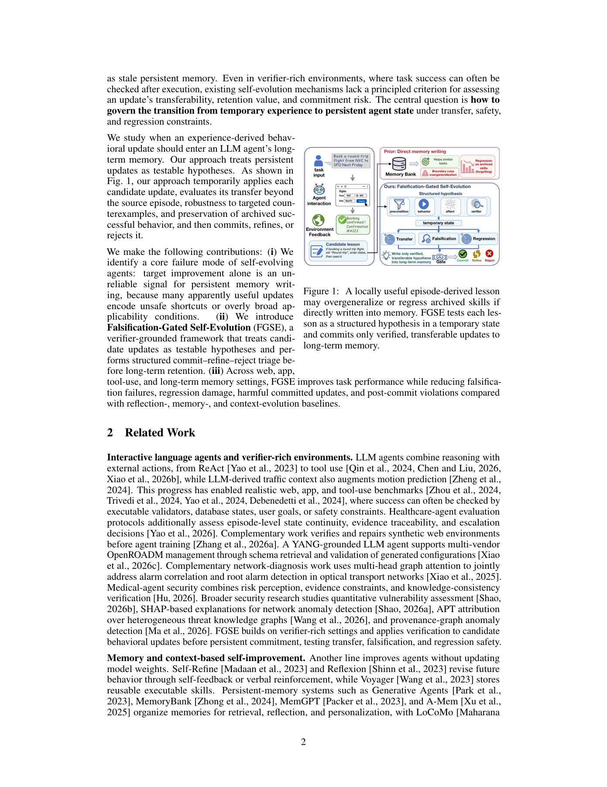

# FGSE: Falsify Before Committing Memory

<!-- source-sha256: 9caa7552e0d61e3278ab9656b244e3285659e1729284b9c838cfdda2a413a8d9 -->

[简体中文](README.md) · English

> This CPU empirical gate consumes paired external verifier records. It generates neither agents, probes nor answers; gate pass rates are not task-success rates.

## Paper information

| Field | Details |
| --- | --- |
| Paper | [When Should Agents Remember?](https://arxiv.org/abs/2611.14326); reviewed [v1](https://arxiv.org/html/2611.14326v1) |
| Affiliation | First author Runxuan Tang: Nanyang Technological University; collaborators at Georgia Tech, UW, WashU, Sydney and NUS |
| First public release | 2026-11-10, 16:52:25 UTC |
| Authors' code | No author repository linked in the fixed paper or found through exact-title search; not claimed open-source |
| Local adapter | None (`adapter: null`); component key `fgse` |
| Local code | `src/auto_research/agent_research/fgse.py` |

## Original paper summary

### Background and main changes

A locally useful update can harm boundary cases or old skills. FGSE represents a lesson as a hypothesis with precondition, behavior, expected effect and verifier. It evaluates a temporary state on transfer, targeted falsification and archived regression probes before committing, refining once, or rejecting it.



<!-- paper-figure:start -->
### Key figure from the paper

[](https://arxiv.org/pdf/2611.14326v1#page=2)

> Figure 1, PDF page 2, from the [original paper](https://arxiv.org/pdf/2611.14326v1#page=2), © the original authors. Local coverage is limited to empirical statistics and admission.
Image from the [original paper](https://arxiv.org/pdf/2611.14326v1#page=2); copyright belongs to its authors. Full-system or experimental results shown are not local component results.

<!-- paper-figure:end -->

### Core equations

Let $\Delta(x)=J(\Theta\oplus h,x)-J(\Theta,x)$. Compute $G=\operatorname{mean}_T\Delta$, $P=\operatorname{mean}_F\mathbf1[\Delta<-\epsilon\lor E=0]$ and $D=\operatorname{mean}_R[-\Delta]_+$, each with its own denominator. Commit only if $G\ge\eta$, $P\le\delta$ and $D\le\beta$. This empirical gate is not a local verification of the paper's confidence-bound theorem.

### Paper results

The authors evaluate updates across web, app, tools, security and memory environments using frozen models and external verifiers. No production A/B test is reported. Those capability results are separate from the synthetic controls below.

## Local implementation

### Data contract and code mapping

`Probe` contains finite paired verifier scores in $[0,1]$ and a binary expected-effect flag, not a gold answer. `commitment_gate()` implements equations 7-9. Callers must obtain actual verifier records externally. There is no actor callback or fabricated execution behind supplied scores.

```bash
PYTHONPATH=src python -c 'from auto_research.agent_research.fgse import diagnostic; print(diagnostic(42))'
```

### Results, controls and limits

CPU diagnostics labeled 42/43/44 admit a safe gain of 0.15. An effect failure rejects an update even without a score drop; regression damage near 0.20 blocks positive transfer; zero gain fails. Tests reject empty groups, NaN, infinity and invalid scores. These are formula and branch controls, not stable model improvements. CUDA is rejected.

### High-cost full experiment

Appendix C.7 totals approximately 460,000 LLM and 703,000 verifier calls, with up to 32 CPU workers and individual groups taking 12-39 hours. Provider-side serving compute is undisclosed, not author-side GPU training. The full study is **too costly and is not reproduced (review DONE)**. No proposer, probe generator, automatic refinement, persistent policy composition or complete environment loop was run.
