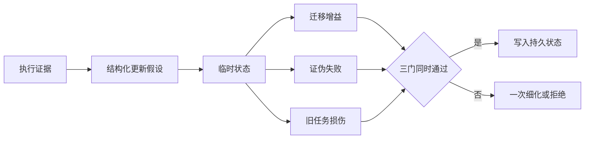
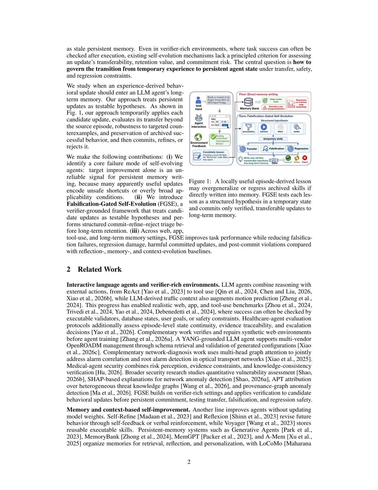

# FGSE：记忆写入之前先证伪

> 本地交付纯 CPU 经验准入门控，输入外部 verifier 的成对记录；不生成 Agent、探针或正确答案，不把门控通过率当任务成功率。

## 论文信息

| 字段 | 内容 |
| --- | --- |
| 论文链接 | [When Should Agents Remember?](https://arxiv.org/abs/2611.14326)，审查 [v1 原文](https://arxiv.org/html/2611.14326v1) |
| 公司/机构 | 一作 Runxuan Tang：南洋理工大学；另有 Georgia Tech、UW、WashU、悉尼大学、新加坡国立大学合作作者 |
| 首次公开日期 | 2026-11-10，16:52:25 UTC |
| 原文开源代码 | 固定原文未给作者仓库，精确标题检索未找到已发布源码；不声称已开源 |
| 本地 Adapter | 无（`adapter: null`）；组件 key：`fgse` |
| 本地复现代码 | `src/auto_research/agent_research/fgse.py` |

## 原始论文总结

### 背景与主要改动

一次经验修复能帮助当前任务，却可能在边界任务有害，或破坏旧技能。FGSE 将更新表示为带前提、行为、预期效果和 verifier 的假设，先在临时状态上跑迁移、定向证伪和归档回归探针，再 commit/refine/reject。风险集中于可分离子范围时允许一次前提细化；它不是“成功经验一律记住”。



<!-- paper-figure:start -->
### 原论文关键图

[](https://arxiv.org/pdf/2611.14326v1#page=2)

> Figure 1，PDF 第 2 页。图片来自[原论文](https://arxiv.org/pdf/2611.14326v1#page=2)，版权归原作者所有；本地只实现经验统计与准入判断。
<!-- paper-figure:end -->

### 核心公式

设 $\Delta(x)=J(\Theta\oplus h,x)-J(\Theta,x)$。按各自探针集分别计算 $G=\operatorname{mean}_T\Delta$、$P=\operatorname{mean}_F\mathbf1[\Delta<-\epsilon\lor E=0]$、$D=\operatorname{mean}_R[-\Delta]_+$。仅当 $G\ge\eta$、$P\le\delta$、$D\le\beta$ 同时成立才提交；三组不能混用分母。论文的置信界分析与此经验门不同，本地不宣称验证该定理。

### 论文离线与线上效果

作者跨 web、app、工具、安全和长期记忆评测收益与有害更新；实验框架使用冻结模型和外部 verifier。未报告生产线上 A/B。论文能力结果与下面的人工小样本门控诊断分开。

## 本地复现

### 数据协议与代码映射

`Probe` 保存同一探针在原状态/临时状态的有限 $[0,1]$ 分数及预期效果布尔值；不保存 gold answer。`commitment_gate()` 按 Eq.7–9 计算并返回三统计量和决定。调用者必须实际取得成对 verifier 结果；这里既没有 actor callback，也没有把预设分数冒充模型执行。

```bash
PYTHONPATH=src python -c 'from auto_research.agent_research.fgse import diagnostic; print(diagnostic(42))'
```

### 结果、负控与边界

CPU seeds 42/43/44 均验证：迁移增益 0.15 且安全时可通过；即使无分数下降，只要预期效果失败仍拒绝；回归损伤约 0.20 会阻止正迁移；零增益拒绝。测试拒绝空探针、NaN、无穷和越界分数。它们只是公式/分支控制，不是稳定模型提升。组件拒绝 CUDA。

### 高成本完整实验

Appendix C.7 Table 4 各组合计约 46 万 LLM、70.3 万 verifier 调用，最多 32 个 CPU worker，各组约 12–39 小时；provider 侧推理算力未披露，不能写成作者本地 GPU 训练。完整实验 **成本过高，不复现（审查 DONE）**。没有运行自动 proposer、探针构造、前提细化、持久策略合成或完整多环境循环。
