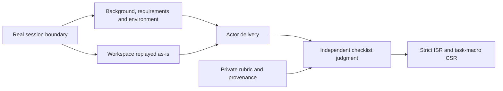
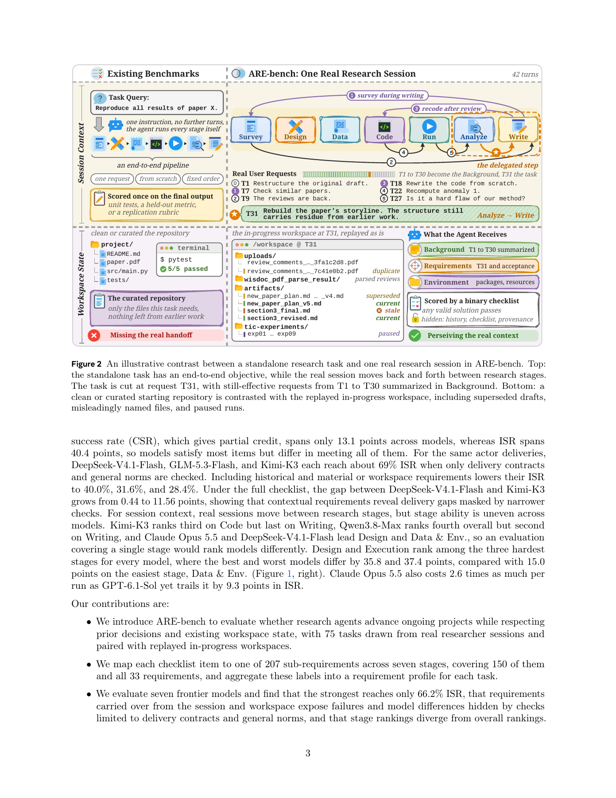

# ARE-bench: Research Delivery with Real History and Workspaces

<!-- source-sha256: 5282531385a6cf949eb0e6bda1272e25e047235990ab57fc9efd477fd0d783c6 -->

[简体中文](README.md) · English

> This is a CPU input-separation and scorer protocol. The 75 official tasks are not integrated, no research agent was run, and hand-built checklists are not the official benchmark.

## Paper information

| Field | Details |
| --- | --- |
| Paper | [ARE-bench](https://arxiv.org/abs/2611.14364); reviewed [v1](https://arxiv.org/html/2611.14364v1) |
| Affiliation | First author Jiahang Lin: Fudan University and Shanghai AI Laboratory internship, checked against [his homepage](https://curry09.github.io/); paper affiliations are collective |
| First public release | 2026-11-10, 17:21:31 UTC; the PDF cover says November 11, so arXiv v1 governs publication |
| Authors' code | [Project site](https://arebench.com) offers contact-based evaluation; no public code/task download found or claimed integrated |
| Local adapter | None (`adapter: null`); interface key `are-bench` |
| Local code | `src/auto_research/agent_research/are_bench.py` |

## Original paper summary

### Background and main changes

Solving a standalone task in a clean directory differs from continuing research. ARE-bench replays the uncleaned workspace at a real session boundary and preserves earlier requirements still in effect. Actors see Background, Requirements, Environment and workspace, while evaluators retain the private rubric and provenance. An empty checklist is an error, not a perfect score.



<!-- paper-figure:start -->
### Key figure from the paper

[](https://arxiv.org/pdf/2611.14364v1#page=3)

> Figure 2, PDF page 3, from the [original paper](https://arxiv.org/pdf/2611.14364v1#page=3), © the original authors. No official task corpus was downloaded or recreated locally.
Image from the [original paper](https://arxiv.org/pdf/2611.14364v1#page=3); copyright belongs to its authors. Full-system or experimental results shown are not local component results.

<!-- paper-figure:end -->

### Core equations

For $n_c>0$ binary decisions per task, $ISR=N^{-1}\sum_c\mathbf1[\bigwedge_k r_{c,k}=1]$ and $CSR=N^{-1}\sum_c(n_c^{-1}\sum_k r_{c,k})$. CSR is task-macro, not pooled item accuracy. Missing, duplicate or non-boolean decisions must not alter the denominator.

### Paper results

The study contains 75 tasks, seven research stages and 1,173 checklist items. The strongest of seven models achieves approximately 66.2% strict ISR. Omitting historical and material requirements hides failures. No production A/B test is reported; local scorer examples are not model reruns.

## Local implementation

### Data contract and code mapping

`TaskInput.actor_payload()` exposes task context and workspace references, never rubric or gold-answer fields. `ChecklistVerdict` is evaluator-only input and checks the exact item-ID set and binary decisions. `score()` implements equations 6-7. It neither generates judge decisions nor reads private sessions or workspace files, and it does not clean task history.

```bash
PYTHONPATH=src python -c 'from auto_research.agent_research.are_bench import diagnostic; print(diagnostic(42))'
```

### Results, controls and limits

Constructed verdicts `[true,false]` and `[true]` yield ISR 0.5 and macro CSR 0.75, unlike pooled 2/3. CPU diagnostics labeled 42/43/44 verify scoring and actor/evaluator field separation. Empty checklists, missing/duplicate IDs and numeric one instead of boolean true fail. There is no official dataset loader, frontier actor, judge or capability comparison. CUDA is rejected.

### High-cost full experiment

75 tasks, seven models and three rollouts imply 1,575 environment runs plus item judging, E2B/RJob/Docker resources and task-specific timeouts. The project site has no public task download. The full environment/API matrix is **too costly and is not reproduced (review DONE)**. A scoring interface is not official benchmark integration.
