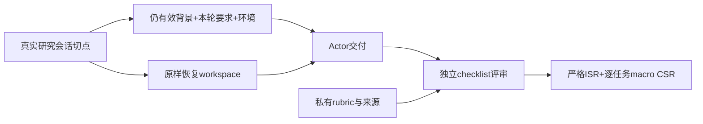
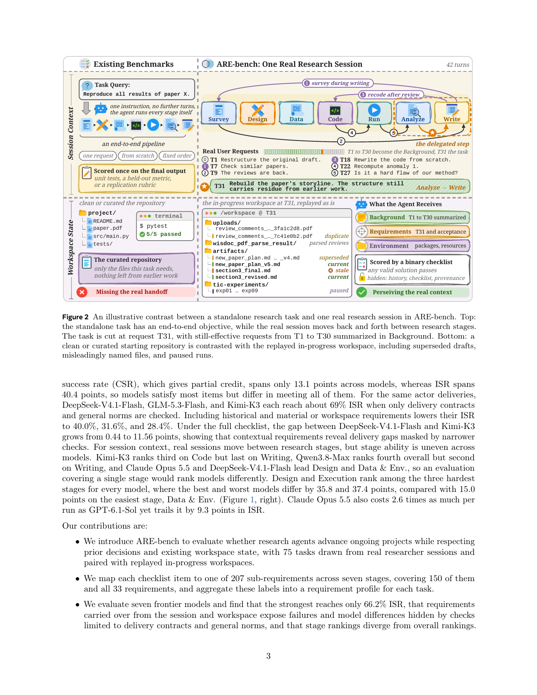

# ARE-bench：真实历史与工作区中的研究交付评测

> 本地仅交付纯 CPU 输入隔离与 scorer 协议，未接入官方 75 个任务，未运行研究 Agent，不把手工 checklist 当官方 benchmark。

## 论文信息

| 字段 | 内容 |
| --- | --- |
| 论文链接 | [ARE-bench](https://arxiv.org/abs/2611.14364)，审查 [v1 原文](https://arxiv.org/html/2611.14364v1) |
| 公司/机构 | 一作 Jiahang Lin：复旦大学、上海人工智能实验室实习；[本人主页](https://curry09.github.io/)核对；原文首页机构为集体列示 |
| 首次公开日期 | 2026-11-10，17:21:31 UTC；PDF 封面署 11 月 11 日，采用 arXiv v1 首发时间 |
| 原文开源代码 | [项目站](https://arebench.com)提供联系评测入口，未找到公开代码/任务包下载；不声称已开源或已接入 |
| 本地 Adapter | 无（`adapter: null`）；接口 key：`are-bench` |
| 本地复现代码 | `src/auto_research/agent_research/are_bench.py` |

## 原始论文总结

### 背景与主要改动

从干净目录完成独立任务，不等于能接手正在进行的研究。ARE-bench 在真实会话切点恢复完整未清理 workspace，保留之前仍有效的要求。Actor 只看 Background、Requirements、Environment 和工作区；历史来源与私有评分 rubric 留在 evaluator。任务必须有可验证 checklist，空表不是满分。



<!-- paper-figure:start -->
### 原论文关键图

[](https://arxiv.org/pdf/2611.14364v1#page=3)

> Figure 2，PDF 第 3 页。图片来自[原论文](https://arxiv.org/pdf/2611.14364v1#page=3)，版权归原作者所有；本地没有下载或重建该官方任务集。
<!-- paper-figure:end -->

### 核心公式

对任务 $c$ 的 $n_c>0$ 个 checklist 决定 $r_{c,k}\in\{0,1\}$，$ISR=N^{-1}\sum_c\mathbf1[\bigwedge_k r_{c,k}=1]$；$CSR=N^{-1}\sum_c(n_c^{-1}\sum_k r_{c,k})$。CSR 先逐任务平均，不是把所有条目合并的 micro accuracy。缺失、重复或非布尔 verdict 不能改变分母。

### 论文离线与线上效果

论文 75 个真实任务覆盖七个研究阶段、1,173 条 checklist，七模型中最高严格 ISR 约 66.2%。只计交付/通用规范会掩盖历史和材料约束失败。未报告生产线上 A/B。本地 scorer 的示例分数不是这些模型的复测。

## 本地复现

### 数据协议与代码映射

`TaskInput.actor_payload()` 仅含公开任务上下文和工作区引用，无 rubric/gold answer 字段。`ChecklistVerdict` 是 evaluator 侧的独立输入，严格核对预期 ID 与完整布尔判定；`score()` 计算 Eq.6–7。组件不生成 judge 结论、不读取私人会话或本地工作区文件，也不清理任务历史。

```bash
PYTHONPATH=src python -c 'from auto_research.agent_research.are_bench import diagnostic; print(diagnostic(42))'
```

### 结果、负控与边界

两个构造任务的条目分别为 `[true,false]` 与 `[true]`，得到 ISR=0.5、macro CSR=0.75，区别于 pooled 2/3。CPU seeds 42/43/44 均验证该计分及 actor/evaluator 字段隔离；空表、重复/缺失 ID 和数值 1 伪装布尔值会失败。没有官方数据集 loader、frontier actor、judge 或能力对照；组件拒绝 CUDA。

### 高成本完整实验

75 任务×7 模型×3 rollout 为 1,575 次环境运行，另有逐条 judge、E2B/RJob/Docker 和任务级超时；公开项目站尚无可下载任务包。完整长任务/API矩阵 **成本过高，不复现（审查 DONE）**。仅实现评分接口不会被称作“官方 ARE-bench 已接入”。
