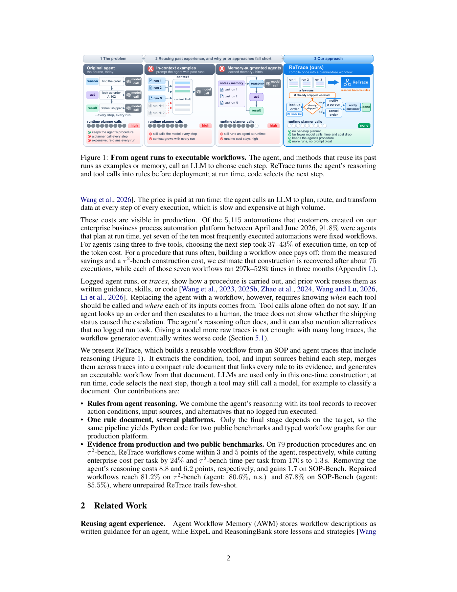

# ReTrace: Compile Trace Conditions into Planner-Free Workflows

<!-- source-sha256: 1ff85eaf5d244e5133e4d8883a210227825ac831536412dc7f1ac7e8b407eba5 -->

[简体中文](README.md) · English

> This CPU typed decision-list IR neither generates model reasoning nor calls production tools. It is not the complete compilation system.

## Paper information

| Field | Details |
| --- | --- |
| Paper | [ReTrace](https://arxiv.org/abs/2611.14492); reviewed [v1](https://arxiv.org/html/2611.14492v1) |
| Affiliation | First author Kaiyuan Hou: Columbia University; work during an Amazon internship |
| First public release | 2026-11-10, 18:49:47 UTC |
| Authors' code | No ReTrace author repository linked in the fixed paper; benchmark repositories are not method code |
| Local adapter | None (`adapter: null`); component key `retrace` |
| Local code | `src/auto_research/agent_research/retrace.py` |

## Original paper summary

### Background and main changes

Repeated SOP execution makes per-step LLM planning costly. ReTrace extracts conditions and argument provenance from reasoning and tool traces, merges cited rules and synthesizes executable workflows. Planner-free does not forbid model-backed tools or mean replaying actions without current observations.


<!-- paper-figure:start -->
### Key figure from the paper

[](https://arxiv.org/pdf/2611.14492v1#page=2)

> Figure 1, PDF page 2, from the [original paper](https://arxiv.org/pdf/2611.14492v1#page=2), © the original authors. Only an IR dispatch subset is implemented locally.
Image from the [original paper](https://arxiv.org/pdf/2611.14492v1#page=2); copyright belongs to its authors. Full-system or experimental results shown are not local component results.

<!-- paper-figure:end -->

### Core equations

$I=(\chi,\langle(g_1,\alpha_1),\ldots,(g_m,\alpha_m)\rangle)$ selects the first satisfied guard until completion check $\chi$ holds. Guards use only pre-action evidence; arguments cite task inputs, earlier tool results or constants. Supported alternatives absent from executed traces retain an `unwitnessed` marker rather than being silently removed or called verified.

### Paper results

The paper reports 93.8% completion across 79 internal production SOPs versus 96.8% for the agent; public $\tau^2$ telecom success is 75.8% versus 80.6%. These are not randomized online A/B results or proof of statistical parity. The internal platform and data are private; local code does not reproduce those numbers.

## Local implementation

### Data contract and code mapping

`Binding` permits inputs, existing observations and constants. `Guard` supports typed eq/ne/exists comparisons: integer one is not boolean true. `Rule` requires evidence citations. `DecisionList.next_call()` emits a typed call without evaluating arbitrary Python or executing tools. Missing observations, arguments, valid types or applicable rules cause explicit failure rather than invented future results.

```bash
PYTHONPATH=src python -c 'from auto_research.agent_research.retrace import diagnostic; print(diagnostic(42))'
```

### Results, controls and limits

CPU diagnostics labeled 42/43/44 dispatch the boolean airplane-mode control, stop on completion and reject missing state. Tests cover first-rule order, type distinctions and preservation of `unwitnessed`. Zero runtime planner calls describe this interpreter, not a measured end-to-end speedup. LLM extraction, aggregation, synthesis, complex guards and real tool execution are absent. CUDA is rejected.

### High-cost full experiment

The full protocol uses repeated Sonnet/Opus merges and construction, 36 requested constructions per trace configuration, training-fold repairs, several benchmarks and a private enterprise platform. It is **too costly and is not reproduced (review DONE)**. Appendix L's USD 2.32 is a public one-time construction estimate, not the enterprise campaign cost; the cheap IR component is not itself classified as expensive.
