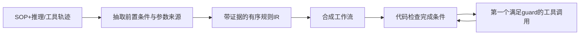
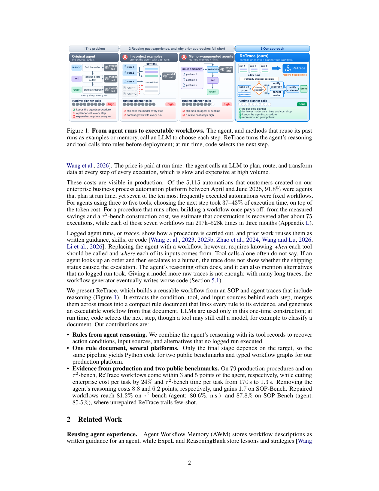

# ReTrace：把轨迹条件编译成无运行时 Planner 的工作流

> 本地交付纯 CPU typed decision-list IR，不生成模型推理、调用生产工具或伪装成完整编译系统。

## 论文信息

| 字段 | 内容 |
| --- | --- |
| 论文链接 | [ReTrace](https://arxiv.org/abs/2611.14492)，审查 [v1 原文](https://arxiv.org/html/2611.14492v1) |
| 公司/机构 | 一作 Kaiyuan Hou：Columbia University，工作在 Amazon 实习期间完成 |
| 首次公开日期 | 2026-11-10，18:49:47 UTC |
| 原文开源代码 | 固定原文未给 ReTrace 作者实现仓库；公共 benchmark 源码不等于该方法源码 |
| 本地 Adapter | 无（`adapter: null`）；组件 key：`retrace` |
| 本地复现代码 | `src/auto_research/agent_research/retrace.py` |

## 原始论文总结

### 背景与主要改动

相同 SOP 反复执行时，每步再让 LLM 规划成本高。ReTrace 从 Agent 的推理解释、工具调用及参数来源恢复“何时执行哪步”，聚合为带证据的条件规则，再合成为可执行工作流。无运行时 Planner 不等于所有工具都不能使用模型，也不等于工具序列可以不看新观察而照抄。



<!-- paper-figure:start -->
### 原论文关键图

[](https://arxiv.org/pdf/2611.14492v1#page=2)

> Figure 1，PDF 第 2 页。图片来自[原论文](https://arxiv.org/pdf/2611.14492v1#page=2)，版权归原作者所有；本地只覆盖 IR 分派子集。
<!-- paper-figure:end -->

### 核心公式

$I=(\chi,\langle(g_1,\alpha_1),\ldots,(g_m,\alpha_m)\rangle)$：完成检查 $\chi$ 未满足时执行第一个为真的 guard。guard 只能使用动作前已经可得的信息；参数必须注明来自任务输入、过去工具结果或常量。未执行过但由 SOP/推理支持的分支标为 `unwitnessed`，不应悄悄删除或当成验证成功。

### 论文离线与线上效果

原文对 79 条内部生产 SOP 报告 93.8% completion（原 Agent 96.8%）及成本变化；公共 $\tau^2$ telecom 上为 75.8% task success（Agent 80.6%）。这不是随机线上 A/B，也不能据小差异宣称统计等效。内部数据/平台私有；本地不复测这些数字。

## 本地复现

### 数据协议与代码映射

`Binding` 限定 input、已有 observation 和 constant；`Guard` 只支持 eq/ne/exists，按类型比较，不把整数 1 当布尔 true。`Rule` 必须保留支持引用；`DecisionList.next_call()` 检查完成条件并返回第一个匹配的 typed call，不执行任意 Python 或真实工具。缺观察、缺参数、错类型和无适用规则均显式报错，不猜未来结果。

```bash
PYTHONPATH=src python -c 'from auto_research.agent_research.retrace import diagnostic; print(diagnostic(42))'
```

### 结果、负控与边界

CPU seeds 42/43/44 的构造示例正确分派关飞行模式的布尔工具参数，完成后停止，缺少状态时拒绝。测试区分规则先后、真假类型和 `unwitnessed` 标记。`runtime_planner_calls=0` 仅说明此解释器没有模型调用，不是完整方法延迟提升。LLM 抽取/聚合/合成、复杂 guard 和真实工具执行均未实现；拒绝 CUDA。

### 高成本完整实验

完整协议包含 Sonnet/Opus 的多次 merge/构建、每 trace 配置 36 个 requested construction、训练折修复及多个 benchmark，另有私有企业平台。**成本过高，不复现（审查 DONE）**。Appendix L 的 2.32 美元是公共 benchmark 一次构建估计，不是企业完整实验成本；廉价 IR 组件不能因此也被标为高成本。
