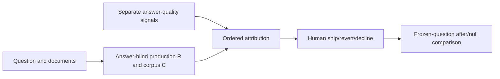
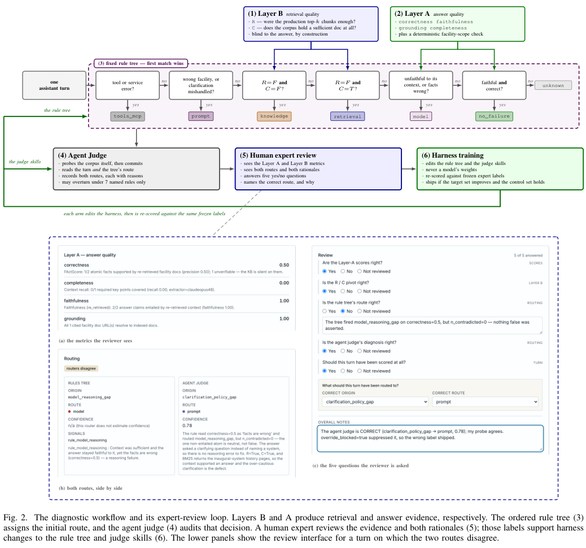

<!-- source-sha256: b5f608c342784cce0a9c3b55229cf71de48c2848e2f086ce32acb16dbb1b9f2c -->

# AskALCF: separate answer quality, retrieval sufficiency and repair attribution

[简体中文](README.md)

> **component_only / L1 deterministic protocol mechanism.** No RAG, agent judge, HPC service or private support log is run. No model weights are trained. The full production/API campaign is not reproduced due to cost (review DONE).

## Paper information

| Field | Content |
| --- | --- |
| Paper | [AskALCF](https://arxiv.org/abs/2611.15700v1), [fixed v1](https://arxiv.org/html/2611.15700v1) |
| First-author affiliation | Jingyan Jiang, Argonne National Laboratory; co-first author Akhilesh Bondapalli also lists Clemson/Argonne |
| Original publication | **2026-11-11 16:38:54 UTC**, arXiv v1 |
| Author code | No verifiable paper-specific author source link found in fixed v1 as of this 2026-11-18 review; cited frameworks are not this release |
| Local adapter / key | `askalcf-protocol`; `adapter=null`, not integrated into Evolve |
| Local code | `src/auto_research/agent_research/askalcf_protocol.py` |

## Original paper

### Background and main changes

Changing prompts or adding documentation after a support failure can repair the wrong component. AskALCF connects production RAG, knowledge-PR authoring, log diagnosis and ticket handling under human review. Self-improvement primarily changes harness rules, prompts and knowledge—not model weights through RL. Layer A scores correctness, faithfulness, citations and completeness. Layer B must **not see the generated answer**: it separately tests production top-k sufficiency and whether sufficient documentation exists anywhere in the corpus.

An ordered router assigns knowledge, retrieval, prompt, model or tools_mcp, retaining no_failure and unknown. Unknown is not healthy. The paper's 28 rules use first-match semantics: service/tool faults, deterministic scope/clarification checks, the sufficiency pivot, then generation-side failures. An agent judge probes the corpus but may override only seven independently verifiable rule classes; other disagreements go to human review.

### Architecture and workflow



<!-- paper-figure:start -->
### Original paper figure



Fixed-v1 PDF p.5, Figure 2, with its caption. The local subset contains neither the agent judge nor the expert UI. [Original figure](https://arxiv.org/pdf/2611.15700v1#page=5), copyright belongs to the authors. [Provenance](assets/provenance.json).

Image from the [original paper](https://arxiv.org/html/2611.15700v1); copyright belongs to the original authors.
<!-- paper-figure:end -->

### Core equations

For production sufficiency $R$ and corpus sufficiency $C$:

$$
R=F,C=F\Rightarrow knowledge;\qquad R=F,C=T\Rightarrow retrieval.
$$

Low answer scores must not bypass this pivot and become model failures. No_failure requires positive evidence of $R=T$, faithfulness and correctness. Missing evidence does not mean false. Core requirements must be fixed before observing corpus coverage; missing facts cannot be reclassified as unimportant.

Repairs compare $\Delta=rate(after)-rate(null)$, not merely the selected before arm. Null reruns the unchanged configuration with a cold generation cache. Also retain $F=\sum_i\mathbf1(before_i\ne null_i)$: opposing flips can cancel the net drift while leaving substantial noise.

### Author results

On 2,174 support turns, unattributable cases fell from 41.4% to 14.2%; agreement with expert references rose from 108 to 123 of 150 turns. These are attribution/reference outcomes, not production satisfaction A/B. Three of 16 harness arms were accepted. Prompt and knowledge repair studies are offline controls; retrieval repair was not exercised, and no approved knowledge PR had been merged and re-indexed in production. Unexecuted stages are not deployment successes.

## Local implementation

### Data protocol and code mapping

`two_scope_sufficiency` actually calls an external evaluator twice, with only question, passages and scope—no generated answer or gold. Three-valued `Evidence` feeds `route`, implementing seven **coarse dispositions**, not the complete 28-rule tree or the seven-class judge-override gate. Sufficiency verdicts come from an external trusted evaluator, not this module.

`ExpansionCache` keys query plus model, prompt, corpus, retrieval, tools and evaluator revisions. Changing any dependency actually invokes expansion again. Null can bypass the cache without overwriting pinned entries. The paper found its gateway ignored temperature zero; versioning prevents stale evidence reuse but does not make remote generation deterministic.

`repair_noise_report` returns after-minus-null, null drift and paired flips. Its conservative local gate requires net improvement beyond all null flips and drift; **it is not the paper's significance test, complete target/control training, or automatic shipping rule**. `reviewed_action` executes real ship/revert callbacks only for an explicit human decision. Decline executes nothing; exceptions and non-True outcomes retain failure.

```bash
PYTHONPATH=src python -c 'from auto_research.agent_research.askalcf_protocol import diagnostic; print(diagnostic(42))'
PYTHONPATH=src python -m pytest tests/test_nov18_agent_protocols.py -q
```

### Diagnostics and limits

[CPU mechanism metrics](metrics/component-cpu-seeds42-44.json) record actual probe, expansion and action callbacks on synthetic controls. Tests cover tool-first routing, retrieval not being mislabeled as model failure, missing evidence not implying health, cancelling null flips, and every cache dependency. [Harness²](../2610.14224-harness2/README.md) also requires execution evidence, but it does not rely on answer/rubric labels; AskALCF's frozen expert references and component attribution are not interchangeable with its open-task comparison.

### High-cost full experiment

The full system requires private ALCF support logs, facility knowledge, expert review and hosted/Argo models. Multi-arm offline reruns are not this CPU contract. **Full experiment not reproduced due to cost and unavailable private resources (review DONE).** No HPC calls, knowledge changes, model campaign or automatic retry. No CUDA path; results are neither capability scores nor Evolve promotion evidence.
