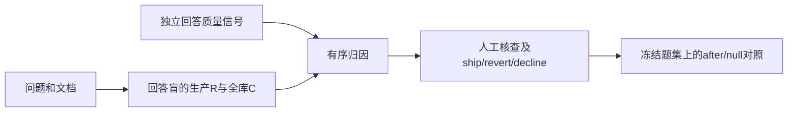
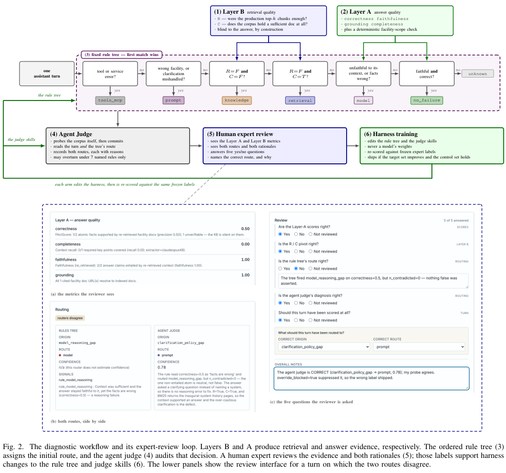

# AskALCF：把回答质量、检索充分性与修复归因分开

[English](README-en.md)

> **component_only／L1确定性协议机制。** 本地不运行RAG、Agent judge、HPC服务或私有支持日志；不训练模型权重。完整生产／API实验高成本不复现（审查 DONE）。

## 论文信息

| 字段 | 内容 |
| --- | --- |
| 论文链接 | [AskALCF](https://arxiv.org/abs/2611.15700v1)，[固定v1正文](https://arxiv.org/html/2611.15700v1) |
| 一作机构 / 公司 / 学校 | Jingyan Jiang，Argonne National Laboratory；共同一作Akhilesh Bondapalli另署Clemson／Argonne |
| 首次公开日期 | **2026-11-11 16:38:54 UTC**（arXiv v1） |
| 原作者代码 | 截至本轮2026-11-18，固定v1中未找到可核实的本篇作者源码链接；引用框架不算本篇开源 |
| 本地 adapter / key | `askalcf-protocol`；`adapter=null`，未接入Evolve |
| 本地复现代码 | `src/auto_research/agent_research/askalcf_protocol.py` |

## 原始论文总结

### 背景与主要改动

技术支持系统答错后，直接改提示或补知识容易修错对象。AskALCF把生产RAG问答、知识PR撰写、日志归因和工单处理连成受人审控制的闭环；“自改进”主要指harness规则、提示和知识，不是模型权重RL。回答层看正确性、忠实性、引用与完整性；检索层必须**看不到生成回答**，分别判断生产top-k是否充分、全库是否存在足够文档。

两范围充分性之后，有序规则把失败归为knowledge、retrieval、prompt、model、tools_mcp，并保留no_failure和unknown。unknown不等于健康。原文28条细则first-match；工具／服务故障优先，其次确定性范围与澄清策略，再做充分性分流，最后才看生成侧错误。Agent judge可以探库，但只在7类可独立核查的规则上覆盖原判，其余分歧交人审。

### 架构与流程



<!-- paper-figure:start -->
### 原论文关键图



固定v1 PDF第5页Figure 2，含原图注；本地只实现部分确定性协议，不包含图中Agent judge或专家UI。[原论文图](https://arxiv.org/pdf/2611.15700v1#page=5)版权归原作者；[资产来源](assets/provenance.json)。
<!-- paper-figure:end -->

### 核心公式

令$R$为生产检索充分性，$C$为全库充分性：

$$R=F,C=F\Rightarrow knowledge;\qquad R=F,C=T\Rightarrow retrieval.$$

低回答分不能越过这个pivot直接归为model。no_failure需要$R=T$且回答忠实、正确的**正面证据**。缺字段不视作false，不支持的归因落到unknown。全库核心要求必须在看覆盖结果前确定，不能把缺失事实临时降为“不重要”。

修复研究要比较$\Delta=rate(after)-rate(null)$，而不是只和选中问题的before比较；null以当前配置冷缓存重跑。还需保留$F=\sum_i\mathbf1(before_i\ne null_i)$：正反翻转抵消时净变化为零，噪声仍可能很大。

### 论文离线与线上效果

原文对2174个支持turn报告unattributable从41.4%降至14.2%；150个人审turn上的一致数由108升至123。它们是日志归因／专家参考结果，不是用户满意度线上A/B。16个harness修改臂中3个被接受；提示和知识修复是离线控制实验，检索修复尚未执行，也没有知识PR经批准合并并重建生产索引。本地不能把这些尚未发生的环节写成部署成功。

## 本地复现

### 数据协议与代码映射

`two_scope_sufficiency`真的调用两次外部evaluator，只传question、passages、scope，不传生成回答或gold。`Evidence`是bool／unknown信号；`route`实现7种**粗粒度合同**，不冒充原文28条完整规则或7类judge覆盖门。检索充分性本身由外部可信judge提供，本地不生成判断。

`ExpansionCache`用query及model、prompt、corpus、retrieval、tools、evaluator revision建立key；改变任一依赖会真实再调用扩展器，null可绕过缓存且不污染固定项。原文特别发现temperature=0不被网关遵守，本地版本化接口用于防止默默复用过期证据，不保证远程模型确定性。

`repair_noise_report`报告after-null、null净漂移和逐题翻转；附带的保守本地noise gate要求净改进超过null翻转数与漂移，**不是原文统计显著性检验、完整target/control训练或自动ship策略**。`reviewed_action`只按显式人审决定执行真实ship／revert回调；decline不调用；异常和非True返回均保留失败。

```bash
PYTHONPATH=src python -c 'from auto_research.agent_research.askalcf_protocol import diagnostic; print(diagnostic(42))'
PYTHONPATH=src python -m pytest tests/test_nov18_agent_protocols.py -q
```

### 结果、负控与边界

[CPU机制指标](metrics/component-cpu-seeds42-44.json)只记录实际probe／扩展／动作回调和合成控制测试。负控验证工具错误优先、检索错不归模型、缺信号不算成功、反向null翻转不被净零掩盖、所有revision使缓存失效。与[Harness²](../2610.14224-harness2/README.md)都要求实际执行证据；AskALCF有冻结专家参考和归因路由，Harness²不依赖答案／rubric，二者不能互换。

### 高成本完整实验

完整系统依赖ALCF私有支持日志、设施知识、专家审查及托管模型／Argo API，多arm离线重跑也不是现有CPU合同。**成本过高且私有资源不可得，完整实验不复现（审查 DONE）**；不调用HPC服务、更新知识库或跑模型矩阵，不自动重试。本地无CUDA路径，禁止当能力分数或Evolve改进证据。
