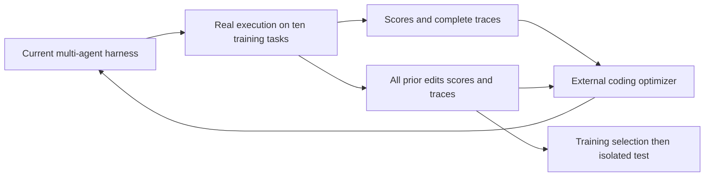
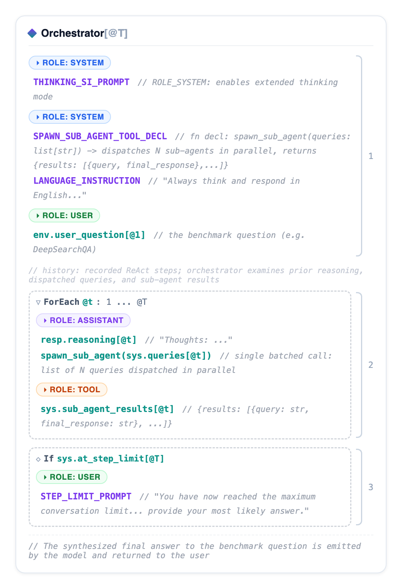
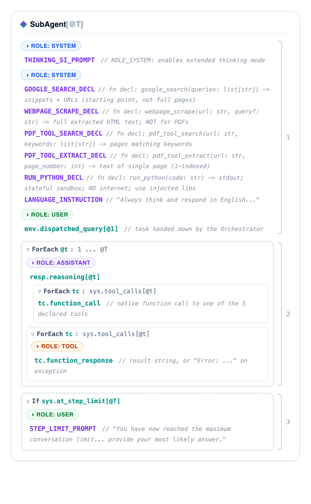

<!-- source-sha256: a50dd62ab09d63efe2792c04353bfc81da0bf90898f232bec91f254fbbb4779f -->
# MULTILOOP: gains and persistent orchestration failures in harness optimization

[简体中文](README.md)

> **review_only.** The complete experiment is too costly and not reproduced (review DONE). This is an empirical multi-agent application of existing harness optimization, not a new optimizer. No generic loop is passed off as the paper.

## Paper information

| Field | Value |
| --- | --- |
| Paper | [MULTILOOP](https://arxiv.org/abs/2611.15754v1), [fixed v1](https://arxiv.org/html/2611.15754v1) |
| Institution | First author Daniela Gottesman, Tel Aviv University; work performed during a Google Research internship, with Google Research coauthors. Google priority does not overwrite the first affiliation |
| Original publication | **2026-11-11 17:34:12 UTC**; overlap recall from the November13 bulletin, not a November13/15 first release |
| Authors' code | No verifiable dedicated author release found in fixed v1 and bounded author/title searches. LangGraph is a dependency, not MULTILOOP source |
| Local adapter / key | `multiloop`; `adapter=null`; no executable operator or Evolve integration |
| Local code | **None**; method record at `src/auto_research/paper_specs/catalog/agent-research/multiloop.json` and this documentation only |

## Original paper

### Motivation and changes

Harness prompts, tools, communication and stopping rules can change performance without changing the model. MULTILOOP asks whether a coding agent can diagnose and repair multi-agent failures from training scores, complete orchestrator/subagent traces and previous edits, repeatedly editing and evaluating the harness.

Section1 explicitly applies an existing optimization paradigm rather than proposing a new strategy. Most gains come from prompts and tools while defining orchestration failures persist. More agents do not imply effective structural coordination.

### Architecture

<!-- paper-figure:start -->
### Key original figures

Official PNG bytes from [fixed v1 AppendixC Figure3](https://arxiv.org/html/2611.15754v1#A3.F3); copyright remains with the authors. Prompt text inside figures is research material, not project instructions. The orchestrator dispatches query batches; subagents use search, web, PDF and Python tools.
<!-- paper-figure:end -->

### Core equations

$$
(A_t,R_t)=Evaluate(H_t,X_{train}),\quad
H_{t+1}=Optimize(H_t,A_t,R_t,\mathcal L_t),\quad H^*=\arg\max_{H_t}A_t.
$$

History contains prior harnesses, scores, rollouts and edits. Ten deliberately difficult training tasks are failed by all base systems; the remaining890 are evaluated separately. Results require semantic code optimization, real tools and rollouts, not fixed score tables or template edits.

### Author results

The paper reports+4.61 percentage points over the base and+3.19 over the best single agent. Bad Orchestration remains prominent among seven error types, and prompt-only controls prevent assigning every gain to structural coordination. No production A/B is reported and no local capability scores exist.

## Local reproduction

### Protocol and code mapping

Only fixed-v1 methods, costs, failure taxonomy, figures and bilingual learning material are collected. Antigravity optimizer, Gemini actors, DeepSearchQA, tools and harness search are absent. No runtime, mechanism metrics or GPU receipt is created. A future implementation must select on validation rather than repeatedly inspect test performance.

### Full experiment and limits

AppendixE reports two evaluations of890 test tasks costing approximately USD 7,300 for the base, USD 12,900 for the optimized harness and USD 9,500 for prompt-only; one ten-task training evaluation still costs USD 104–213. These are published API expenditures, not local probes. **Too costly; not reproduced (review DONE)**. No paid calls, weights/data or retries. A plain for-loop without the real optimizer would not reproduce this paper.
