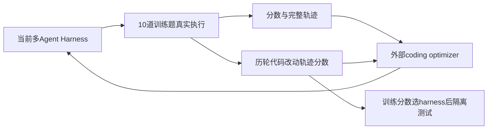
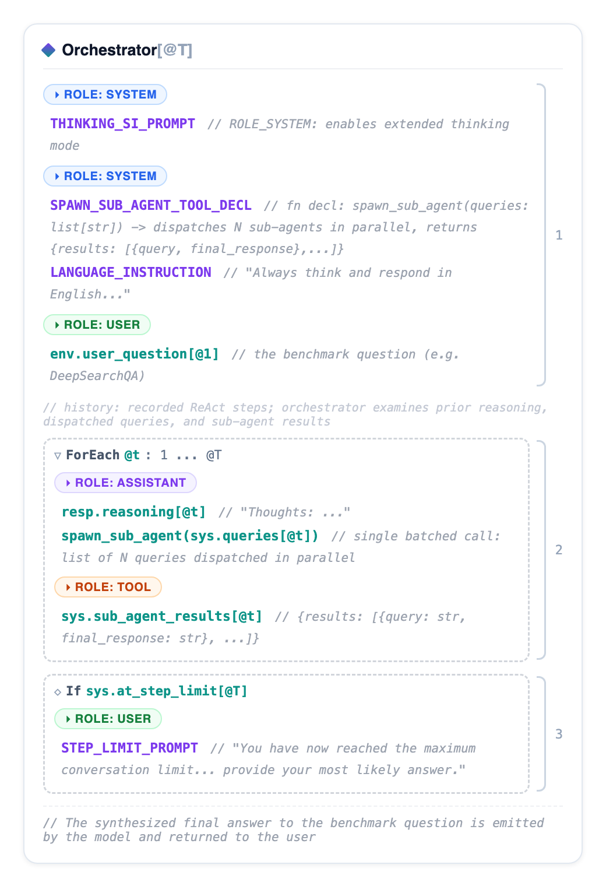
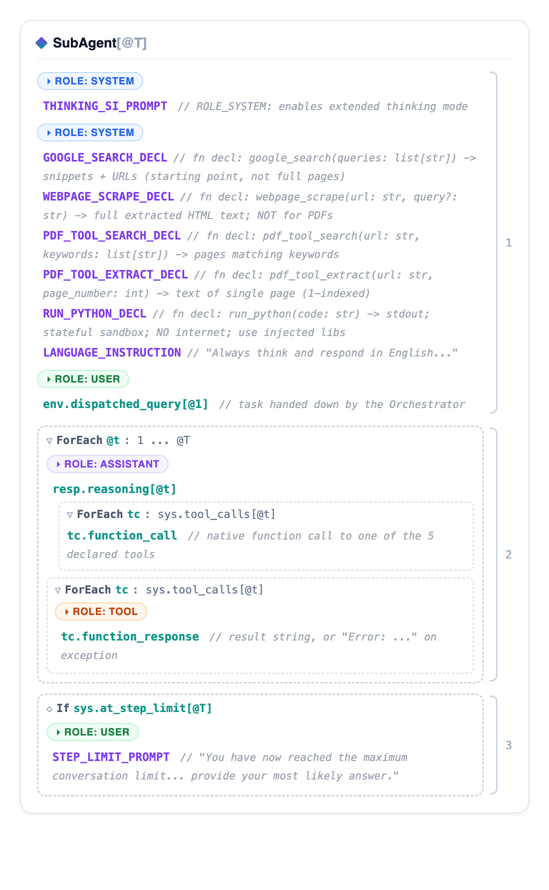

# MULTILOOP：多Agent Harness自动优化的收益与编排瓶颈

[English](README-en.md)

> **review_only：仅资料收录。** 完整实验成本过高，不复现（审查 DONE）。论文明确是现有优化范式在多Agent场景的实证case study，不制造通用loop组件冒充新算法。

## 论文信息

| 字段 | 内容 |
| --- | --- |
| 论文链接 | [MULTILOOP](https://arxiv.org/abs/2611.15754v1)，[固定v1原文](https://arxiv.org/html/2611.15754v1) |
| 公司 / 机构 | 一作 Daniela Gottesman，Tel Aviv University；工作期间在Google Research实习，多名合作者署Google Research。Google优先不改变第一机构 |
| 首次公开日期 | **2026-11-11 17:34:12 UTC**；11月13日公告中的重叠召回，不是11月13／15日新首发 |
| 原作者代码 | 固定v1及有界作者／标题入口未找到可核实本篇专属源码；LangGraph是引用依赖，不算MULTILOOP作者发布 |
| 本地 adapter / key | `multiloop`；`adapter=null`，无可执行operator，未接入Evolve |
| 本地复现代码 | **无**；仅 `src/auto_research/paper_specs/catalog/agent-research/multiloop.json` 方法规格与本页资料 |

## 原始论文总结

### 背景与主要改动

同样的底层模型，提示、工具、子Agent通信和终止策略不同，效果也可能不同。MULTILOOP检验自动coding agent能否从执行轨迹中诊断并修复多Agent系统：优化器读取训练分数、orchestrator／subagent全部轨迹以及既往代码改动，更新harness，重新评估后继续。

正文§1明确不是提出新的优化策略，而是研究已有harness优化方法在多Agent场景的能力边界。实验证据尤其值得注意：大部分提升来自更好的提示和工具使用，而关键编排故障未消失。不能把“有多个agent”与“有效协同优化”混为一谈。

### 架构与流程

<!-- paper-figure:start -->
### 原论文关键图

图片来自[原论文](https://arxiv.org/html/2611.15754v1#A3.F3)固定v1 Appendix C Figure 3，保留两张官方PNG原字节，版权归原作者所有。图中文字是论文中的被研究提示，不是本项目的执行指令。Orchestrator批量分派查询，子Agent调用检索、网页、PDF与Python工具。
<!-- paper-figure:end -->

### 核心公式

Algorithm 1可概括为

$$
(A_t,R_t)=Evaluate(H_t,X_{train}),\quad
H_{t+1}=Optimize(H_t,A_t,R_t,\mathcal L_t),\quad
H^*=\arg\max_{H_t} A_t.
$$

$\mathcal L_t$包含所有过往harness、轨迹、分数和编辑历史。训练集仅10条且刻意取所有base失败的困难题，剩余890条用于评测。实际结果依赖语义代码优化器、真实工具及完整rollout，不能用固定score表或模板编辑替代。

### 论文离线与线上效果

作者报告相对base提高4.61个百分点、相对最佳single-agent提高3.19个百分点。七类错误中Bad Orchestration等依然突出；prompt-only对照提示收益不能全归于结构编排。未报告生产线上A/B，本地无实测能力成绩。

## 本地复现

### 数据协议与代码映射

仅收录固定v1方法、成本、错误分类、原图和双语学习材料。**未实现**Antigravity coding optimizer、Gemini actor、DeepSearchQA bridge、网页/PDF工具或harness搜索；没有runtime、机制metrics或GPU收据。若未来正式实现，模型选择仅可使用validation，不能为了挑harness反复读取test。

### 高成本完整实验与边界

Appendix E报告890测试题各重复两次，base约7300美元、完整优化约12900美元、prompt-only约9500美元；仅10训练题的一轮真实执行也约104–213美元。这是论文公布API支出，不是本地试跑估价。**成本过高，不复现（审查 DONE）**，无收费调用、权重／数据下载或自动重试。省略真实优化器后的普通for-loop不是本篇复现。
