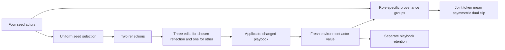
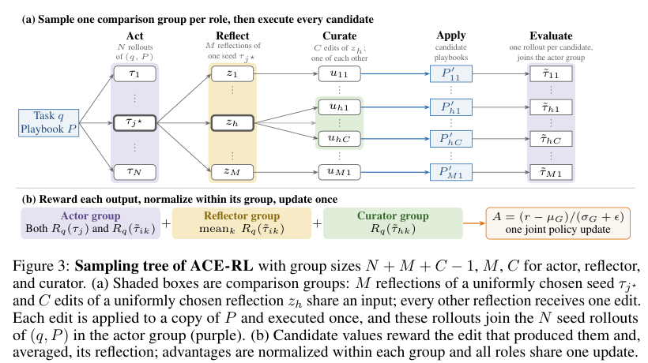

<!-- source-sha256: 7989ff55c2e398e5021a7eefab63a136188cc84c6139a3ab56cdbdf22c8223ed -->
# ACE-RL: role-specific credit for learned experience handoff

[简体中文](README.md)

> **component_only / L1 mechanism diagnostics; no agent was trained.** The full campaign is too costly and not reproduced (review DONE). No AppWorld/SWE bridge or demonstrated RSI capability is claimed.

## Paper information

| Field | Value |
| --- | --- |
| Paper | [Experience-Handoff Reinforcement Learning for Recursive Self-Improvement](https://arxiv.org/abs/2611.16409v1), [fixed v1 PDF](https://arxiv.org/pdf/2611.16409v1) |
| Institution | First author Doyoung Kim, New York University; Byeongguk Jeon lists KAIST AI |
| Original publication | **2026-11-12 07:18:30 UTC**; a new first release |
| Authors' code | No verifiable dedicated training release found in fixed v1 and bounded author/title searches. Dependencies such as mini-swe-agent are not ACE-RL source |
| Local adapter / key | `ace-rl`; `adapter=null`; no Evolve integration |
| Local code | `src/auto_research/agent_research/ace_rl.py` |

## Original paper

### Motivation and changes

Outcome RL compresses rich error logs into a scalar. A fixed ACE harness can write playbooks without learning which handoffs help. ACE-RL keeps the scaffold fixed and trains one shared actor/reflector/curator model, crediting edits through fresh downstream actor rewards rather than a subjective reflection-text judge.

Each episode resets the same task environment; only task-local playbooks cross attempts and inference weights stay frozen. Seed actors, reflections, edits and candidate actors retain provenance and compare within task/seed/reflection groups. Generated tokens are jointly updated once. This is not autonomous scaffold mutation or test-time weight learning.

### Architecture



<!-- paper-figure:start -->
### Key original figure



Cropped from [fixed v1 PDF page5 Figure3](https://arxiv.org/pdf/2611.16409v1), preserving the whole caption; copyright remains with the authors. Colored groups identify comparisons, not explicit role weights.
<!-- paper-figure:end -->

### Core equations

$$
r_{cur}(u)=\widehat V(Apply(P,u)),\quad
r_{ref}(z)=\operatorname{mean}_{u\in C(z)}r_{cur}(u).
$$

An admissible edit parses, has an applicable operation, changes the playbook and stays within2048 actual tokens. Empty admissible sets give reflection reward0. Retention separately selects the best candidate at least as good as the seed; rejection does not erase training credit.

$$
A_i=(r_i-\mu_G)/(\sigma_G+\epsilon),\quad
L=-\frac{\sum_{i,t}M_{it}\ell(\rho_{it},A_i)}{\sum_{i,t}M_{it}}.
$$

Use $\ell_0=\min(\rho A,clip(\rho,0.8,1.28)A)$ and $\ell=\max(\ell_0,3A)$ for negative advantages. No explicit role weights, KL, entropy or critic; generated-token counts determine role weighting. The local standard deviation convention is explicitly population-based rather than an undocumented backend claim.

AppendixD.3 threshold filtering drops groups all≤0 or all≥1. A fractional singleton can survive with mean0/scale1, giving an outcome-weighted update. MiniSWEBench instead requires nonzero group reward range. Reset occurs before each task's third, sixth, ... training encounter, not every third optimizer step or in evaluation memory.

### Author results

The authors report held-out gains on Mastermind, MBPP, AppWorld and MiniSWEBench, not production A/B. One training run per method means task SEM is not multi-seed variance; matched update compute excludes generation. MBPP exposes scored assertions as feedback, and an early baseline learned an exit exploit before a patch; some reported evaluations precede that patch. Do not infer strict hidden-test generalization.

## Local reproduction

### Protocol and code mapping

RoleSample retains task/seed/reflection provenance; role_advantages implements both filters. apply_edits accepts parsed ADD/UPDATE/REMOVE, uses zero-based local IDs and deduplicates/renumbers after all operations. Token budgets require integer IDs from an external tokenizer, not character counts. PlaybookStore contains training task-local state. joint_policy_loss differentiates Eq24 with detached old-policy logs/evaluator advantages.

```bash
PYTHONPATH=src python -c 'from auto_research.agent_research.ace_rl import diagnostic; print(diagnostic(42))'
PYTHONPATH=src python -m pytest tests/test_nov15_agent_components.py -q
```

### Evidence, controls and limits

[CPU metrics](metrics/component-cpu-seeds42-44.json) and [A100 mechanism evidence](../../gpu-validations/ace-rl-a100-20261115.json) cover provenance grouping, singleton differences, unchanged-edit rejection, token budget interfaces, per-task reset, credit/retention separation, asymmetric/dual clipping, zero padding gradients and token versus output means. No real actor/reflector/curator, environment values or success rates exist here. Gold/verifier information is trainer/evaluator-only, never an evaluated actor input.

### Full experiment not reproduced

AppendixD.3 Tables5/6 use two H100/H200 GPUs per run,300–500 steps, eight tasks per step and up to eight actor rollouts per task plus reflections/edits across four environments; individual trajectory timeouts reach two hours. These are source budgets, not local runtime estimates. **Too costly; not reproduced (review DONE)**. No data/weights, full-chain cost probes or automatic retries.
