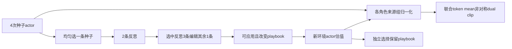
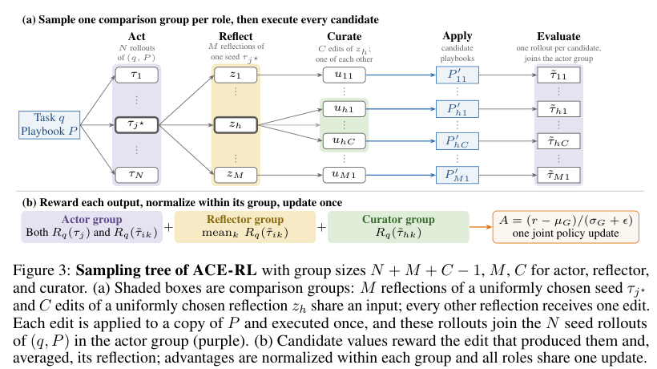

# ACE-RL：用后续actor表现训练经验交接的三角色信用

[English](README-en.md)

> **component_only／L1机制诊断，未训练Agent。** 完整实验成本过高，不复现（审查 DONE）。本地不是AppWorld／SWE环境接入，也不声称已获得RSI能力。

## 论文信息

| 字段 | 内容 |
| --- | --- |
| 论文链接 | [Experience-Handoff Reinforcement Learning for Recursive Self-Improvement](https://arxiv.org/abs/2611.16409v1)，[固定v1 PDF](https://arxiv.org/pdf/2611.16409v1) |
| 公司 / 机构 | 一作 Doyoung Kim，New York University；Byeongguk Jeon署KAIST AI |
| 首次公开日期 | **2026-11-12 07:18:30 UTC**；近期新首发 |
| 原作者代码 | 固定v1和本轮有界作者／标题入口未找到可核实专属训练代码；mini-swe-agent等引用依赖不等同本篇开源 |
| 本地 adapter / key | `ace-rl`；`adapter=null`，未接入Evolve |
| 本地复现代码 | `src/auto_research/agent_research/ace_rl.py` |

## 原始论文总结

### 背景与主要改动

普通结果RL把尝试压成一个分数，丢失错误日志等细粒度经验；固定ACE harness虽能写playbook，却没有训练“写什么经验”。ACE-RL固定scaffold，以一个共享模型分别扮演actor、reflector和curator，并让编辑后全新环境actor的回报评价交接物，而不是让judge主观评分反思文本。

每次环境都重置到同一任务；仅task-local playbook跨尝试，推理时权重冻结。训练的种子actor、反思、编辑及候选actor保留完整来源关系，分别在任务／种子／反思组比较，随后合并生成token进行一次更新。这里的RSI不是自主改harness或测试时更新模型参数。

### 架构与流程



<!-- paper-figure:start -->
### 原论文关键图



图片来自[原论文](https://arxiv.org/pdf/2611.16409v1)固定v1 PDF第5页Figure 3，以PDF点坐标裁剪并完整保留caption；版权归原作者所有。彩色组展示训练比较关系，不是角色加权系数。
<!-- paper-figure:end -->

### 核心公式

$$
r_{cur}(u)=\widehat V(Apply(P,u)),\quad
r_{ref}(z)=\operatorname{mean}_{u\in C(z)}r_{cur}(u).
$$

$C(z)$只包含可解析、至少一条操作适用、实际改变playbook且不超2048真实token的编辑；空集合反思reward为0。保留选择独立于训练credit：候选值不低于种子且最好才保留；未保留不代表其输出从训练中删除。

$$
A_i=(r_i-\mu_G)/(\sigma_G+\epsilon),\qquad
L=-\frac{\sum_{i,t}M_{it}\,\ell(\rho_{it},A_i)}{\sum_{i,t}M_{it}},
$$

$\ell_0=\min(\rho A,clip(\rho,0.8,1.28)A)$，负优势时 $\ell=\max(\ell_0,3A)$。没有角色显式权重、KL、entropy或critic，role占比由生成token数决定。本地明确使用population标准差，不能把未说明的backend细节藏起来。

Appendix D.3的threshold过滤删去全≤0或全≥1组；fractional singleton可存活并以mean0／scale1产生结果加权更新。MiniSWEBench改为必须有非零组内range，不能一概把singleton归零。每任务第3、6…次训练encounter开始前reset，不是每3个optimizer step或重置评测memory。

### 论文离线与线上效果

作者在Mastermind、MBPP、AppWorld与MiniSWEBench报告held-out改善，未报告生产线上A/B。一方法一训练run，task SEM不是多seed方差；所谓update compute匹配不含生成。MBPP反馈暴露实际计分assert，早期baseline出现exit作弊并修补，部分报告先于修补，不能据此宣称严格隐藏测试泛化。

## 本地复现

### 数据协议与代码映射

`RoleSample`保存task／seed／reflection来源；`role_advantages`显式执行两种过滤。`apply_edits`接收已解析ADD／UPDATE／REMOVE，局部ID从0起、操作完成后去重重编号，token预算必须由外部tokenizer给出整数ID，不用字符数冒充。`PlaybookStore`仅维护训练task-local状态；`joint_policy_loss`执行Eq24真实梯度并detach旧策略／evaluator优势。

```bash
PYTHONPATH=src python -c 'from auto_research.agent_research.ace_rl import diagnostic; print(diagnostic(42))'
PYTHONPATH=src python -m pytest tests/test_nov15_agent_components.py -q
```

### 结果、负控与边界

[CPU机制指标](metrics/component-cpu-seeds42-44.json)与[A100机制验收](../../gpu-validations/ace-rl-a100-20261115.json)对应来源隔离、singleton差异、编辑无变化拒绝、真实token预算、每任务reset、训练credit与保留分离、非对称／dual clip、padding零梯度和token-mean不等于output-mean。这里没有真实actor／reflector／curator生成、环境价值或任务成功率。gold和verifier信息只能处于trainer／evaluator边界，不得塞给被评actor。

### 高成本完整实验

Appendix D.3表5／6每run使用2张H100／H200、300–500步、8任务每步、每任务最多8条actor及额外反思与编辑，跨四环境，单轨迹超时可到2小时。原文预算不是本地耗时估计。**成本过高，不复现（审查 DONE）**；不下载数据／权重、不试训完整链路、不创建自动重试任务。
